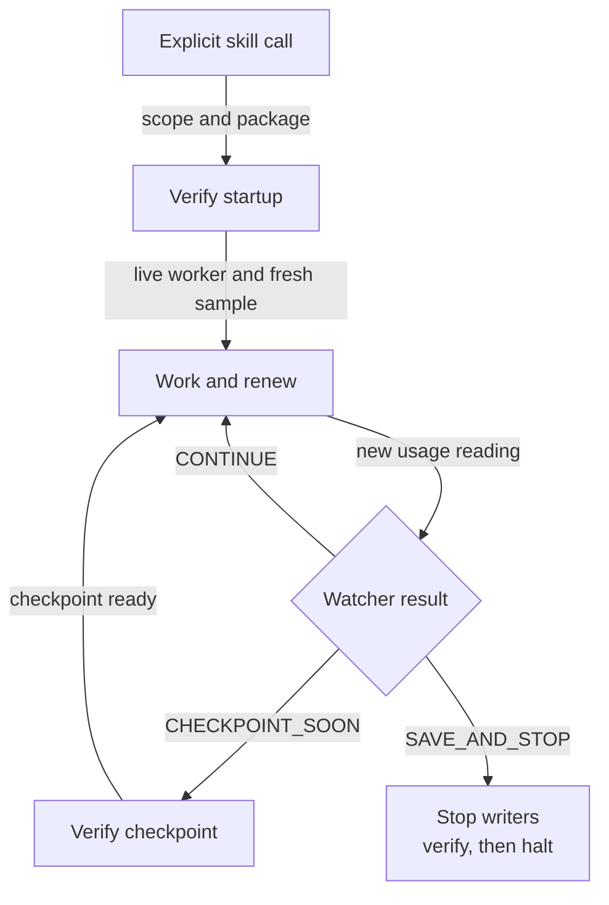

# AGWF · Agent Workflow for Codex

**Coordinate a long Codex task, see what was actually verified, and leave a checkpoint another session can check before continuing.**

English · [Türkçe](docs/i18n/tr/README.md) · [简体中文](docs/i18n/zh-Hans/README.md) · [Español](docs/i18n/es/README.md) · [日本語](docs/i18n/ja/README.md) · [Français](docs/i18n/fr/README.md) · [Deutsch](docs/i18n/de/README.md) · [Italiano](docs/i18n/it/README.md) · [Русский](docs/i18n/ru/README.md) · [한국어](docs/i18n/ko/README.md)

[Install and verify](docs/installation.md) · [Architecture and orchestration](docs/architecture.md) · [Lifecycle command guide](docs/lifecycle-check.md) · [Changelog](CHANGELOG.md)

> **A typical run:** A maintainer asks Codex to change a project and verify the outcome. One agent owns the assigned files. A verifier gets the finished files and evidence. If the usage reading expires while work is underway, AGWF requests a stop. A checkpoint captures the changed files and their hashes. The next session can inspect that checkpoint before it decides whether the run can resume.

## What is it?

AGWF is an explicitly invoked Codex skill and a Python 3.11+ runtime. It records who authorized a run, which package and project it belongs to, who may write each file, what Codex actually dispatched, and what evidence supports accepting the result. The callable name is `$agent-workflow-v1-1`, the visible name is **agent-workflow-v1.1**, and the package version is **1.1**.

The main Codex agent owns decisions and native tool calls. The Python helper checks the evidence it receives and records run and task transitions. Its model-free background watcher checks the freshness of Codex usage readings, worker identity, heartbeat and lease. The watcher can request a checkpoint or stop. The main agent is responsible for acting on that decision.

## Why does it exist?

A long session can end after a worker has written files but before another person has checked them. A completed agent status does not answer whether its output is correct. Repeating a timed-out dispatch can create two writers. Resuming after a usage interruption can pick up files that changed after the last checkpoint.

AGWF records the facts needed to tell those cases apart. It binds each run to an approved package and project, checks file ownership before dispatch, records tool receipts and treats an uncertain dispatch as unresolved until Codex inventory settles it. A checkpoint saves changed files, deletion records and workflow state. Restore is rehearsed in a separate directory before that checkpoint is accepted.

## What can I use it for?

| Work | What AGWF records or checks | What you can verify |
| --- | --- | --- |
| Keep a substantial task in the main chat | A run identity and, when explicitly authorized, its native goal and usage evidence | Whether the helper and watcher are actually active. A small task can stay with the main agent. |
| Split a code, research or writing task | Dependencies, exact project-relative write paths, input hashes, role, capacity and the submitted dispatch | Which worker owns each output and whether an ambiguous dispatch is safe to reconcile. |
| Require a separate review | Terminal worker inventory, producer output hashes and review-target evidence | Whether the review addressed the same files that are being accepted. |
| Stop safely and come back later | Verified snapshot, actual watcher stop cause and new observations | Whether the original checkpoint still matches and whether this cause permits recovery. |
| Monitor an authorized task without full orchestration | A manual watcher run, native usage receipts, samples and lease | Whether the watcher is healthy. This mode does not create or activate a native goal. |
| Hand off current work or analyze usage after a run | A read-only context summary with source pins, or usage totals from explicitly selected transcript ranges | Which blockers and evidence survive the handoff, and which token counts or timings the recorded data support. |

## How it works

This view follows the decision that matters during a run. It shows what the main agent does when the watcher asks it to preserve work or stop.



- **Package and run identity.** The caller supplies a manifest hash retained outside the mutable package. The candidate verifies the manifest and dependencies, then binds the project, package and run ID. Recomputing a changed manifest's hash does not establish approval.
- **Dispatch and acceptance.** The helper prepares a scoped assignment. Codex performs the actual spawn and supplies the returned identity and receipt. A finished worker still needs output checks. When independent review is required, the verifier works against the recorded output hashes.
- **Fresh usage and owned process.** A healthy heartbeat alone does not refresh the usage reading. The main agent must obtain a new native measurement before the adaptive deadline and renew the lease. At 25% remaining the default policy calls for a checkpoint. At 20% or on an early reserve signal it requests a stop.
- **Recovery has a cause.** A recorded `usage_receipt_expired` stop can recover under the same authorized active native goal if the checkpoint is unchanged, owned workers are stopped and the required observations are fresh. Early reserve, exhausted quota and explicit user stops retain their own continuation rules. Manual watcher-only runs use their own explicit continuation path.
- **Evidence can be inspected separately.** The context renderer summarizes current tasks and keeps evidence references and blockers without copying full logs. The usage extractor counts unique response records from pinned input ranges, keeps missing coverage visible and publishes a bounded metadata report. This is a measurement of recorded usage. Billing and any claimed cache or time savings need their own evidence.

The [architecture guide](docs/architecture.md) separates components, the dispatch and review exchange, and the recovery decision. The [operations contract](skills/agent-workflow-v1-1/references/operations.md) explains each command's evidence.

## Get started

Follow [installation](docs/installation.md) to build and check the candidate with a preserved manifest hash. The first check can run in a disposable project. It verifies package and run binding without activating a workflow, launching a watcher or creating a native goal.

When you want to start real work in Codex, explicitly select `$agent-workflow-v1-1` and state the scope. For example:

> $agent-workflow-v1-1 — Inspect this project's failing regression, make a bounded fix, verify the change, and keep a checkpoint if the run must stop. Use a separate reviewer only if the result needs one.

The example is an invocation pattern. Starting a workflow requires fresh native usage and the appropriate authorization evidence. [Native receipt contract](skills/agent-workflow-v1-1/references/native-usage.md).

## Technical guides

| Guide | Use it to |
| --- | --- |
| [Install and verify](docs/installation.md) | Build, install manually or through an agent, verify isolation, update, or preserve data when removing the skill |
| [Architecture and orchestration](docs/architecture.md) | Understand what runs in Codex, what Python checks, who owns files and how recovery differs by cause |
| [Lifecycle check](docs/lifecycle-check.md) | Prepare and operate the lifecycle harness with genuine host observations and inspect timing limits |
| [Command contract](skills/agent-workflow-v1-1/references/commands.md) | Find typed payloads, supported commands and JSON/error handling |
| [Operations](skills/agent-workflow-v1-1/references/operations.md) | Activate, assign, reconcile, verify, checkpoint, halt and resume |
| [Context and acceptance](skills/agent-workflow-v1-1/references/context.md) | Pass only relevant context and tie independent review to output hashes |
| [Usage measurement](skills/agent-workflow-v1-1/references/measurement.md) | Inspect bounded token and timing evidence and see where the records are incomplete |
| [Package binding](skills/agent-workflow-v1-1/references/coexistence.md) · [Migration](skills/agent-workflow-v1-1/references/migration.md) | Verify the installed package and preserve earlier immutable run records |

## Updates and data

An owned update uses the installer with `--update` and an externally preserved pin for the accepted package. Verify the owned worker has stopped before changing its installation. A successful update does not rebind an old run. Use a new run ID with the new package and keep older checkpoints, bindings and receipts with their original identities.

Runtime state normally lives at `.agent-workflow-v1-1/runs/<run-id>`. Keep usage, goal, dispatch and local report files outside publication. The installer has no permanent rollback archive or uninstall command. [Installation and data preservation](docs/installation.md).

## Verification

Run the repository's Python suites from the root:

```powershell
python -X utf8 -B -m unittest discover -s skills/agent-workflow-v1-1/tests
python -X utf8 -B -m unittest discover -s tooling/tests
```

In the isolated Windows run for this documentation, 303 workflow tests and 124 tooling tests passed. The suites exercise typed authority, binding, receipt age and replay, output-hash checks, real worker process ownership, checkpoint integrity, installation and Windows file sharing. Host observations are synthetic in these suites. A passive CLI check proves package validation, not live Codex Continue, Remote, provider identity or a live ten-second timing result. The [lifecycle guide](docs/lifecycle-check.md) defines those observation boundaries.

## Project files

| Path | Responsibility |
| --- | --- |
| [`skills/agent-workflow-v1-1/SKILL.md`](skills/agent-workflow-v1-1/SKILL.md) | Explicit invocation and main-agent instructions |
| [`skills/agent-workflow-v1-1/scripts/`](skills/agent-workflow-v1-1/scripts/) | Manifest-pinned entrypoint, workflow state machine and coordinated commands |
| [`skills/agent-workflow-v1-1/private/limit-watcher/`](skills/agent-workflow-v1-1/private/limit-watcher/) | Model-free monitor and separate optional adviser |
| [`skills/agent-workflow-v1-1/roles/`](skills/agent-workflow-v1-1/roles/) | Role policies, contextual memory and model settings |
| [`tooling/`](tooling/) | Deterministic build, environment checks, producer and lifecycle harnesses |
| [`docs/`](docs/) | Installation, architecture, lifecycle and historical maintenance notes |

## License and contributions

This checkout does not include a license file. The [changelog](CHANGELOG.md) records the existing version history. Changes should document the commands actually tested, the affected package or runtime boundary, and any host interaction still awaiting verification.
