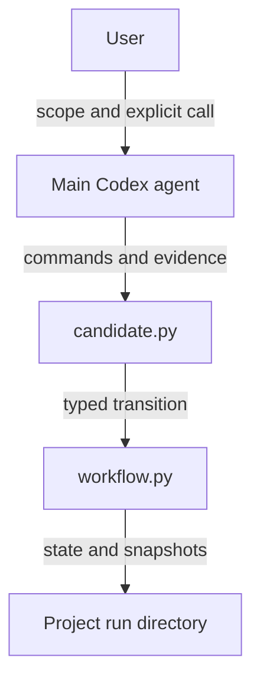
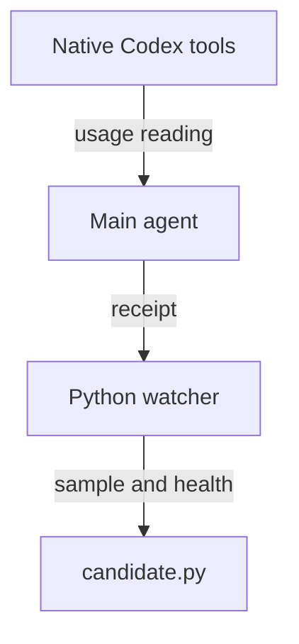
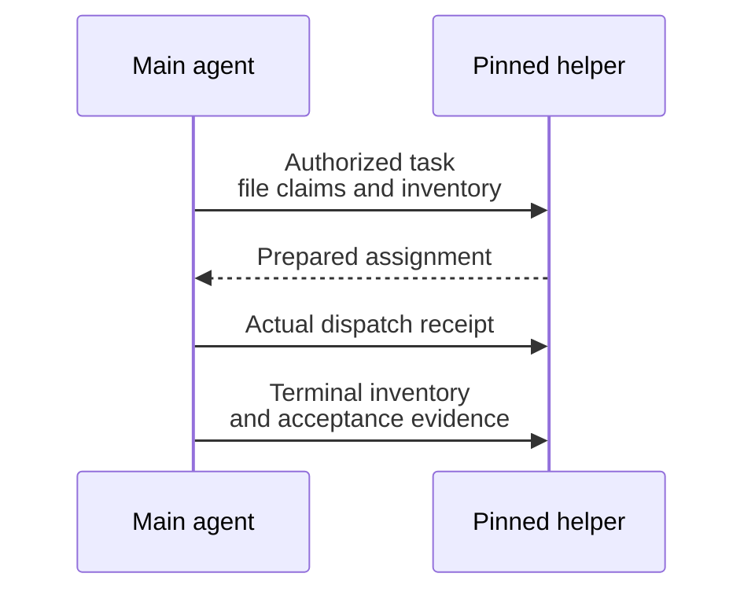
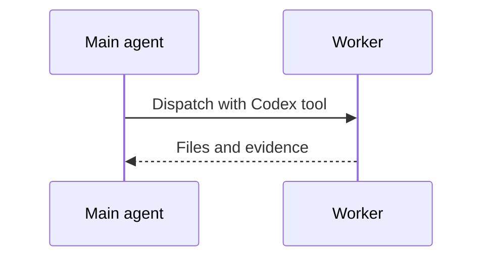
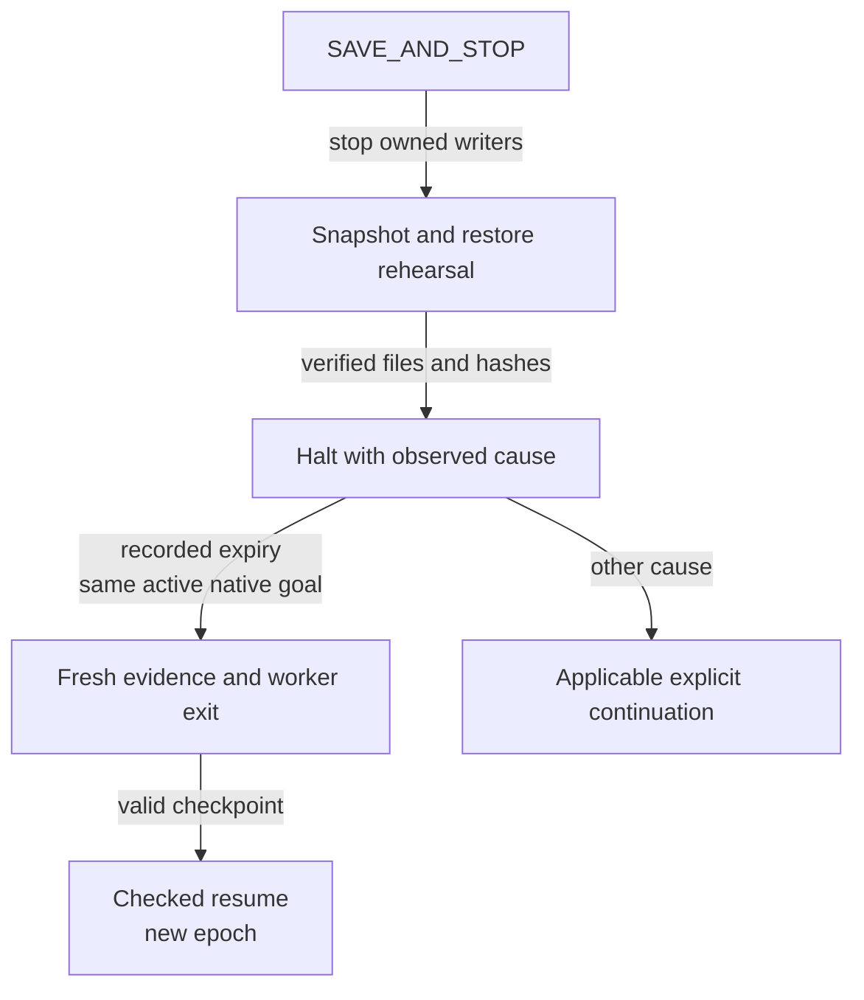

# Architecture and orchestration

AGWF keeps two sorts of authority visible. The user and native Codex tools establish the authorized scope, the goal, and what actually happened. The Python candidate verifies the supplied evidence and owns the local state transitions. A valid JSON record is not independent authentication of its source.

## Components and ownership

The candidate checks its externally pinned manifest and supported entrypoint before binding the package to a project and run. The core stores tasks, ownership, replay protection, authorization state and snapshot metadata. A coordination journal records uncertain or pending outcomes. The watcher operates on a separate evidence path. Full package checks run at measurement and command boundaries. Heartbeats verify the smaller ownership and control record.

The candidate owns the watcher startup. The main agent also obtains goal and child inventory from the host. The watcher holds the run/epoch lease and cannot read usage directly from Codex.

| Boundary | Source |
| --- | --- |
| External hash, dependency checks, activation and worker lifecycle | [Candidate](../skills/agent-workflow-v1-1/scripts/candidate.py), [package binding](../skills/agent-workflow-v1-1/references/coexistence.md) |
| Authority, file claims, prepared dispatch, output checks and checkpoints | [Workflow core](../skills/agent-workflow-v1-1/scripts/workflow.py), [command contract](../skills/agent-workflow-v1-1/references/commands.md) |
| Usage reading, replay, heartbeat, lease and stop decision | [Watcher](../skills/agent-workflow-v1-1/private/limit-watcher/scripts/monitor.py), [native receipts](../skills/agent-workflow-v1-1/references/native-usage.md) |
| Set up sessions and exercise lifecycle observations | [Lifecycle harness](../tooling/run-lifecycle-check.py), [lifecycle guide](lifecycle-check.md) |

## Who hands what to whom?

The assignment is sent through Codex between preparation and the dispatch receipt. The checked result then comes back to the main agent.

The main agent can keep a small task. A coordinator may propose boundaries for larger work. Architect, implementer and researcher roles cover bounded tasks, while the verifier can review the checked outputs independently. The package carries their [role definitions](../skills/agent-workflow-v1-1/roles/) and prompt files. The main agent uses the user's model and effort. Prepared settings are distinct from effective provider-observed settings.

When dispatch is uncertain, the main agent reconciles the prepared arguments and actual session against a fresh inventory instead of blindly retrying. A terminal worker releases execution uncertainty, but does not make its output correct. An independent verifier references the specific output revision and hash. A later file edit invalidates that earlier review target. [Acceptance and handoff](../skills/agent-workflow-v1-1/references/context.md).

## What survives a stop?

Snapshots include the specified changed paths, deletion records, task claims and local state. The tool restores to a new directory and compares hashes. A changed or incomplete checkpoint requires reconciliation. The helper does not change a native goal's status. The main agent reads and updates that state using Codex tools when the task authorizes it.

The technical recovery path shown here applies to an eligible bound workflow with a recorded expired usage receipt. It requires an already authorized, still-active matching goal and actual post-halt observations. A manual watcher-only run uses the explicit continuation or verified native transition path. Read the [start, stop and recovery rules](../skills/agent-workflow-v1-1/references/operations.md) before deciding which path applies.
