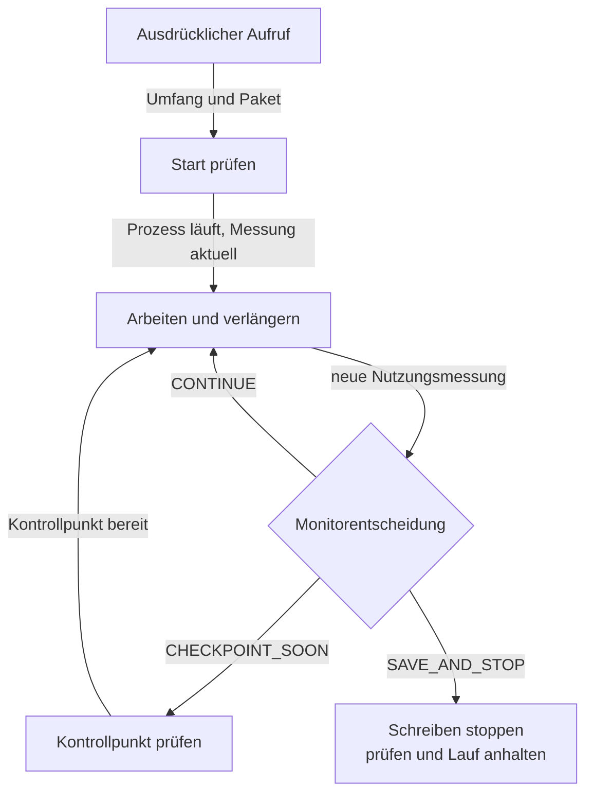

<a name="agwf--agent-workflow-for-codex"></a>

# AGWF · Aufgabenkoordination für Codex

**Koordiniere eine längere Codex-Aufgabe, sieh nach, was tatsächlich geprüft wurde, und hinterlasse einen Kontrollpunkt, den die nächste Sitzung vor der Wiederaufnahme verifizieren kann.**

[English](../../../README.md) · [Türkçe](../tr/README.md) · [简体中文](../zh-Hans/README.md) · [Español](../es/README.md) · [日本語](../ja/README.md) · [Français](../fr/README.md) · [Deutsch](README.md) · [Italiano](../it/README.md) · [Русский](../ru/README.md) · [한국어](../ko/README.md)

[Installieren und prüfen](docs/installation.md) · [Architektur und Orchestrierung](docs/architecture.md) · [Befehle für den Ablauf eines Laufs](docs/lifecycle-check.md) · [Änderungsprotokoll](CHANGELOG.md)

> **Ein typischer Lauf.** Wer ein Projekt pflegt, bittet Codex um eine Änderung und eine Prüfung des Ergebnisses. Ein Agent ist für die ihm zugewiesenen Dateien zuständig. Ein Prüfer erhält die fertigen Dateien und die Belege. Läuft die Nutzungsmessung während der Arbeit ab, fordert AGWF einen Stopp an. Ein Kontrollpunkt erfasst die geänderten Dateien und ihre Hashes. Die nächste Sitzung kann ihn prüfen, bevor sie über die Wiederaufnahme entscheidet.

<a name="what-is-it"></a>

## Was ist AGWF?

AGWF besteht aus einem ausdrücklich aufgerufenen Codex-Skill und einer Laufzeit für Python 3.11 oder neuer. Er hält fest, wer einen Lauf freigegeben hat, zu welchem Paket und Projekt er gehört, wer in welche Datei schreiben darf, welche Aufgaben Codex tatsächlich an Agenten übermittelt hat und welche Belege die Abnahme stützen. Der Aufruf lautet `$agent-workflow-v1-1`, der Anzeigename ist **agent-workflow-v1.1** und die Paketversion ist **1.1**.

Der Hauptagent trifft Entscheidungen und ruft die nativen Codex-Werkzeuge auf. Das Python-Hilfsprogramm prüft die Belege, die es erhält, und speichert Zustandswechsel von Läufen und Aufgaben. Der Hintergrundmonitor arbeitet ohne Modell. Er prüft die Aktualität der Codex-Nutzungsmessung, die Identität des Prozesses, sein Lebenszeichen und seine befristete Laufberechtigung. Der Monitor kann einen Kontrollpunkt oder einen Stopp anfordern. Der Hauptagent setzt diese Entscheidung um.

<a name="why-does-it-exist"></a>

## Warum gibt es das Projekt?

Eine lange Sitzung kann enden, nachdem ein Agent Dateien bearbeitet hat und bevor ein anderer sie prüfen konnte. Der Status „beendet“ sagt nichts darüber aus, ob die Ausgabe stimmt. Wird eine Zuweisung nach einem Timeout erneut gesendet, können zwei Agenten dieselben Dateien bearbeiten. Wer nach einer Unterbrechung wegen der Nutzung weiterarbeitet, kann auf Dateien stoßen, die sich seit dem letzten Kontrollpunkt geändert haben.

AGWF hält die Informationen fest, mit denen sich diese Situationen auseinanderhalten lassen. Er bindet jeden Lauf an ein freigegebenes Paket und ein Projekt, prüft vor dem Senden die Schreibzuständigkeit und speichert die Werkzeugbelege. Eine Zuweisung mit unklarem Ausgang bleibt offen, bis sie anhand des Codex-Sitzungsbestands geklärt ist. Der Kontrollpunkt sichert geänderte Dateien, Einträge zu Löschungen und den Zustand des Arbeitsablaufs. Vor der Abnahme dieses Kontrollpunkts wird die Wiederherstellung in einem separaten Verzeichnis erprobt.

<a name="what-can-i-use-it-for"></a>

## Wofür kann ich AGWF nutzen?

| Aufgabe | Was AGWF erfasst oder prüft | Was du überprüfen kannst |
| --- | --- | --- |
| Eine umfangreiche Aufgabe im Hauptchat bearbeiten | Die Laufidentität und, bei ausdrücklicher Freigabe, das native Ziel und die dazugehörigen Nutzungsbelege | Ob Hilfsprogramm und Monitor tatsächlich aktiv sind. Eine kleine Aufgabe kann beim Hauptagenten bleiben. |
| Code-, Recherche- oder Schreibarbeit aufteilen | Abhängigkeiten, genaue projektbezogene Schreibpfade, Eingabe-Hashes, Rollen, Kapazität und die tatsächlich übermittelte Zuweisung | Welcher Agent für welche Ausgabe zuständig ist und ob sich der unklare Ausgang eines Aufrufs sicher klären lässt. |
| Eine unabhängige Prüfung verlangen | Den Sitzungsbestand mit Endstatus, die Hashes der erzeugten Ausgaben und die Belege zum exakten Prüfgegenstand | Ob der Prüfer dieselben Dateien untersucht hat, die abgenommen werden sollen. |
| Sicher stoppen und später weiterarbeiten | Einen verifizierten Snapshot, den tatsächlichen Stoppgrund des Monitors und neue Beobachtungen | Ob der ursprüngliche Kontrollpunkt noch zu den Dateien passt und dieser Grund eine Wiederaufnahme zulässt. |
| Eine autorisierte Aufgabe ohne vollständigen Arbeitsablauf überwachen | Einen manuell gestarteten Monitor, native Nutzungsbelege, Messwerte und die befristete Laufberechtigung | Ob der Monitor ordnungsgemäß läuft. Dieser Modus erstellt oder aktiviert kein natives Ziel. |
| Arbeit übergeben oder die Nutzung nach einem Lauf auswerten | Eine schreibgeschützte Kontextzusammenfassung mit fixierten Quellen oder Nutzungszahlen aus ausdrücklich ausgewählten Gesprächsbereichen | Welche Hindernisse und Belege bei der Übergabe erhalten bleiben und welche Tokenzahlen oder Zeitangaben die Aufzeichnungen belegen. |

<a name="how-it-works"></a>

## So funktioniert es

Dieses Diagramm folgt der Entscheidung, die der Hauptagent während des Laufs treffen muss. Es zeigt, wie er reagiert, wenn der Monitor das Sichern oder Stoppen anfordert.



- **Paket- und Laufidentität.** Der Aufrufer übergibt einen außerhalb des veränderlichen Pakets gesicherten Manifest-Hash. Der Kandidat prüft das Manifest und die Abhängigkeiten und verknüpft dann Projekt, Paket und Lauf-ID. Wer den Hash eines geänderten Manifests neu berechnet, hat damit keine Freigabe nachgewiesen.
- **Zuweisung und Abnahme.** Das Hilfsprogramm bereitet eine Aufgabe mit festem Umfang vor. Codex startet den Agenten tatsächlich und liefert die erhaltene Identität und den Aufrufbeleg. Auch die Ausgabe eines beendeten Agenten muss geprüft werden. Ist eine unabhängige Prüfung vorgeschrieben, arbeitet der Prüfer mit den gespeicherten Ausgabe-Hashes.
- **Aktuelle Messung und eigener Prozess.** Das Lebenszeichen des Monitors erneuert die Nutzungsmessung nicht. Der Hauptagent muss vor der adaptiven Frist neu messen und die befristete Laufberechtigung verlängern. Bei 25 % Rest fordert die Standardregel einen Kontrollpunkt an. Bei 20 % oder einem Signal zur vorzeitigen Sicherung fordert sie einen Stopp.
- **Der Stoppgrund bestimmt die Fortsetzung.** Ist `usage_receipt_expired` als Ursache protokolliert, kommt eine Wiederaufnahme unter demselben freigegebenen und weiterhin aktiven nativen Ziel infrage. Der Kontrollpunkt muss unverändert sein, die laufzugehörigen Prozesse müssen beendet und die erforderlichen Beobachtungen aktuell sein. Bei einem vorzeitigen Reservesignal, ausgeschöpftem Kontingent oder ausdrücklichem Nutzerstopp gelten eigene Voraussetzungen. Auch für den reinen Überwachungsmodus gibt es einen eigenen ausdrücklichen Fortsetzungsweg.
- **Belege lassen sich separat prüfen.** Das Kontextwerkzeug fasst die aktuellen Aufgaben zusammen. Verweise auf Belege und Hindernisse bleiben erhalten, ohne ganze Protokolle zu kopieren. Die Nutzungsauswertung zählt eindeutige Antwortdatensätze aus festgelegten Eingabebereichen, hält Lücken sichtbar und veröffentlicht einen begrenzten Metadatenbericht. Er misst die aufgezeichnete Nutzung. Für Abrechnung, Cache-Vorteile und Zeitersparnis sind eigene Belege nötig.

Der [Architekturleitfaden](docs/architecture.md) beschreibt Komponenten, Nachrichten für Zuweisung und Prüfung und die Entscheidung zur Wiederaufnahme. Der [Betriebsleitfaden](skills/agent-workflow-v1-1/references/operations.md) erklärt, welche Belege die einzelnen Befehle benötigen.

<a name="get-started"></a>

## Einstieg

Bau und prüfe den Kandidaten mit dem separat gesicherten Manifest-Hash wie in der [Installationsanleitung](docs/installation.md) beschrieben. Für die erste Prüfung eignet sich ein Wegwerfprojekt. Sie verifiziert das Paket und die Zuordnung des Laufs, ohne einen Workflow zu aktivieren, einen Monitor zu starten oder ein natives Ziel anzulegen.

Wenn du in Codex mit der eigentlichen Arbeit beginnen möchtest, wähle `$agent-workflow-v1-1` ausdrücklich aus und gib den Umfang an. So kann eine Anfrage aussehen.

> $agent-workflow-v1-1 — Untersuche den fehlschlagenden Regressionstest in diesem Projekt, behebe den Fehler mit einer gezielten Änderung und prüfe das Ergebnis. Sichere einen Kontrollpunkt, falls der Lauf gestoppt werden muss. Ziehe nur dann einen separaten Prüfer hinzu, wenn das Ergebnis ihn erfordert.

Das Beispiel zeigt die Form des Aufrufs. Für den tatsächlichen Start sind ein aktueller nativer Nutzungsbeleg und die passenden Freigabenachweise erforderlich. [Format der nativen Belege](skills/agent-workflow-v1-1/references/native-usage.md).

<a name="technical-guides"></a>

## Technische Anleitungen

| Anleitung | Hilft dir dabei |
| --- | --- |
| [Installieren und prüfen](docs/installation.md) | Das Paket bauen, selbst oder durch einen Agenten installieren, die Isolation prüfen, aktualisieren oder beim Entfernen die Daten erhalten |
| [Architektur und Orchestrierung](docs/architecture.md) | Verstehen, was in Codex läuft, was Python prüft, wer Dateien bearbeiten darf und wie sich die Fortsetzung je nach Ursache unterscheidet |
| [Lebenszyklus prüfen](docs/lifecycle-check.md) | Das Prüfwerkzeug mit echten Host-Beobachtungen vorbereiten und bedienen und die Grenzen der Zeitmessung einordnen |
| [Befehlsspezifikation](skills/agent-workflow-v1-1/references/commands.md) | Typisierte Eingaben, unterstützte Befehle und den Umgang mit JSON und Fehlern nachschlagen |
| [Betrieb](skills/agent-workflow-v1-1/references/operations.md) | Aktivieren, zuweisen, unklare Aufrufe klären, prüfen, sichern, stoppen und fortsetzen |
| [Kontext und Abnahme](skills/agent-workflow-v1-1/references/context.md) | Relevanten Kontext übergeben und unabhängige Prüfungen an die Ausgabe-Hashes binden |
| [Nutzungsmessung](skills/agent-workflow-v1-1/references/measurement.md) | Tokenzahlen und Zeitmessungen in einem festgelegten Bereich prüfen und Lücken in den Daten erkennen |
| [Paketbindung](skills/agent-workflow-v1-1/references/coexistence.md) · [Migration](skills/agent-workflow-v1-1/references/migration.md) | Das installierte Paket prüfen und unveränderliche Nachweise früherer Läufe erhalten |

<a name="updates-and-data"></a>

## Updates und Daten

Für das Update einer vom Installer verwalteten Installation braucht der Installer `--update` und den separat gesicherten Hash des freigegebenen Pakets. Prüfe vor der Änderung der Installation, ob ihr Prozess beendet ist. Ein erfolgreiches Update bindet alte Läufe nicht neu. Verwende mit dem neuen Paket eine neue Lauf-ID. Behalte ältere Kontrollpunkte, Bindungen und Belege mit ihren ursprünglichen Identitäten.

Der Laufzeitzustand liegt normalerweise unter `.agent-workflow-v1-1/runs/<run-id>`. Halte Nutzungsdaten, Zielbelege, Aufrufprotokolle und lokale Berichte aus der Veröffentlichung heraus. Der Installer hat weder ein dauerhaftes Rücksicherungsarchiv noch einen Deinstallationsbefehl. [Installation und Datenerhalt](docs/installation.md).

<a name="verification"></a>

## Überprüfung

Starte die Python-Tests aus dem Stammverzeichnis des Repositorys.

```powershell
python -X utf8 -B -m unittest discover -s skills/agent-workflow-v1-1/tests
python -X utf8 -B -m unittest discover -s tooling/tests
```

Im isolierten Windows-Test für diese Dokumentation waren 303 Workflow- und 124 Werkzeugtests erfolgreich. Die Tests decken typisierte Freigaben, Bindungen, Gültigkeitsdauer und Wiederverwendung der Belege, Ausgabe-Hashes, die Identität echter Prozesse, die Integrität der Kontrollpunkte, die Installation und die Dateifreigabe unter Windows ab. Die Host-Beobachtungen sind in diesen Tests synthetisch. Eine passive Prüfung auf der Kommandozeile belegt die Paketvalidierung. Eine echte Fortsetzung über Continue in Codex, Remote, die Anbieteridentität und ein echter Zehn-Sekunden-Versuch benötigen jeweils eigene Belege. Welche Beobachtungen nötig sind, steht im [Leitfaden zum Lebenszyklus](docs/lifecycle-check.md).

<a name="project-files"></a>

## Projektdateien

| Pfad | Zuständigkeit |
| --- | --- |
| [`skills/agent-workflow-v1-1/SKILL.md`](skills/agent-workflow-v1-1/skill-guide.md) | Ausdrücklicher Aufruf und Anweisungen für den Hauptagenten |
| [`skills/agent-workflow-v1-1/scripts/`](../../../skills/agent-workflow-v1-1/scripts) | An den Manifest-Hash gebundener Einstiegspunkt, Zustandslogik und koordinierte Befehle |
| [`skills/agent-workflow-v1-1/private/limit-watcher/`](../../../skills/agent-workflow-v1-1/private/limit-watcher) | Monitor ohne Modell und eine getrennte optionale Beratungsrolle |
| [`skills/agent-workflow-v1-1/roles/`](../../../skills/agent-workflow-v1-1/roles) | Rollenregeln, Referenzwissen und Modelleinstellungen |
| [`tooling/`](../../../tooling) | Deterministischer Paketbau, Umgebungsprüfungen und Prüfwerkzeuge für Ergebnisse und Lebenszyklus |
| [`docs/`](../..) | Installation, Architektur, Lebenszyklus und historische Wartungshinweise |

<a name="license-and-contributions"></a>

## Lizenz und Beiträge

Dieser Checkout enthält keine Lizenzdatei. Das [Änderungsprotokoll](CHANGELOG.md) dokumentiert die bestehende Versionsgeschichte. Gib bei Änderungen an, welche Befehle du tatsächlich getestet hast, welchen Paket- oder Laufzeitbereich die Änderung betrifft und welche Interaktionen mit der Host-Anwendung noch geprüft werden müssen.
