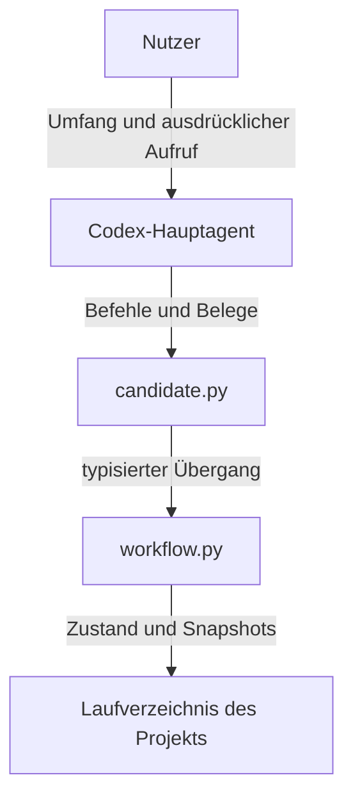
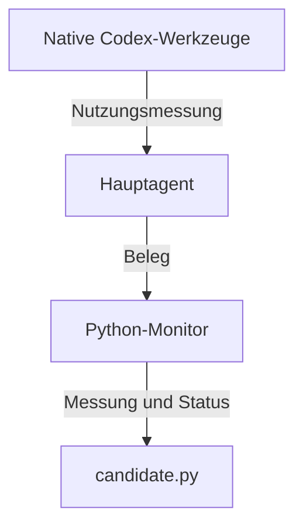
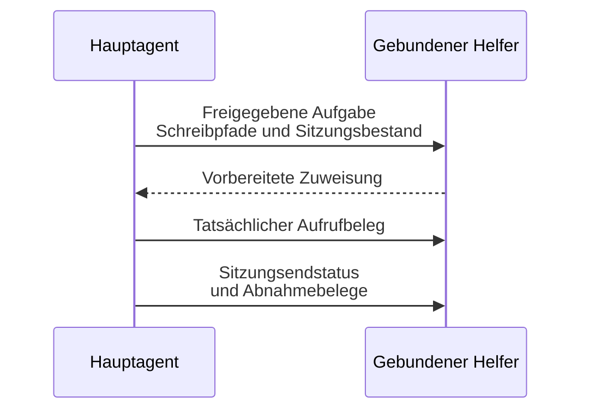
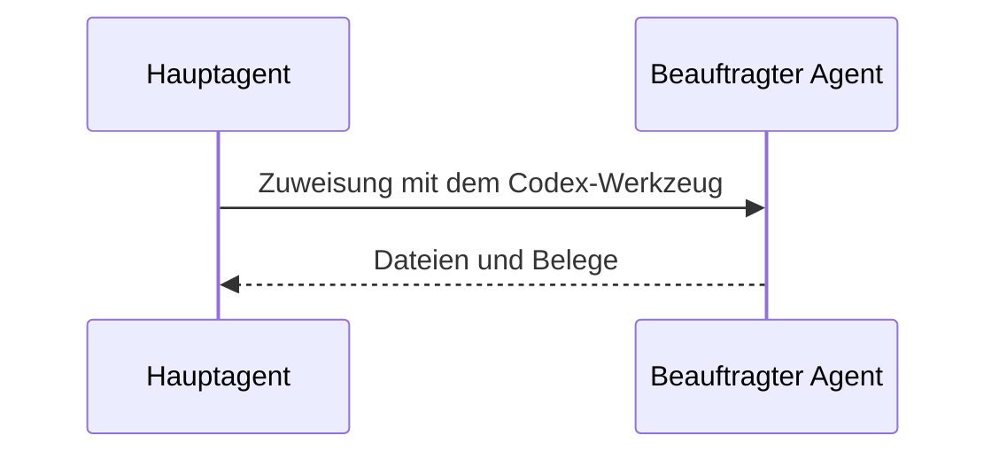
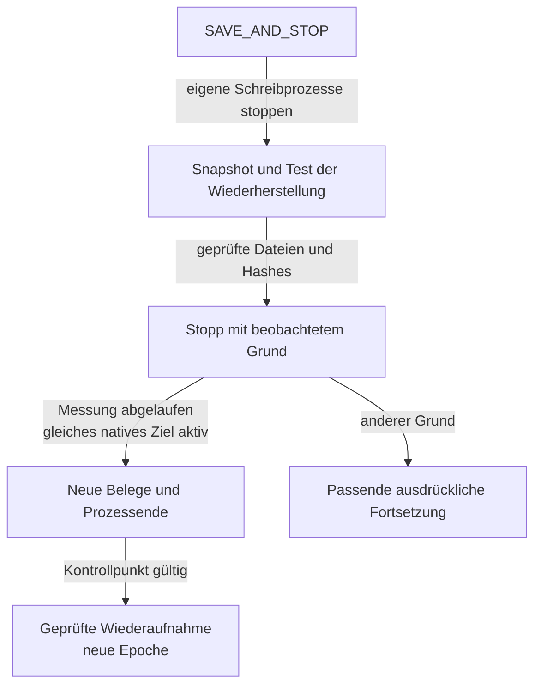

# Architektur und Orchestrierung

AGWF macht zwei Zuständigkeiten sichtbar. Der Nutzer und die nativen Codex-Werkzeuge liefern den freigegebenen Umfang, das Ziel und den Nachweis, was tatsächlich geschehen ist. Der Python-Kandidat prüft die übergebenen Belege und steuert die lokalen Zustandswechsel. Ein gültiger JSON-Datensatz kann seine Herkunft nicht unabhängig bestätigen.

## Komponenten und Zuständigkeiten

Der Kandidat prüft sein Manifest gegen die separat aufbewahrte Prüfsumme und kontrolliert den unterstützten Einstiegspunkt, bevor er das Paket an Projekt und Lauf bindet. Der Kern speichert Aufgaben, Zuständigkeiten, Schutz vor wiederverwendeten Ereignissen, Freigabestatus und Snapshot-Metadaten. Ein Koordinationsjournal vermerkt unklare oder noch ausstehende Ergebnisse. Für den Monitor gibt es einen eigenen Belegpfad. Die vollständige Paketprüfung findet bei Messungen und Befehlen statt. Die Lebenszeichen prüfen nur den kleineren Datensatz für Zugehörigkeit und Steuerung.

Der Kandidat startet den Monitor. Der Hauptagent erfasst beim Host außerdem die Zielbeobachtung und den Sitzungsbestand der Kindagenten. Der Monitor hält die befristete Berechtigung für Lauf und Epoche. Er kann keine Nutzungsdaten direkt aus Codex lesen.

| Zuständigkeit | Quellen |
| --- | --- |
| Externer Hash, Abhängigkeitsprüfung, Aktivierung und Prozesslebenszyklus | [Kandidat](../../../../skills/agent-workflow-v1-1/scripts/candidate.py), [Paketbindung](../skills/agent-workflow-v1-1/references/coexistence.md) |
| Freigabe, Schreibzuständigkeit, Vorbereitung der Zuweisung, Prüfung der Ausgaben und Kontrollpunkte | [Workflow-Kern](../../../../skills/agent-workflow-v1-1/scripts/workflow.py), [Befehlsspezifikation](../skills/agent-workflow-v1-1/references/commands.md) |
| Nutzungsmessung, Schutz vor Wiederverwendung, Lebenszeichen, Laufberechtigung und Stoppentscheidung | [Monitor](../../../../skills/agent-workflow-v1-1/private/limit-watcher/scripts/monitor.py), [native Belege](../skills/agent-workflow-v1-1/references/native-usage.md) |
| Sitzungen vorbereiten und Beobachtungen zum Lebenszyklus prüfen | [Prüfwerkzeug](../../../../tooling/run-lifecycle-check.py), [Leitfaden zum Lebenszyklus](lifecycle-check.md) |

## Wer übergibt wem welche Informationen?

Zwischen der Vorbereitung und dem Aufrufbeleg leitet der Hauptagent den Auftrag über Codex weiter. Das überprüfte Ergebnis kommt anschließend zum Hauptagenten zurück.

Kleine Aufgaben kann der Hauptagent selbst bearbeiten. Für größere Arbeiten kann ein Koordinator die Aufteilung vorschlagen. Architekt, Implementierer und Rechercheur bearbeiten abgegrenzte Aufgaben. Ein Prüfer kann die Ausgaben unabhängig untersuchen. Das Paket enthält ihre [Rollendefinitionen](../../../../skills/agent-workflow-v1-1/roles) und Anweisungen. Beim Hauptagenten gelten Modell und Denkstufe des Nutzers. Die vorbereiteten Einstellungen und die tatsächlich beim Anbieter beobachteten Einstellungen sind getrennte Angaben.

Bleibt der Ausgang einer Zuweisung unklar, gleicht der Hauptagent die vorbereiteten Argumente und die tatsächliche Sitzung mit einem aktuellen Sitzungsbestand ab, bevor er erneut sendet. Ein beendeter Agent klärt, dass die Ausführung beendet ist. Ob seine Ergebnisse stimmen, bleibt zu prüfen. Der unabhängige Prüfer bezieht sich auf die konkrete Revision und den Hash der Ausgabe. Eine spätere Dateiänderung macht diesen Prüfgegenstand ungültig. [Abnahme und Übergabe](../skills/agent-workflow-v1-1/references/context.md).

## Was bleibt nach einem Stopp erhalten?

Die Snapshots enthalten die angegebenen geänderten Pfade, Nachweise zu Löschungen, die Schreibzuständigkeiten der Aufgaben und den lokalen Zustand. Das Werkzeug stellt die Daten in einem neuen Verzeichnis wieder her und vergleicht die Hashes. Ein veränderter oder unvollständiger Kontrollpunkt muss vor einer Fortsetzung geklärt werden. Das Hilfsprogramm ändert den Status eines nativen Ziels nicht. Der Hauptagent liest und aktualisiert diesen Zustand mit Codex-Werkzeugen, wenn der Auftrag es erlaubt.

Der hier gezeigte technische Wiederaufnahmeweg gilt für einen geeigneten gebundenen Workflow mit protokolliertem Ablauf eines Nutzungsbelegs. Dazu muss dasselbe Ziel bereits freigegeben und weiterhin aktiv sein, und es müssen echte Beobachtungen nach dem Stopp vorliegen. Ein Lauf, in dem nur manuell überwacht wird, folgt dem Weg der ausdrücklichen Fortsetzung oder eines nachgewiesenen nativen Übergangs. Welche Voraussetzungen gelten, steht in den [Regeln für Start, Stopp und Wiederaufnahme](../skills/agent-workflow-v1-1/references/operations.md).
