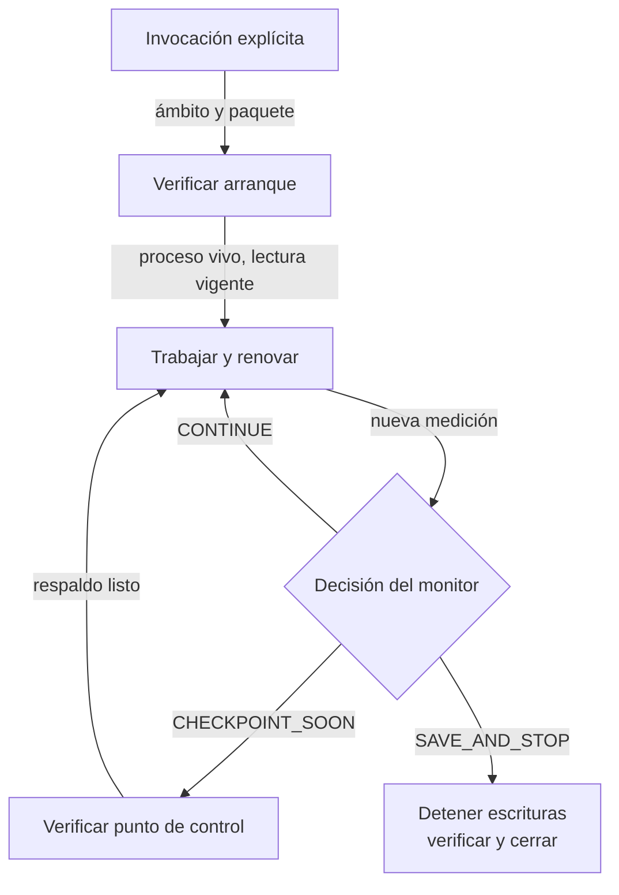

<a name="agwf--agent-workflow-for-codex"></a>

# AGWF · Coordinación de tareas para Codex

**Coordina una tarea larga de Codex, identifica qué se verificó y deja un punto de control que otra sesión pueda comprobar antes de continuar.**

[English](../../../README.md) · [Türkçe](../tr/README.md) · [简体中文](../zh-Hans/README.md) · [Español](README.md) · [日本語](../ja/README.md) · [Français](../fr/README.md) · [Deutsch](../de/README.md) · [Italiano](../it/README.md) · [Русский](../ru/README.md) · [한국어](../ko/README.md)

[Instalación y verificación](docs/installation.md) · [Arquitectura y orquestación](docs/architecture.md) · [Ciclo de vida](docs/lifecycle-check.md) · [Historial de cambios](CHANGELOG.md)

> Una persona pide a Codex que cambie un proyecto y compruebe el resultado. Un agente escribe en los archivos asignados y otro revisa el resultado y las pruebas. Si caduca la lectura de uso, AGWF pide detener el trabajo. El punto de control guarda los cambios y sus hashes. La próxima sesión examina ese registro antes de decidir si puede continuar.

<a name="what-is-it"></a>

## ¿Qué es?

AGWF combina una skill de Codex de invocación explícita con un entorno Python 3.11 o posterior. Registra quién autorizó la ejecución, su proyecto y paquete, quién puede escribir en cada archivo, qué tareas se enviaron realmente y qué pruebas respaldan la aceptación. Se invoca con `$agent-workflow-v1-1`, se muestra como **agent-workflow-v1.1** y el paquete usa la versión **1.1**.

El agente principal toma las decisiones y llama a las herramientas nativas. El ayudante de Python comprueba las pruebas recibidas y registra las transiciones. Su monitor en segundo plano funciona sin modelos. Comprueba la vigencia del uso, la identidad del proceso, su señal de actividad y el plazo que lo mantiene operativo. El agente principal actúa cuando el monitor pide guardar o detener el trabajo.

<a name="why-does-it-exist"></a>

## ¿Por qué existe?

Una sesión larga puede terminar con archivos escritos que nadie ha revisado. Que un agente haya acabado no garantiza un resultado correcto. Repetir un envío que agotó su tiempo de espera puede generar dos responsables de escritura. Después de una interrupción, los archivos pueden haber cambiado desde el último punto de control.

AGWF conserva las pruebas para distinguir estos casos. Vincula la ejecución al paquete y al proyecto aprobados, verifica quién puede escribir antes del envío y registra la respuesta real de la herramienta. Un envío incierto se contrasta con el inventario de Codex. El punto de control guarda cambios, eliminaciones y estado. Antes de aceptarlo, se prueba su restauración en una carpeta diferente.

<a name="what-can-i-use-it-for"></a>

## ¿Para qué sirve?

| Tarea | Qué registra o comprueba AGWF | Qué puedes verificar |
| --- | --- | --- |
| Hacer una tarea extensa en el chat principal | Identidad de ejecución y, con autorización expresa, objetivo nativo y prueba de uso | Si el ayudante y el monitor están activos. Una tarea pequeña puede quedarse con el agente principal. |
| Dividir un trabajo de código, investigación o redacción | Dependencias, rutas de escritura relativas al proyecto, hashes de entrada, perfiles, capacidad y envío real | A quién corresponde cada archivo y cómo resolver un envío incierto. |
| Exigir una revisión independiente | Inventario terminal, hashes de los archivos producidos y referencias de revisión | Si se revisaron los mismos archivos que se van a aceptar. |
| Detener el trabajo y retomarlo después | Instantánea verificada, causa real de parada y nuevas observaciones | Si el punto de control está intacto y si la causa permite reanudar. |
| Monitorizar una tarea autorizada sin activar la orquestación completa | Monitor independiente, recibos de uso nativo, muestras y plazo de vigencia | Si el monitor está sano. Este modo no crea ni activa un objetivo nativo. |
| Traspasar el trabajo o medir el uso después | Resumen de solo lectura con referencias fijadas o totales de tramos de registro escogidos explícitamente | Qué bloqueos y pruebas se transmiten y qué cifras de tokens o tiempo respaldan los registros. |

<a name="how-it-works"></a>

## Cómo funciona

El diagrama muestra qué hace el agente principal cuando el monitor pide guardar o detener el trabajo.



- **Identidad del paquete y de la ejecución.** Quien ejecuta AGWF aporta el hash del manifiesto conservado fuera del paquete. El programa comprueba el manifiesto y las dependencias y vincula proyecto, paquete e ID. Recalcular el hash de un manifiesto modificado no lo aprueba.
- **Envío y aceptación.** El ayudante prepara una asignación delimitada. Codex la envía y el agente principal registra la sesión y el recibo reales. El estado final del agente no acepta sus archivos. Si hay revisión independiente, se cotejan los hashes registrados del resultado.
- **Medida vigente y proceso propio.** Una señal de actividad no actualiza la lectura de uso. El agente principal toma una lectura nueva antes del plazo adaptativo y renueva la vigencia del proceso. La regla predeterminada pide un punto de control al quedar el 25% y una parada al quedar el 20% o al detectar una reserva anticipada.
- **Reanudación según la causa de parada.** Un `usage_receipt_expired` admite recuperación técnica si se mantiene el mismo objetivo nativo activo y autorizado. Requiere comprobar que el punto de control está intacto, que los procesos propios salieron y que las observaciones posteriores son nuevas. Reserva anticipada, cuota agotada y parada del usuario conservan sus reglas. El monitor por sí solo usa su propia vía de continuación expresa.
- **Pruebas que se pueden examinar aparte.** El resumen conserva referencias y bloqueos sin copiar registros completos. El extractor cuenta respuestas únicas en tramos fijados, señala lagunas y publica metadatos de alcance limitado. Mide el uso registrado. La factura y cualquier ahorro de tiempo o caché necesitan pruebas independientes.

La [guía de arquitectura](docs/architecture.md) separa los componentes, el intercambio de información al asignar y revisar tareas, y la decisión de recuperación. El [contrato de operaciones](skills/agent-workflow-v1-1/references/operations.md) explica las pruebas de cada comando.

<a name="get-started"></a>

## Primeros pasos

Sigue la [guía de instalación](docs/installation.md) para generar y comprobar el candidato con el hash del manifiesto conservado por separado. La primera comprobación puede hacerse en un proyecto desechable. Verifica el paquete y la vinculación de ejecución sin activar un flujo, iniciar un monitor o crear un objetivo.

Para comenzar un trabajo real en Codex selecciona `$agent-workflow-v1-1` expresamente e indica su alcance:

> $agent-workflow-v1-1 — Investiga la regresión del proyecto, corrígela con un cambio acotado y verifica el resultado. Deja un punto de control si debes detener el trabajo. Recurre a un revisor independiente si el resultado lo requiere.

Este es un ejemplo de invocación. El arranque real requiere un recibo reciente de uso nativo y la prueba de autorización aplicable. [Recibos de uso nativos](skills/agent-workflow-v1-1/references/native-usage.md).

<a name="technical-guides"></a>

## Guías técnicas

| Guía | Para qué sirve |
| --- | --- |
| [Instalación y verificación](docs/installation.md) | Generar el paquete, instalar de forma manual o con un agente, comprobarlo, actualizar o conservar datos al retirarlo |
| [Arquitectura y orquestación](docs/architecture.md) | Entender el reparto entre Codex y Python, la asignación de archivos y la recuperación según causa |
| [Ciclo de vida](docs/lifecycle-check.md) | Usar el arnés con observaciones reales y entender qué prueba la medición de tiempos |
| [Contrato de comandos](skills/agent-workflow-v1-1/references/commands.md) | Consultar las entradas tipadas, los comandos disponibles y los errores JSON |
| [Operaciones](skills/agent-workflow-v1-1/references/operations.md) | Activar, asignar, conciliar, verificar, guardar, detener y reanudar |
| [Contexto y aceptación](skills/agent-workflow-v1-1/references/context.md) | Pasar solo el contexto pertinente y vincular la revisión con hashes de salida |
| [Vinculación del paquete](skills/agent-workflow-v1-1/references/coexistence.md) · [Migración](skills/agent-workflow-v1-1/references/migration.md) | Verificar la instalación y preservar los registros inmutables anteriores |
| [Medición de uso](skills/agent-workflow-v1-1/references/measurement.md) | Consultar qué recuentos y tiempos se pueden medir y dónde faltan datos |

<a name="updates-and-data"></a>

## Actualizaciones y datos

Actualiza una instalación administrada con `--update` y el hash externo del paquete aceptado. Verifica que su proceso ha salido antes de cambiar la instalación. Un paquete nuevo usa un identificador de ejecución nuevo. Conserva los puntos de control, los enlaces y los recibos antiguos con sus identidades originales.

El estado suele vivir en `.agent-workflow-v1-1/runs/<run-id>`. Mantén los archivos de uso, objetivos, envíos e informes fuera de la publicación. El instalador carece de respaldo de reversión permanente y de comando para desinstalar. [Instalación y conservación de datos](docs/installation.md).

<a name="verification"></a>

## Verificación

Desde la raíz del repositorio:

```powershell
python -X utf8 -B -m unittest discover -s skills/agent-workflow-v1-1/tests
python -X utf8 -B -m unittest discover -s tooling/tests
```

La comprobación aislada en Windows para esta documentación pasó 303 pruebas del flujo y 124 de herramientas. Cubren autorización tipada, vínculo, vigencia y reuso del recibo, hashes de salida, procesos propios reales, integridad de los puntos de control, instalación y compartición de archivos en Windows. Las observaciones nativas de los tests son sintéticas. Una verificación pasiva valida el paquete; Continue, Remote, la identidad del proveedor y la medición real de diez segundos requieren pruebas propias. Véase la [guía del ciclo de vida](docs/lifecycle-check.md).

<a name="project-files"></a>

## Archivos del proyecto

| Ruta | Responsabilidad |
| --- | --- |
| [`skills/agent-workflow-v1-1/SKILL.md`](skills/agent-workflow-v1-1/skill-guide.md) | Invocación explícita e instrucciones para el agente principal |
| [`skills/agent-workflow-v1-1/scripts/`](../../../skills/agent-workflow-v1-1/scripts) | Entrada fijada por manifiesto, estado del flujo y coordinación |
| [`skills/agent-workflow-v1-1/private/limit-watcher/`](../../../skills/agent-workflow-v1-1/private/limit-watcher) | Monitor sin modelo y asesor opcional |
| [`skills/agent-workflow-v1-1/roles/`](../../../skills/agent-workflow-v1-1/roles) | Políticas de rol, memoria de contexto y ajustes de modelos |
| [`tooling/`](../../../tooling) | Build determinista, diagnóstico del entorno, verificación de productor y arnés del ciclo de vida |
| [`docs/`](../..) | Instalación, arquitectura, ciclo de vida y notas históricas |

<a name="license-and-contributions"></a>

## Licencia y contribuciones

Esta copia no contiene un archivo de licencia. El [historial](CHANGELOG.md) registra las versiones existentes. Al proponer un cambio, indica los comandos realmente comprobados, el paquete o alcance de ejecución afectado y qué interacción con el entorno sigue sin verificar.
