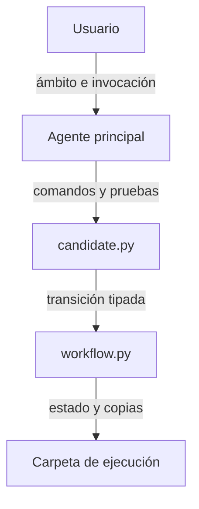
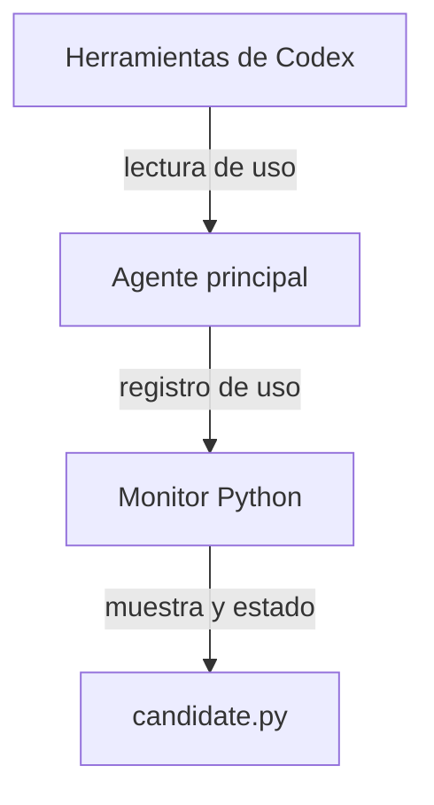
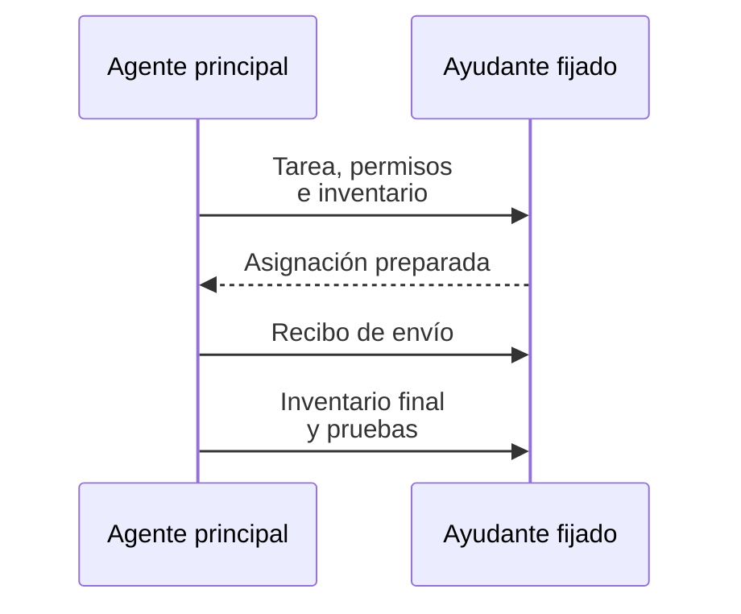
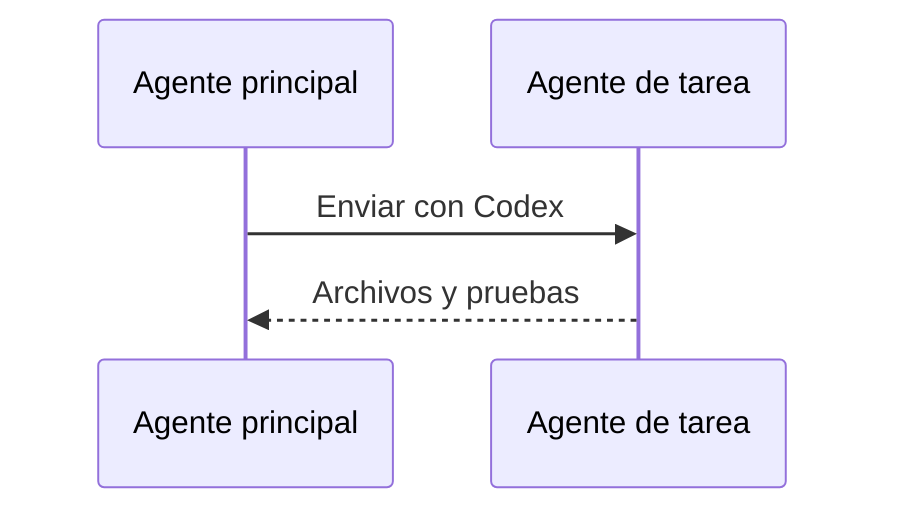
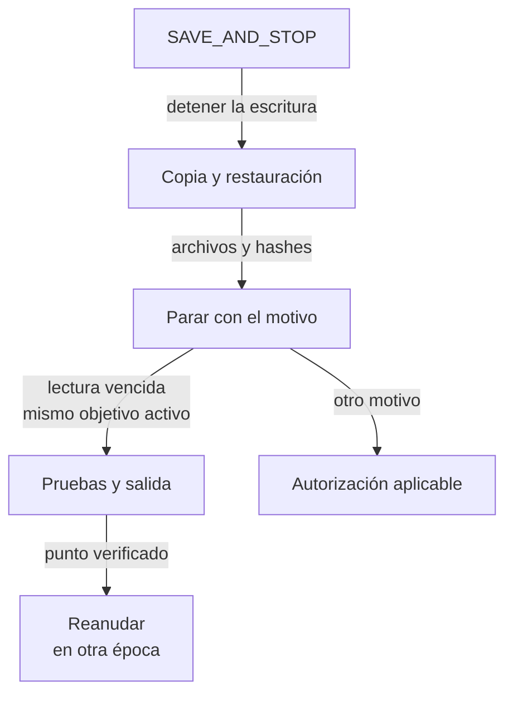

# Arquitectura y orquestación

La autoridad proviene del usuario. Las herramientas nativas de Codex registran el objetivo y las acciones que se han producido. El candidate de Python comprueba las pruebas que recibe y administra las transiciones locales. Un JSON válido no autentica su fuente.

## Componentes y responsabilidades

El candidate verifica el hash externo del manifiesto y el punto de entrada antes de vincular el paquete con un proyecto y una ejecución. El núcleo guarda tareas, permisos de escritura, protección contra repeticiones, estado de la autorización y metadatos de instantáneas. El diario de coordinación registra operaciones pendientes o de resultado desconocido. El monitor tiene su propio flujo de pruebas. Cada comando y cada medición verifica el paquete completo. La señal periódica comprueba un registro más pequeño de control y propiedad.

El candidate inicia el monitor y el agente principal obtiene el objetivo y el inventario de subagentes mediante Codex. El monitor gestiona la vigencia de su época y ejecución. No accede por su cuenta a la herramienta de uso de Codex.

| Área | Código y guía |
| --- | --- |
| Hash externo, dependencias, activación y ciclo de vida del proceso | [Candidate](../../../../skills/agent-workflow-v1-1/scripts/candidate.py), [vinculación del paquete](../skills/agent-workflow-v1-1/references/coexistence.md) |
| Autorización, rutas de escritura, preparación, comprobación y puntos de control | [Núcleo del flujo](../../../../skills/agent-workflow-v1-1/scripts/workflow.py), [contrato de comandos](../skills/agent-workflow-v1-1/references/commands.md) |
| Uso, repeticiones, señal de actividad, plazo y parada | [Monitor](../../../../skills/agent-workflow-v1-1/private/limit-watcher/scripts/monitor.py), [recibos nativos](../skills/agent-workflow-v1-1/references/native-usage.md) |
| Preparar sesiones y comprobar observaciones del ciclo de vida | [Arnés](../../../../tooling/run-lifecycle-check.py), [guía del ciclo de vida](lifecycle-check.md) |

## Quién envía qué y a quién

Entre recibir los parámetros preparados y registrar el recibo, el agente principal usa Codex para enviar el encargo. El resultado y las pruebas vuelven al agente principal.

El agente principal puede encargarse de una tarea pequeña. Coordinación propone límites para encargos grandes. Arquitectura, implementación e investigación se ocupan de trabajos delimitados; verificación puede revisar por separado los resultados. El paquete incluye las [definiciones de rol](../../../../skills/agent-workflow-v1-1/roles) y sus instrucciones. El agente principal usa el modelo y la intensidad elegidos por el usuario. Los ajustes preparados y los observados en el proveedor son pruebas diferentes.

Cuando no se sabe cómo terminó un envío, el agente principal coteja los parámetros preparados y la sesión real con un inventario reciente antes de repetir nada. Un estado terminal resuelve la incertidumbre de ejecución, pero todavía hay que comprobar el resultado. La revisión independiente fija la revisión y los hashes exactos. Una edición posterior invalida ese objetivo de revisión. [Aceptación y traspaso](../skills/agent-workflow-v1-1/references/context.md).

## Qué se conserva al detenerse

La instantánea incluye las rutas cambiadas declaradas, las eliminaciones, los archivos asignados y el estado local. La herramienta ensaya la restauración en otra carpeta y compara los hashes. Si el punto de control cambió o está incompleto, primero hay que resolverlo. El ayudante no cambia el estado del objetivo nativo. El agente principal lo consulta y lo actualiza con las herramientas de Codex si el encargo lo autoriza.

La recuperación técnica del diagrama corresponde a un flujo vinculado que registró la caducidad del recibo de uso. Requiere el mismo objetivo autorizado y activo y observaciones genuinas posteriores al cierre. Las ejecuciones solo con monitor usan una continuación explícita o una transición nativa verificada. Consulta las [reglas de arranque, parada y recuperación](../skills/agent-workflow-v1-1/references/operations.md) antes de elegir la vía.
