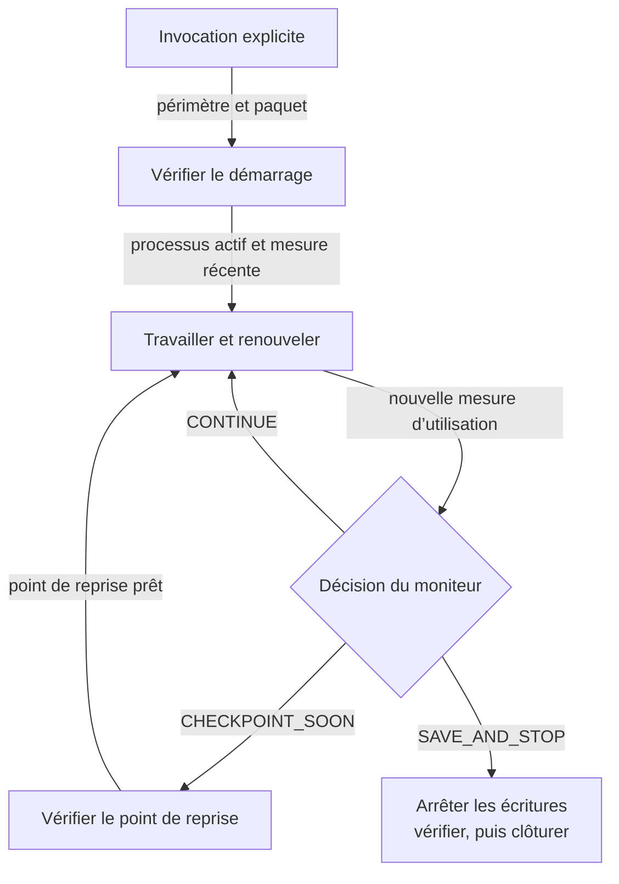

<a name="agwf--agent-workflow-for-codex"></a>

# AGWF · Coordination des tâches Codex

**Coordonnez une tâche longue dans Codex, voyez ce qui a réellement été vérifié et laissez un point de reprise que la session suivante pourra contrôler.**

[English](../../../README.md) · [Türkçe](../tr/README.md) · [简体中文](../zh-Hans/README.md) · [Español](../es/README.md) · [日本語](../ja/README.md) · [Français](README.md) · [Deutsch](../de/README.md) · [Italiano](../it/README.md) · [Русский](../ru/README.md) · [한국어](../ko/README.md)

[Installer et vérifier](docs/installation.md) · [Architecture et orchestration](docs/architecture.md) · [Commandes du cycle de vie](docs/lifecycle-check.md) · [Historique des modifications](CHANGELOG.md)

> **Une exécution typique.** La personne qui maintient le projet demande à Codex d’y apporter une modification et d’en vérifier le résultat. Un agent a la responsabilité des fichiers qui lui sont attribués. Un vérificateur reçoit les fichiers terminés et les éléments de preuve. Si la mesure d’utilisation arrive à expiration en cours de travail, AGWF demande l’arrêt. Un point de reprise conserve les fichiers modifiés et leurs empreintes. La session suivante peut le contrôler avant de décider si l’exécution peut reprendre.

<a name="what-is-it"></a>

## Qu’est-ce qu’AGWF ?

AGWF est une compétence Codex à invocation explicite, accompagnée d’un environnement d’exécution Python 3.11 ou ultérieur. Il consigne qui a autorisé une exécution, à quel projet et à quel paquet elle se rattache, qui peut écrire dans chaque fichier, quelles tâches Codex a réellement envoyées et sur quelles preuves repose l’acceptation du résultat. Le nom d’appel est `$agent-workflow-v1-1`, le nom affiché est **agent-workflow-v1.1** et la version du paquet est **1.1**.

L’agent principal prend les décisions et appelle les outils natifs de Codex. L’assistant Python vérifie les preuves qui lui sont transmises et consigne les changements d’état des exécutions et des tâches. Le moniteur d’arrière-plan fonctionne sans modèle. Il contrôle la fraîcheur des mesures d’utilisation de Codex, l’identité du processus de surveillance, son signal périodique et la validité de son bail. Il peut demander un point de reprise ou un arrêt. C’est à l’agent principal de donner suite.

<a name="why-does-it-exist"></a>

## Pourquoi ce projet existe-t-il ?

Une longue session peut s’interrompre après qu’un agent a écrit des fichiers et avant que quelqu’un d’autre les ait contrôlés. Le statut « terminé » d’un agent ne renseigne pas sur la qualité du résultat. Relancer un envoi qui a expiré peut donner deux agents en écriture sur les mêmes fichiers. Après une interruption liée à l’utilisation, une reprise peut tomber sur des fichiers modifiés depuis le dernier point de reprise.

AGWF consigne les faits nécessaires pour distinguer ces situations. Il associe chaque exécution à un paquet approuvé et à un projet, contrôle l’attribution des fichiers avant l’envoi et conserve les reçus d’outils. Lorsque le résultat d’un envoi est incertain, il attend que l’inventaire de Codex permette de trancher. Le point de reprise conserve les fichiers modifiés, la trace des suppressions et l’état du flux de travail. Avant de l’accepter, AGWF teste sa restauration dans un dossier distinct.

<a name="what-can-i-use-it-for"></a>

## À quoi sert-il ?

| Travail | Ce qu’AGWF consigne ou vérifie | Ce que vous pouvez contrôler |
| --- | --- | --- |
| Garder une tâche importante dans la conversation principale | L’identité de l’exécution et, si le périmètre l’autorise explicitement, l’objectif natif et les relevés d’utilisation associés | Si l’assistant et le moniteur sont effectivement actifs. Une petite tâche peut rester à la charge de l’agent principal. |
| Répartir un travail de code, de recherche ou de rédaction | Les dépendances, les chemins d’écriture exacts relatifs au projet, les empreintes des entrées, le rôle, la capacité et les paramètres de l’envoi réel | Quel agent est responsable de chaque résultat et si l’issue d’un envoi ambigu peut être établie sans risque. |
| Exiger une vérification indépendante | L’inventaire des agents ayant terminé, les empreintes de leurs fichiers de sortie et les preuves qui désignent précisément la cible de la revue | Si la revue a bien porté sur les mêmes fichiers que ceux qui sont acceptés. |
| Arrêter proprement pour reprendre plus tard | Un instantané vérifié, le motif d’arrêt enregistré par le moniteur et de nouvelles observations | Si le point de reprise d’origine correspond encore aux fichiers et si le motif autorise la reprise. |
| Surveiller une tâche autorisée sans orchestration complète | Une exécution en surveillance manuelle, les relevés d’utilisation natifs, les mesures et le bail | Si le moniteur est opérationnel. Ce mode ne crée ni n’active d’objectif natif. |
| Transmettre le travail en cours ou analyser l’utilisation après une exécution | Un résumé du contexte en lecture seule avec des références à des sources figées, ou des totaux issus de plages explicites du journal de conversation | Quels obstacles et éléments de preuve restent visibles, et quels nombres de jetons ou quelles durées les données permettent d’établir. |

<a name="how-it-works"></a>

## Comment ça marche ?

Le diagramme suit la décision qui compte pendant l’exécution. Il montre comment l’agent principal réagit lorsque le moniteur demande de préserver le travail ou de l’arrêter.



- **Identité du paquet et de l’exécution.** L’appelant fournit l’empreinte du manifeste conservée en dehors du paquet modifiable. Le candidat vérifie le manifeste et ses dépendances, puis rattache le projet et le paquet à l’identifiant d’exécution. Recalculer l’empreinte d’un manifeste modifié ne vaut pas approbation.
- **Envoi et acceptation.** L’assistant prépare une affectation délimitée. Codex lance réellement l’agent, puis fournit l’identité et le reçu retournés. Une fois le travail de l’agent terminé, les résultats restent à vérifier. Lorsqu’une revue indépendante est exigée, le vérificateur travaille sur les sorties dont les empreintes ont été enregistrées.
- **Mesure récente et processus sous contrôle.** La présence du signal périodique ne renouvelle pas la mesure d’utilisation. L’agent principal doit obtenir un nouveau relevé natif avant l’échéance adaptative et renouveler le bail. Par défaut, il doit vérifier un point de reprise à 25 % de quota restant. À 20 % ou sur un signal de réserve anticipée, le moniteur demande l’arrêt.
- **La reprise dépend du motif.** Après un arrêt consigné avec le motif `usage_receipt_expired`, la reprise peut s’appuyer sur le même objectif natif, toujours actif et autorisé. Elle requiert un point de reprise intact, l’arrêt des processus appartenant à l’exécution et des observations récentes. La réserve anticipée, le quota épuisé et l’arrêt explicite demandé par l’utilisateur ont leurs propres conditions. La surveillance seule suit sa propre procédure de reprise explicite.
- **Les preuves peuvent être examinées à part.** Le générateur de contexte résume les tâches en cours en conservant les références aux preuves et aux obstacles, sans recopier les journaux complets. L’extracteur compte les réponses uniques dans les plages d’entrée figées, indique les lacunes et publie un rapport de métadonnées limité à ce périmètre. Ce rapport mesure l’utilisation enregistrée. La facturation et les gains de temps ou de cache exigent leurs propres preuves.

Le [guide d’architecture](docs/architecture.md) présente séparément les composants, les échanges lors de l’envoi et de la revue, ainsi que la décision de reprise. Le [guide d’exploitation](skills/agent-workflow-v1-1/references/operations.md) précise les preuves nécessaires pour chaque commande.

<a name="get-started"></a>

## Prise en main

Suivez le [guide d’installation](docs/installation.md) pour construire puis vérifier le candidat à partir d’une empreinte de manifeste conservée séparément. Vous pouvez effectuer le premier contrôle dans un projet jetable. Le contrôle vérifie le paquet et le rattachement de l’exécution sans activer un flux de travail, lancer un moniteur ni créer d’objectif natif.

Pour commencer un travail dans Codex, sélectionnez explicitement `$agent-workflow-v1-1` et précisez le périmètre. Voici une demande possible.

> $agent-workflow-v1-1 — Examine la régression de ce projet, apporte une correction ciblée et vérifie le changement. Conserve un point de reprise si l’exécution doit s’arrêter. Fais intervenir un vérificateur distinct uniquement si le résultat l’exige.

Cet exemple illustre la forme de la demande. Le démarrage d’un flux de travail exige un relevé d’utilisation natif récent et les preuves d’autorisation adaptées. [Spécification des relevés natifs](skills/agent-workflow-v1-1/references/native-usage.md).

<a name="technical-guides"></a>

## Guides techniques

| Guide | Il vous aide à |
| --- | --- |
| [Installation et vérification](docs/installation.md) | Construire le paquet, l’installer manuellement ou par l’intermédiaire d’un agent, vérifier son isolement, le mettre à jour et conserver les données en cas de retrait |
| [Architecture et orchestration](docs/architecture.md) | Comprendre ce qui s’exécute dans Codex, ce que Python contrôle, qui a la responsabilité des fichiers et comment la reprise varie selon le motif |
| [Contrôle du cycle de vie](docs/lifecycle-check.md) | Préparer et utiliser l’outil de contrôle avec des observations réelles de l’hôte, puis interpréter les limites des mesures de temps |
| [Spécification des commandes](skills/agent-workflow-v1-1/references/commands.md) | Consulter les formats d’entrée typés, les commandes prises en charge et le traitement du JSON et des erreurs |
| [Exploitation](skills/agent-workflow-v1-1/references/operations.md) | Activer, affecter, clarifier un résultat incertain, vérifier, sauvegarder, arrêter et reprendre |
| [Contexte et acceptation](skills/agent-workflow-v1-1/references/context.md) | Transmettre uniquement le contexte utile et rattacher la revue indépendante aux empreintes de sortie |
| [Mesure de l’utilisation](skills/agent-workflow-v1-1/references/measurement.md) | Examiner les relevés de jetons et de durées dans le périmètre mesuré, et repérer les données manquantes |
| [Rattachement du paquet](skills/agent-workflow-v1-1/references/coexistence.md) · [Migration](skills/agent-workflow-v1-1/references/migration.md) | Vérifier le paquet installé et préserver les traces immuables des anciennes exécutions |

<a name="updates-and-data"></a>

## Mises à jour et données

Pour mettre à jour une installation gérée par l’outil, utilisez l’installateur avec `--update` et l’empreinte du manifeste approuvé conservée à l’extérieur du paquet. Avant de modifier l’installation, vérifiez que le processus appartenant à cette exécution est arrêté. Une mise à jour réussie ne rattache pas automatiquement les exécutions antérieures. Utilisez un nouvel identifiant avec le nouveau paquet et conservez les points de reprise, les rattachements et les reçus précédents sous leur identité d’origine.

L’état d’exécution se trouve normalement dans `.agent-workflow-v1-1/runs/<run-id>`. Gardez les relevés d’utilisation, les observations d’objectifs, les traces d’envoi et les rapports locaux hors publication. L’installateur ne fournit ni archive de restauration durable ni commande de désinstallation. [Installation et conservation des données](docs/installation.md).

<a name="verification"></a>

## Vérification

Lancez les suites Python depuis la racine du dépôt.

```powershell
python -X utf8 -B -m unittest discover -s skills/agent-workflow-v1-1/tests
python -X utf8 -B -m unittest discover -s tooling/tests
```

Pour cette documentation, 303 tests du flux de travail et 124 tests de l’outillage ont réussi dans un environnement Windows isolé. Ils couvrent les autorisations typées, le rattachement, l’âge et la réutilisation des relevés, les empreintes de sortie, l’identité de véritables processus, l’intégrité des points de reprise, l’installation et le partage de fichiers sous Windows. Les observations de l’hôte utilisées dans ces suites sont synthétiques. Un contrôle passif en ligne de commande vérifie le paquet. La reprise réelle via Continue dans Codex, Remote, l’identité du fournisseur et un essai réel à dix secondes exigent leurs propres observations. Le [guide du cycle de vie](docs/lifecycle-check.md) en précise le périmètre.

<a name="project-files"></a>

## Fichiers du projet

| Chemin | Rôle |
| --- | --- |
| [`skills/agent-workflow-v1-1/SKILL.md`](skills/agent-workflow-v1-1/skill-guide.md) | Invocation explicite et instructions pour l’agent principal |
| [`skills/agent-workflow-v1-1/scripts/`](../../../skills/agent-workflow-v1-1/scripts) | Point d’entrée rattaché à un manifeste figé, automate du flux de travail et commandes de coordination |
| [`skills/agent-workflow-v1-1/private/limit-watcher/`](../../../skills/agent-workflow-v1-1/private/limit-watcher) | Moniteur sans modèle et rôle de conseil distinct, facultatif |
| [`skills/agent-workflow-v1-1/roles/`](../../../skills/agent-workflow-v1-1/roles) | Règles de chaque rôle, mémoire de référence et modèles configurés |
| [`tooling/`](../../../tooling) | Construction déterministe, contrôles d’environnement et outils de validation des résultats et du cycle de vie |
| [`docs/`](../..) | Guides d’installation, d’architecture et de cycle de vie, et notes historiques de maintenance |

<a name="license-and-contributions"></a>

## Licence et contributions

Ce dépôt ne contient pas de fichier de licence. L’[historique des modifications](CHANGELOG.md) recense les versions existantes. Pour chaque changement, indiquez les commandes réellement testées, le périmètre du paquet ou de l’exécution qui est concerné, ainsi que les interactions avec l’hôte qui restent à vérifier.
