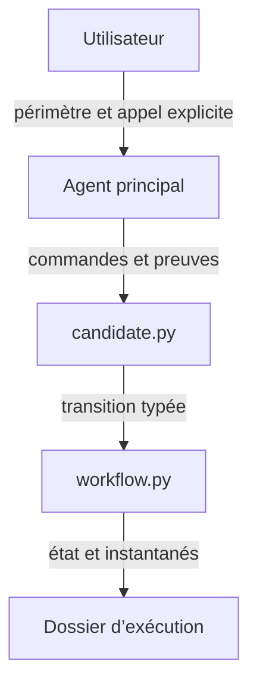
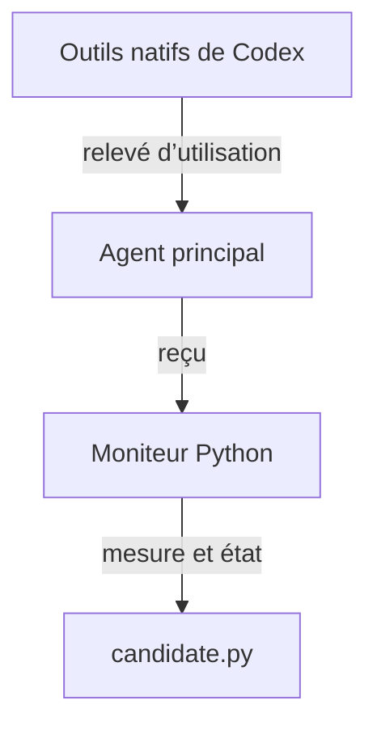
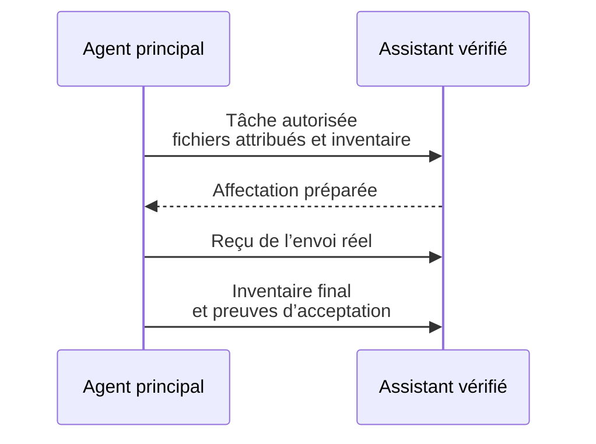
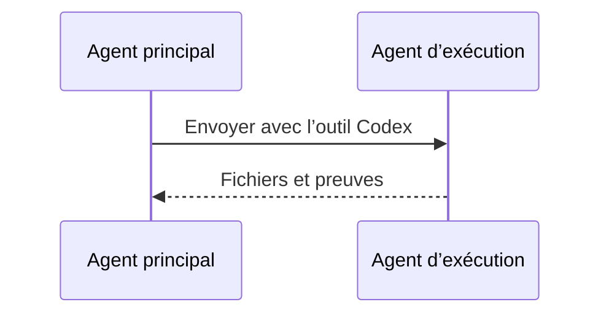
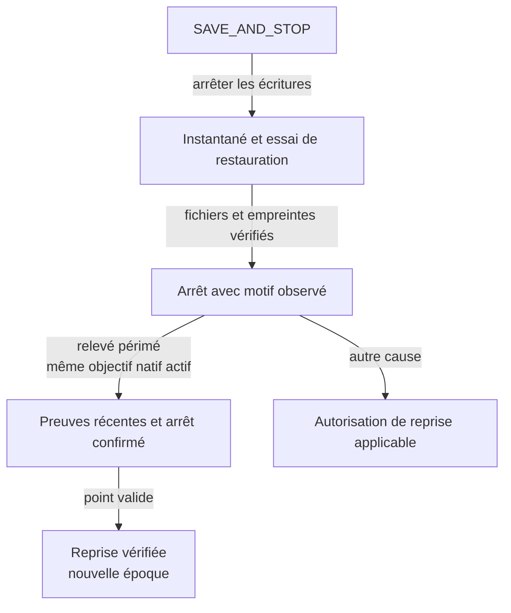

# Architecture et orchestration

AGWF rend visibles deux responsabilités. L’utilisateur et les outils natifs de Codex établissent le périmètre autorisé, l’objectif et les actions qui ont réellement eu lieu. Le candidat Python vérifie les preuves reçues et prend en charge les changements d’état locaux. Un enregistrement JSON valide ne suffit pas à authentifier sa source indépendamment.

## Composants et responsabilités

Le candidat vérifie l’empreinte externe de son manifeste et le point d’entrée pris en charge avant d’associer le paquet à un projet et à une exécution. Le moteur conserve les tâches, l’attribution des fichiers, la protection contre les événements rejoués, l’état des autorisations et les métadonnées des instantanés. Un journal de coordination consigne les résultats incertains ou en attente. Le moniteur suit son propre circuit de relevés. Le paquet est vérifié intégralement lors des mesures et des commandes. Le signal périodique contrôle seulement les données d’appartenance et de contrôle.

Le candidat démarre le moniteur. L’agent principal obtient aussi auprès de l’hôte les observations sur l’objectif et l’inventaire des agents enfants. Le moniteur détient le bail de l’exécution et de son époque. Il ne peut pas lire directement l’utilisation de Codex.

| Responsabilité | Sources |
| --- | --- |
| Empreinte externe, vérification des dépendances, activation et cycle de vie du processus | [Candidat](../../../../skills/agent-workflow-v1-1/scripts/candidate.py), [rattachement du paquet](../skills/agent-workflow-v1-1/references/coexistence.md) |
| Autorisation, attribution des fichiers, préparation d’un envoi, vérification des sorties et points de reprise | [Moteur du flux de travail](../../../../skills/agent-workflow-v1-1/scripts/workflow.py), [spécification des commandes](../skills/agent-workflow-v1-1/references/commands.md) |
| Mesure d’utilisation, protection contre les événements rejoués, signal périodique, bail et décision d’arrêt | [Moniteur](../../../../skills/agent-workflow-v1-1/private/limit-watcher/scripts/monitor.py), [relevés natifs](../skills/agent-workflow-v1-1/references/native-usage.md) |
| Préparation des sessions et vérification des observations du cycle de vie | [Outil de contrôle](../../../../tooling/run-lifecycle-check.py), [guide du cycle de vie](lifecycle-check.md) |

## Qui transmet quoi, et à qui ?

L’agent principal envoie l’affectation dans Codex entre la préparation et l’enregistrement du reçu. Il reçoit ensuite le résultat vérifié.

L’agent principal peut prendre en charge une petite tâche. Pour un travail plus important, un coordinateur peut proposer sa répartition. L’architecte, le responsable de l’implémentation et le chercheur interviennent sur des tâches délimitées. Un vérificateur peut examiner les sorties de façon indépendante. Le paquet inclut leurs [définitions de rôle](../../../../skills/agent-workflow-v1-1/roles) et leurs instructions. Le modèle et l’effort de l’agent principal sont ceux choisis par l’utilisateur. Les réglages préparés et les réglages effectivement observés chez le fournisseur sont deux informations différentes.

Quand l’issue d’un envoi est incertaine, l’agent principal compare les paramètres préparés et la session réelle à un inventaire récent avant d’envisager un nouvel envoi. Un agent en état terminal lève l’incertitude sur l’exécution. Il reste à vérifier son résultat. Un vérificateur indépendant se réfère à une révision et à une empreinte précises. Toute modification ultérieure du fichier invalide cette cible de revue. [Acceptation et transmission du travail](../skills/agent-workflow-v1-1/references/context.md).

## Que conserve-t-on après un arrêt ?

Les instantanés contiennent les chemins modifiés indiqués, la trace des suppressions, les fichiers attribués aux tâches et l’état local. L’outil restaure le contenu dans un nouveau dossier et compare les empreintes. Si un point de reprise est modifié ou incomplet, il faut établir ce qui a changé et résoudre l’écart. L’assistant ne modifie pas le statut d’un objectif natif. L’agent principal le lit et le met à jour avec les outils de Codex lorsque la tâche l’y autorise.

Cette reprise technique s’applique à un flux de travail rattaché qui remplit les conditions et pour lequel l’expiration du relevé d’utilisation a été consignée. Elle exige le même objectif, déjà autorisé et toujours actif, ainsi que des observations réelles après l’arrêt. Une exécution en surveillance manuelle seule suit la procédure de reprise explicite ou de transition native vérifiée. Consultez les [règles de démarrage, d’arrêt et de reprise](../skills/agent-workflow-v1-1/references/operations.md) pour déterminer la procédure applicable.
