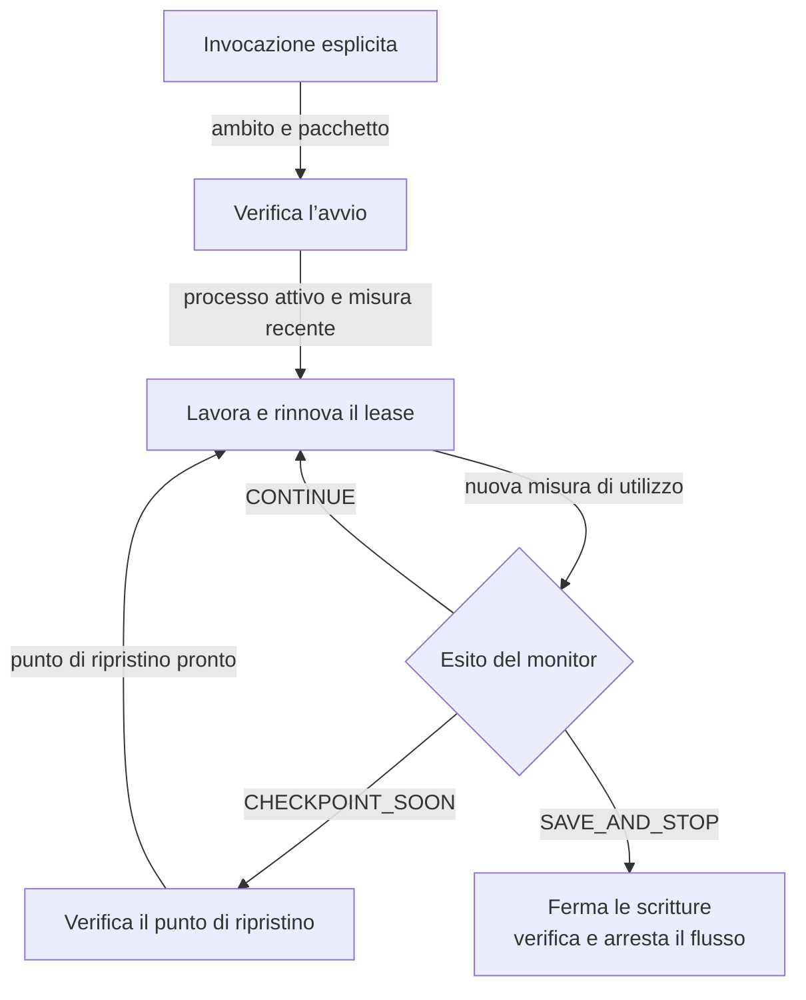

<a name="agwf--agent-workflow-for-codex"></a>

# AGWF · Coordinamento delle attività per Codex

**Coordina un’attività lunga in Codex, scopri quali risultati sono stati davvero verificati e lascia un punto di ripristino che la sessione successiva possa controllare prima di riprendere.**

[English](../../../README.md) · [Türkçe](../tr/README.md) · [简体中文](../zh-Hans/README.md) · [Español](../es/README.md) · [日本語](../ja/README.md) · [Français](../fr/README.md) · [Deutsch](../de/README.md) · [Italiano](README.md) · [Русский](../ru/README.md) · [한국어](../ko/README.md)

[Installazione e verifica](docs/installation.md) · [Architettura e orchestrazione](docs/architecture.md) · [Comandi per il ciclo di vita](docs/lifecycle-check.md) · [Cronologia delle modifiche](CHANGELOG.md)

> **Un’esecuzione tipica.** Chi mantiene un progetto chiede a Codex di modificarlo e verificare il risultato. Un agente è responsabile dei file che gli sono stati assegnati. Un revisore riceve i file completati e i riscontri. Se la misurazione dell’utilizzo scade durante il lavoro, AGWF chiede di fermarsi. Un punto di ripristino conserva i file modificati e i relativi hash. La sessione successiva può controllarlo prima di stabilire se l’esecuzione può riprendere.

<a name="what-is-it"></a>

## Che cos’è AGWF?

AGWF include una skill da invocare esplicitamente in Codex e un ambiente di esecuzione per Python 3.11 o successivo. Registra chi ha autorizzato un’esecuzione, a quale progetto e pacchetto appartiene, chi può scrivere in ciascun file, quali incarichi Codex ha effettivamente inviato e quali riscontri giustificano l’accettazione del risultato. Si invoca con `$agent-workflow-v1-1`, compare con il nome **agent-workflow-v1.1** e il pacchetto è alla versione **1.1**.

L’agente principale prende le decisioni e chiama gli strumenti nativi di Codex. Il programma ausiliario in Python controlla i riscontri ricevuti e registra i passaggi di stato di esecuzioni e attività. Il monitor in background funziona senza modelli. Controlla se le misurazioni di Codex sono ancora valide, l’identità del processo, il segnale periodico di attività e la validità del lease. Può chiedere un punto di ripristino o un arresto. Spetta all’agente principale attuare la decisione.

<a name="why-does-it-exist"></a>

## Perché esiste?

Una sessione lunga può interrompersi dopo che un agente ha scritto dei file e prima che qualcun altro li abbia controllati. Lo stato «completato» di un agente non dice se il risultato sia corretto. Ripetere un invio di cui non si è ricevuto l’esito entro il tempo previsto può far scrivere due agenti sugli stessi file. Dopo un’interruzione legata all’utilizzo, alla ripresa si possono trovare file cambiati dopo l’ultimo punto di ripristino.

AGWF registra i fatti necessari per distinguere questi casi. Collega ogni esecuzione al pacchetto approvato e al progetto, controlla la responsabilità di scrittura prima dell’invio e conserva le ricevute degli strumenti. Un invio dall’esito incerto rimane in sospeso finché l’inventario di Codex non chiarisce cosa sia successo. Un punto di ripristino salva i file modificati, le registrazioni delle eliminazioni e lo stato del flusso di lavoro. Prima di accettarlo, AGWF prova a ripristinarlo in una directory separata.

<a name="what-can-i-use-it-for"></a>

## A cosa serve?

| Lavoro | Che cosa registra o verifica AGWF | Che cosa puoi controllare |
| --- | --- | --- |
| Tenere un’attività importante nella chat principale | L’identità dell’esecuzione e, quando è autorizzato esplicitamente, il suo obiettivo nativo e i rilevamenti di utilizzo | Se il programma ausiliario e il monitor sono davvero attivi. Una piccola attività può restare all’agente principale. |
| Suddividere un lavoro di sviluppo, ricerca o scrittura | Le dipendenze, i percorsi di scrittura esatti relativi al progetto, gli hash degli input, il ruolo, la capacità e l’invio effettivamente effettuato | Quale agente è responsabile di ciascun risultato e se si può chiarire senza rischi lo stato di un invio ambiguo. |
| Richiedere una revisione indipendente | L’inventario degli agenti in stato terminale, gli hash dei file prodotti e i riscontri che individuano l’oggetto della revisione | Se il revisore ha esaminato gli stessi file che si stanno accettando. |
| Fermarsi in sicurezza e riprendere in seguito | Un’istantanea verificata, il motivo effettivo dell’arresto del monitor e nuove osservazioni | Se il punto di ripristino originale corrisponde ancora ai file e se la causa consente la ripresa. |
| Monitorare un’attività autorizzata senza orchestrazione completa | Un’esecuzione di monitoraggio manuale, i rilevamenti nativi d’uso, le misurazioni e il lease | Se il monitor funziona. Questa modalità non crea né attiva un obiettivo nativo. |
| Passare il lavoro in corso o analizzare l’utilizzo al termine di un’esecuzione | Un riepilogo in sola lettura con fonti fissate tramite hash, oppure totali di utilizzo da intervalli del registro conversazionale scelti esplicitamente | Quali blocchi e riscontri si conservano nel passaggio e quali conteggi di token o durate sono supportati dalle registrazioni. |

<a name="how-it-works"></a>

## Come funziona

Il diagramma segue la decisione dell’agente principale nel corso dell’esecuzione. Mostra cosa fa quando il monitor chiede di preservare il lavoro o di interromperlo.



- **Identità del pacchetto e dell’esecuzione.** Chi invoca il programma fornisce l’hash del manifest conservato fuori dal pacchetto modificabile. Il candidato verifica il manifest e le dipendenze, quindi associa progetto, pacchetto e identificativo dell’esecuzione. Ricalcolare l’hash di un manifest modificato non dimostra che sia approvato.
- **Invio e accettazione.** Il programma ausiliario prepara un incarico circoscritto. Codex avvia davvero l’agente e restituisce identità e ricevuta della chiamata. Anche quando l’agente ha terminato, il risultato deve essere controllato. Se serve una revisione indipendente, il revisore usa gli hash dei file prodotti che sono stati registrati.
- **Misurazione recente e processo di competenza dell’esecuzione.** Il segnale di attività del processo, da solo, non rinnova il rilevamento di utilizzo. L’agente principale deve ottenere una nuova misurazione nativa prima della scadenza adattiva e rinnovare il lease. Le regole predefinite chiedono un punto di ripristino con il 25% residuo e un arresto al 20% o in caso di segnale di riserva anticipata.
- **La ripresa dipende dalla causa.** Un arresto registrato come `usage_receipt_expired` può essere recuperato con lo stesso obiettivo nativo ancora attivo e autorizzato, se il punto di ripristino è immutato, i processi di competenza sono terminati e le osservazioni necessarie sono recenti. La riserva anticipata, l’esaurimento della quota e lo stop esplicito dell’utente seguono ciascuno le proprie regole. Il monitoraggio manuale senza flusso segue una propria procedura di ripresa esplicita.
- **I riscontri si possono esaminare separatamente.** Il generatore di contesto riepiloga le attività attuali e conserva i riferimenti ai riscontri e ai blocchi, senza copiare tutti i log. L’estrattore d’uso conta i record univoci di risposta negli intervalli fissati, segnala le lacune e pubblica un rapporto circoscritto ai metadati. Misura l’uso registrato. Fatturazione, vantaggi di cache e risparmi di tempo richiedono riscontri specifici.

La [guida all’architettura](docs/architecture.md) distingue i componenti, gli scambi di invio e revisione e la decisione di ripresa. La [guida operativa](skills/agent-workflow-v1-1/references/operations.md) spiega quali riscontri richiede ogni comando.

<a name="get-started"></a>

## Per iniziare

Segui la [guida all’installazione](docs/installation.md) per costruire e controllare il candidato partendo da un hash del manifest conservato separatamente. Il primo controllo si può eseguire in un progetto temporaneo. Verifica il pacchetto e il legame con l’esecuzione senza attivare un flusso, avviare un monitor o creare un obiettivo nativo.

Quando vuoi iniziare a lavorare in Codex, seleziona esplicitamente `$agent-workflow-v1-1` e indica l’ambito. Una richiesta possibile è questa.

> $agent-workflow-v1-1 — Esamina il test di regressione che non passa in questo progetto, applica una correzione circoscritta e verifica la modifica. Conserva un punto di ripristino se il lavoro deve fermarsi. Coinvolgi un revisore separato soltanto se il risultato lo richiede.

L’esempio mostra come formulare l’invocazione. Per avviare un flusso di lavoro servono una misura nativa recente e i riscontri di autorizzazione adatti. [Specifica dei rilevamenti nativi](skills/agent-workflow-v1-1/references/native-usage.md).

<a name="technical-guides"></a>

## Guide tecniche

| Guida | Usala per |
| --- | --- |
| [Installazione e verifica](docs/installation.md) | Costruire il pacchetto, installarlo a mano o con un agente, verificarne l’isolamento, aggiornarlo e preservare i dati quando lo rimuovi |
| [Architettura e orchestrazione](docs/architecture.md) | Capire cosa viene eseguito in Codex, cosa verifica Python, chi è responsabile dei file e come cambia la ripresa a seconda del motivo |
| [Verifica del ciclo di vita](docs/lifecycle-check.md) | Preparare e usare lo strumento di controllo con osservazioni effettive dell’host e capire i limiti delle misure temporali |
| [Specifica dei comandi](skills/agent-workflow-v1-1/references/commands.md) | Consultare input tipizzati, comandi supportati e gestione di JSON ed errori |
| [Operatività](skills/agent-workflow-v1-1/references/operations.md) | Attivare, assegnare, chiarire esiti incerti, verificare, salvare un punto di ripristino, arrestare e riprendere |
| [Contesto e accettazione](skills/agent-workflow-v1-1/references/context.md) | Passare soltanto il contesto rilevante e associare la revisione indipendente agli hash dei file prodotti |
| [Misurazione dell’utilizzo](skills/agent-workflow-v1-1/references/measurement.md) | Consultare token e tempi negli intervalli misurati e individuare le lacune nelle registrazioni |
| [Associazione al pacchetto](skills/agent-workflow-v1-1/references/coexistence.md) · [Migrazione](skills/agent-workflow-v1-1/references/migration.md) | Verificare il pacchetto installato e conservare i registri immutabili delle vecchie esecuzioni |

<a name="updates-and-data"></a>

## Aggiornamenti e dati

Per aggiornare un’installazione gestita, usa l’installatore con `--update` e l’hash approvato del pacchetto, conservato all’esterno. Prima di cambiare l’installazione, verifica che il processo che le appartiene sia terminato. Un aggiornamento riuscito non associa nuovamente le vecchie esecuzioni. Usa un nuovo identificativo con il nuovo pacchetto e conserva associazioni, punti di ripristino e riscontri precedenti con le identità originali.

Lo stato normalmente risiede in `.agent-workflow-v1-1/runs/<run-id>`. Tieni fuori dalla pubblicazione i dati d’uso, gli obiettivi, i riscontri d’invio e i rapporti locali. L’installatore non conserva un archivio permanente di ripristino e non ha un comando di disinstallazione. [Installazione e conservazione dei dati](docs/installation.md).

<a name="verification"></a>

## Verifica

Esegui i test Python dalla radice del repository.

```powershell
python -X utf8 -B -m unittest discover -s skills/agent-workflow-v1-1/tests
python -X utf8 -B -m unittest discover -s tooling/tests
```

Nell’esecuzione isolata su Windows per questa documentazione sono passati 303 test del flusso di lavoro e 124 test degli strumenti. Coprono le autorizzazioni tipizzate, l’associazione dell’esecuzione, l’età e il riuso dei riscontri, gli hash dei risultati, l’identità di processi reali, l’integrità dei punti di ripristino, l’installazione e la condivisione dei file in Windows. Le osservazioni dell’host in questi test sono sintetiche. Un controllo passivo da riga di comando verifica il pacchetto. L’azione Continue in Codex, Remote, l’identità del fornitore e un test reale da dieci secondi richiedono osservazioni a sé. Il [controllo del ciclo di vita](docs/lifecycle-check.md) spiega il perimetro di queste verifiche.

<a name="project-files"></a>

## File del progetto

| Percorso | Responsabilità |
| --- | --- |
| [`skills/agent-workflow-v1-1/SKILL.md`](skills/agent-workflow-v1-1/skill-guide.md) | Invocazione esplicita e istruzioni per l’agente principale |
| [`skills/agent-workflow-v1-1/scripts/`](../../../skills/agent-workflow-v1-1/scripts) | Punto di ingresso protetto dall’hash del manifest, macchina a stati del flusso e comandi coordinati |
| [`skills/agent-workflow-v1-1/private/limit-watcher/`](../../../skills/agent-workflow-v1-1/private/limit-watcher) | Monitor senza modello e ruolo di consulenza separato, facoltativo |
| [`skills/agent-workflow-v1-1/roles/`](../../../skills/agent-workflow-v1-1/roles) | Regole dei ruoli, memoria di riferimento e impostazioni dei modelli |
| [`tooling/`](../../../tooling) | Build deterministica, verifiche dell’ambiente e strumenti di controllo dei risultati e del ciclo di vita |
| [`docs/`](../..) | Installazione, architettura, ciclo di vita e note storiche di manutenzione |

<a name="license-and-contributions"></a>

## Licenza e contributi

Questa copia del repository non contiene un file di licenza. La [cronologia](CHANGELOG.md) riporta le versioni esistenti. Per ogni modifica indica i comandi realmente testati, la parte del pacchetto o dell’ambiente di esecuzione interessata e le interazioni con l’host che restano da verificare.
