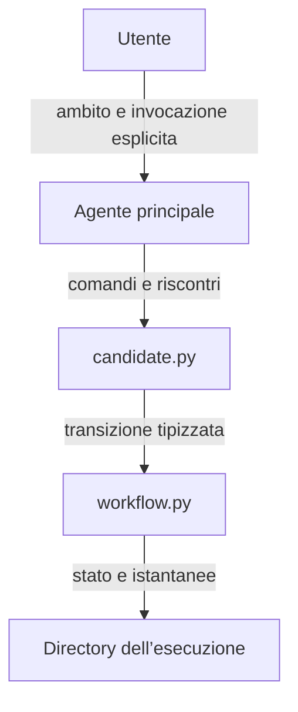
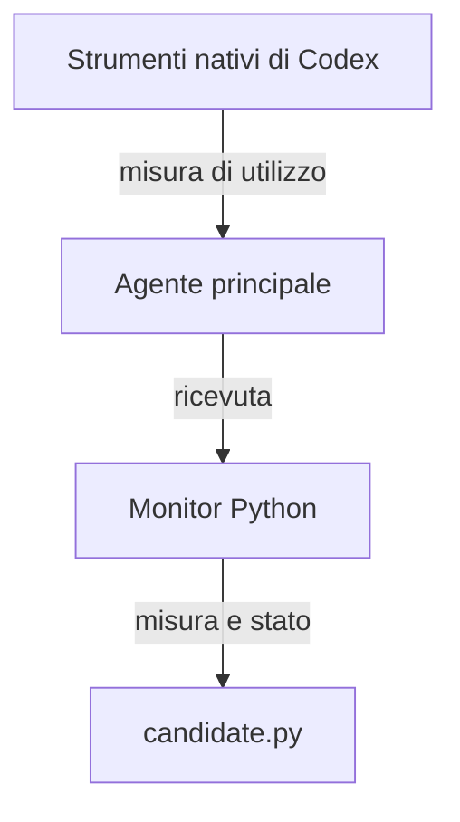
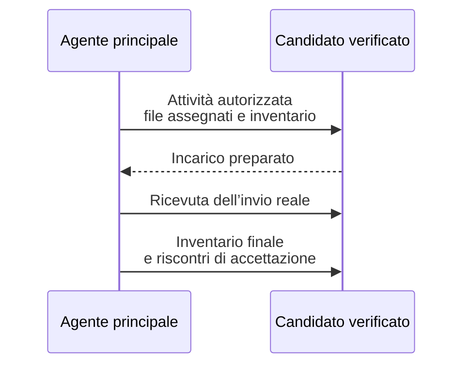
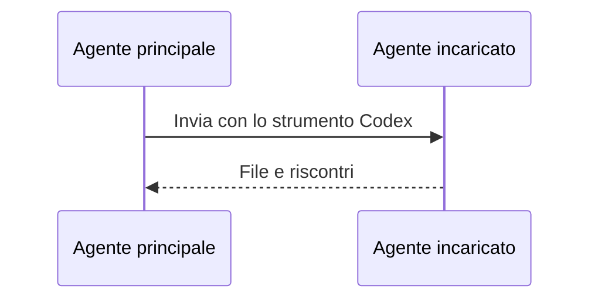
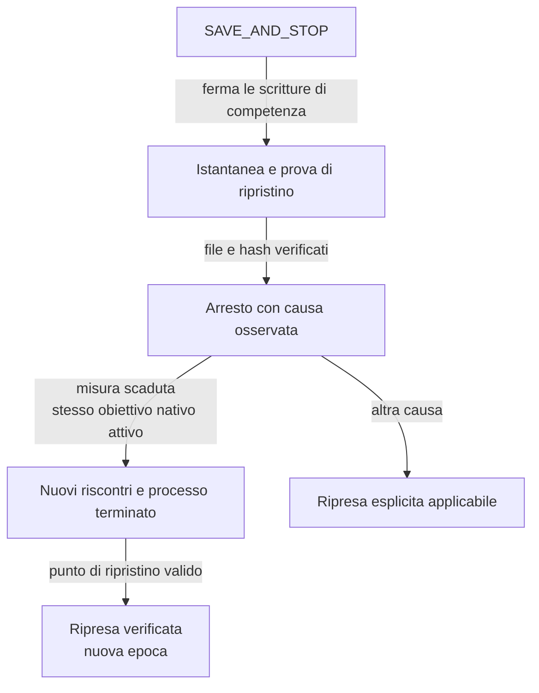

# Architettura e orchestrazione

AGWF rende visibili due responsabilità. L’utente e gli strumenti nativi di Codex stabiliscono l’ambito autorizzato, l’obiettivo e ciò che è accaduto. Il candidato Python verifica i riscontri ricevuti e gestisce i cambiamenti di stato locali. Un record JSON valido non autentica in modo indipendente la sua fonte.

## Componenti e responsabilità

Il candidato verifica il manifest con l’hash conservato all’esterno e controlla il punto di ingresso supportato prima di legare il pacchetto al progetto e all’esecuzione. Il motore conserva attività, responsabilità, protezioni contro il riuso degli eventi, stato delle autorizzazioni e metadati delle istantanee. Un registro di coordinamento conserva gli esiti incerti o in sospeso. Il monitor segue un percorso separato per i rilevamenti. I controlli completi del pacchetto si eseguono in occasione delle misurazioni e dei comandi. I segnali periodici verificano solo i dati di appartenenza e controllo.

Il candidato avvia il monitor. L’agente principale ricava dall’host anche le osservazioni sull’obiettivo e l’inventario dei sottoagenti. Il monitor mantiene il lease dell’esecuzione e dell’epoca e non può leggere direttamente l’uso da Codex.

| Responsabilità | Fonte |
| --- | --- |
| Hash esterno, verifica delle dipendenze, attivazione e ciclo di vita del processo | [Candidato](../../../../skills/agent-workflow-v1-1/scripts/candidate.py), [associazione al pacchetto](../skills/agent-workflow-v1-1/references/coexistence.md) |
| Autorizzazione, assegnazione dei file, preparazione dell’invio, controlli di output e punti di ripristino | [Motore del flusso di lavoro](../../../../skills/agent-workflow-v1-1/scripts/workflow.py), [specifica dei comandi](../skills/agent-workflow-v1-1/references/commands.md) |
| Misura d’uso, protezione dal riuso, segnale periodico, lease e decisione di arresto | [Monitor](../../../../skills/agent-workflow-v1-1/private/limit-watcher/scripts/monitor.py), [rilevamenti nativi](../skills/agent-workflow-v1-1/references/native-usage.md) |
| Preparazione delle sessioni e controllo delle osservazioni del ciclo di vita | [Strumento di verifica](../../../../tooling/run-lifecycle-check.py), [guida al ciclo di vita](lifecycle-check.md) |

## Chi passa cosa e a chi?

L’agente principale invia l’incarico tramite Codex tra la preparazione e l’acquisizione della ricevuta. Il risultato controllato torna quindi all’agente principale.

L’agente principale può occuparsi da solo di una piccola attività. Per lavori più grandi il coordinatore può proporre una suddivisione. L’architetto, l’implementatore e il ricercatore svolgono incarichi circoscritti. Il revisore può controllare i risultati in modo indipendente. Il pacchetto include le [definizioni dei ruoli](../../../../skills/agent-workflow-v1-1/roles) e i relativi file di istruzioni. L’agente principale usa il modello e il livello di ragionamento che l’utente ha scelto. Le impostazioni preparate sono distinte dalle impostazioni effettive osservate presso il fornitore.

Se l’esito di un invio è incerto, l’agente principale confronta gli argomenti preparati e la sessione effettiva con un inventario recente prima di valutare un nuovo invio. Lo stato terminale chiarisce che l’esecuzione è finita. Il risultato deve ancora essere controllato. Un revisore indipendente indica la revisione e l’hash esatti dell’output. Una modifica successiva del file invalida l’oggetto della revisione precedente. [Accettazione e passaggio di consegne](../skills/agent-workflow-v1-1/references/context.md).

## Che cosa rimane dopo un arresto?

Le istantanee contengono i percorsi modificati indicati, le registrazioni delle eliminazioni, i file assegnati alle attività e lo stato locale. Lo strumento ripristina i dati in una nuova directory e confronta gli hash. Un punto di ripristino cambiato o incompleto va riconciliato con lo stato reale. Il programma ausiliario non cambia lo stato dell’obiettivo nativo. L’agente principale può leggerlo o aggiornarlo con gli strumenti Codex quando l’attività lo autorizza.

La ripresa tecnica qui illustrata vale per un flusso associato che soddisfa i requisiti e per il quale è stata registrata la scadenza di un rilevamento d’uso. Richiede lo stesso obiettivo, già autorizzato e ancora attivo, e osservazioni reali dopo l’arresto. Un’esecuzione di solo monitoraggio manuale segue la procedura di continuazione esplicita o di transizione nativa verificata. Consulta le [regole di avvio, arresto e ripresa](../skills/agent-workflow-v1-1/references/operations.md) per stabilire quale procedura si applica.
