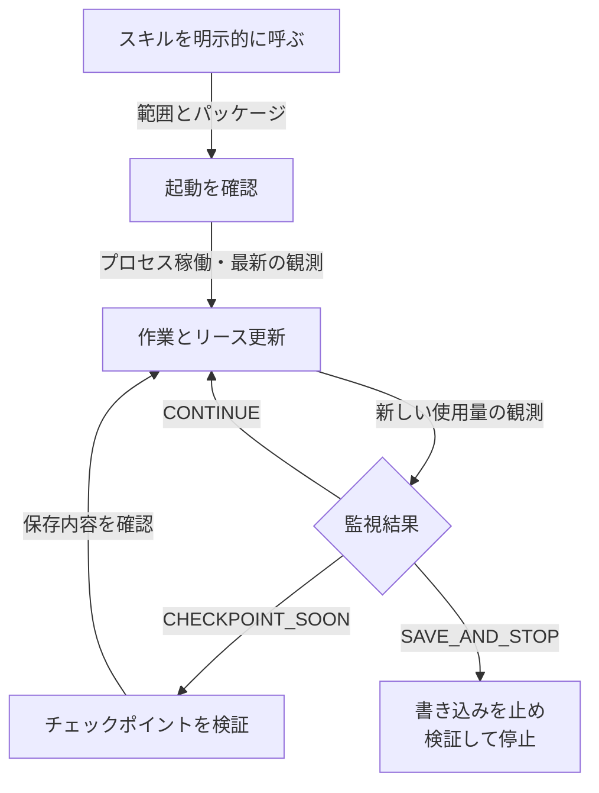

<a name="agwf--agent-workflow-for-codex"></a>

# AGWF · Codex のタスク進行を管理

**長時間の Codex タスクを調整し、何を検証したかを記録します。次のセッションはチェックポイントを確認してから作業を再開できます。**

[English](../../../README.md) · [Türkçe](../tr/README.md) · [简体中文](../zh-Hans/README.md) · [Español](../es/README.md) · [日本語](README.md) · [Français](../fr/README.md) · [Deutsch](../de/README.md) · [Italiano](../it/README.md) · [Русский](../ru/README.md) · [한국어](../ko/README.md)

[インストールと検証](docs/installation.md) · [アーキテクチャと調整](docs/architecture.md) · [ライフサイクルのコマンド](docs/lifecycle-check.md) · [変更履歴](CHANGELOG.md)

> 保守担当者が Codex に変更と動作確認を依頼します。担当エージェントが指定ファイルを編集し、検証担当が成果物と証拠を確認します。作業中に使用量の観測期限が切れると AGWF が停止を求めます。チェックポイントには変更ファイルとハッシュが保存されます。次のセッションはそれを照合し、続行できるかを判断します。

<a name="what-is-it"></a>

## どんなツールですか？

AGWF は明示的に呼び出す Codex スキルと Python 3.11+ の実行ツールです。誰が実行を許可したか、どのプロジェクトとパッケージに紐付くか、ファイルの書き込み担当、実際に送信した割り当て、成果物の受け入れ根拠を記録します。呼び出し名は `$agent-workflow-v1-1`、表示名は **agent-workflow-v1.1**、パッケージのバージョンは **1.1** です。

メインの Codex エージェントが判断とネイティブツールの呼び出しを行います。Python ヘルパーは与えられた証拠を確認し、実行とタスクの状態遷移を記録します。モデルを使わない監視プロセスが使用量の鮮度、プロセス ID、ハートビート、リースを確認します。チェックポイントや停止を求められたときに対応するのはメインエージェントです。

<a name="why-does-it-exist"></a>

## なぜ作られたのですか？

長いセッションでは、エージェントがファイルを書いた後、検証前に中断することがあります。終了状態だけでは結果が正しいか分かりません。返答がなかった割り当てを繰り返すと、同じファイルを二つのエージェントが書きかねません。再開時には、最後に保存した後でファイルが変わっていることもあります。

AGWF はこれらを区別できる記録を残します。承認済みパッケージとプロジェクトに実行を紐付け、割り当て前にファイル担当を確認し、実際の受領記録を残します。割り当て結果が不明なら、Codex の一覧と照合するまで未解決です。チェックポイントは変更・削除とワークフロー状態を記録し、別ディレクトリへの復元を試してから受け入れます。

<a name="what-can-i-use-it-for"></a>

## 何に使えますか？

| 作業 | AGWF が記録・確認すること | 確認できること |
| --- | --- | --- |
| 大きなタスクをメインのチャットで作業する | 実行の識別情報と、許可された場合のネイティブ目標・使用量の証拠 | ヘルパーと監視が実際に稼働しているか。小さな作業はメインで扱えます。 |
| コード、調査、執筆を分担する | 依存関係、正確なプロジェクト相対書き込みパス、入力ハッシュ、ロール、容量、実際の割り当て | 各ファイルの担当と、結果不明の割り当てをどう解決できるか。 |
| 独立レビューを要求する | 終了したエージェントの一覧、出力ハッシュ、審査対象の証拠 | レビューしたファイルと受け入れるファイルが同じか。 |
| 安全に停止し、後で戻る | 検証済みのスナップショット、停止の実原因、新たな観測 | 保存データが一致し、停止理由が再開を許すか。 |
| 許可済み作業の監視だけを行う | 手動監視、ネイティブ使用量観測、サンプルとリース | 監視が正常か。ネイティブ目標を作ったり有効にしたりはしません。 |
| 引き継ぎや実行後の使用量分析 | 参照元を固定した読み取り専用の要約、選択したログ範囲からの集計 | 引き継いだ保留事項と証拠、記録が裏付けるトークン数や時間。 |

<a name="how-it-works"></a>

## 仕組み

監視プロセスが保存や停止を求めたときに、メインエージェントが取る手順です。



- **パッケージと実行の識別。** 呼び出し側は変更可能なパッケージの外に保存したマニフェストハッシュを指定します。candidate はマニフェストと依存関係を検証し、プロジェクト、パッケージ、実行 ID を紐付けます。変更後のハッシュを計算し直しても承認の証拠にはなりません。
- **割り当てと受け入れ。** ヘルパーが範囲を限定した割り当てを用意し、Codex が実際に送信します。メインエージェントが返ったセッション情報と記録を保存します。終了後も成果物を検証します。独立レビューは記録済み出力ハッシュを基準にします。
- **観測の鮮度とプロセス所有。** ハートビートは使用量を更新しません。メインエージェントは動的な期限前に新たに測定し、リースを延長します。既定では残り 25% でチェックポイント、20% または早期停止信号で停止を求めます。
- **停止理由に応じた復旧。** `usage_receipt_expired` が記録され、同じ許可済みのネイティブ目標がまだ有効なら、技術復旧を行える場合があります。チェックポイントが変わっていないこと、所有プロセスが終了したこと、停止後の観測が新しいことを確認します。早期停止、枠の枯渇、ユーザーの停止指示は別の続行条件に従います。監視のみの実行も独自の明示的な続行手順に従います。
- **証拠の個別確認。** コンテキスト生成はタスクと阻害要因を要約し、完全なログを複製せず参照を残します。使用量抽出は固定した範囲の応答を重複なく数え、欠けた範囲と限定したメタデータを報告します。測るのは記録された使用量です。請求やキャッシュ、時間短縮には別の根拠が必要です。

[アーキテクチャ](docs/architecture.md)では、構成要素、割り当てと審査時に受け渡す情報、停止後の判断を分けています。[運用ガイド](skills/agent-workflow-v1-1/references/operations.md)にはコマンド別の証拠をまとめています。

<a name="get-started"></a>

## はじめに

[インストール](docs/installation.md)を参照し、candidate をビルドして別に保持したマニフェストハッシュで検証してください。使い捨てのプロジェクトで初回検証できます。この手順はパッケージと実行の紐付けを確認します。ワークフロー、監視、ネイティブ目標は開始しません。

Codex で実際の作業を開始するときは `$agent-workflow-v1-1` を明示的に呼び、範囲を伝えます。

> $agent-workflow-v1-1 — このプロジェクトで失敗している回帰テストを調べ、修正範囲を限定して検証してください。停止が必要ならチェックポイントを残し、独立レビューは必要に応じて行ってください。

実際の起動には最新の使用量観測と範囲に合う許可が必要です。[使用量の記録形式](skills/agent-workflow-v1-1/references/native-usage.md)。

<a name="technical-guides"></a>

## 技術ガイド

| ガイド | 内容 |
| --- | --- |
| [インストールと検証](docs/installation.md) | ビルド、手動・エージェント経由の導入、隔離検証、更新、削除時のデータ保護 |
| [アーキテクチャと調整](docs/architecture.md) | Codex と Python の担当、ファイル所有と理由別の復旧 |
| [ライフサイクルの確認](docs/lifecycle-check.md) | 実観測を用いた準備と実行、計時で分かること |
| [コマンド仕様](skills/agent-workflow-v1-1/references/commands.md) | 型付き入力、コマンド、JSON とエラー |
| [運用](skills/agent-workflow-v1-1/references/operations.md) | 起動、割り当て、照合、検証、保存、停止、再開 |
| [コンテキストと受け入れ](skills/agent-workflow-v1-1/references/context.md) | 必要な範囲だけの引き継ぎと、出力ハッシュに紐付けたレビュー |
| [使用量の測定](skills/agent-workflow-v1-1/references/measurement.md) | トークン数・時刻の測定範囲と欠落 |
| [パッケージの紐付け](skills/agent-workflow-v1-1/references/coexistence.md) · [移行](skills/agent-workflow-v1-1/references/migration.md) | インストールされたパッケージの検証と不変な以前の実行の保存 |

<a name="updates-and-data"></a>

## 更新とデータ

管理下のインストールの更新は、受け入れた外部ハッシュと `--update` を使います。更新前に所有プロセスが終了したことを確認します。更新しても以前の実行は変わりません。新しいパッケージには新しい実行 ID を使用し、以前のチェックポイント、紐付け、受領記録は元の識別情報で保管してください。

実行状態の配置は通常 `.agent-workflow-v1-1/runs/<run-id>` です。使用量、目標、割り当て、ローカル報告は公開対象から外します。恒久のロールバック用アーカイブやアンインストールコマンドはありません。[インストールとデータの保護](docs/installation.md)。

<a name="verification"></a>

## 検証

ルートから Python のテストを実行します。

```powershell
python -X utf8 -B -m unittest discover -s skills/agent-workflow-v1-1/tests
python -X utf8 -B -m unittest discover -s tooling/tests
```

この文書用の Windows 隔離実行では、ワークフロー 303 件とツール 124 件に合格しました。型付き権限、紐付け、観測の鮮度と再利用、出力ハッシュ、実際のプロセス所有、チェックポイント、インストール、ファイル共有を確認します。ホスト観測は合成です。受動的な CLI 検証はパッケージに限られ、実環境の Continue、Remote、プロバイダー識別や実測十秒を証明するものではありません。[ライフサイクルの確認](docs/lifecycle-check.md)。

<a name="project-files"></a>

## プロジェクトのファイル

| パス | 担当 |
| --- | --- |
| [`skills/agent-workflow-v1-1/SKILL.md`](skills/agent-workflow-v1-1/skill-guide.md) | 明示的な呼び出しとメインの指示 |
| [`skills/agent-workflow-v1-1/scripts/`](../../../skills/agent-workflow-v1-1/scripts) | マニフェストで固定した入口、状態機械と調整コマンド |
| [`skills/agent-workflow-v1-1/private/limit-watcher/`](../../../skills/agent-workflow-v1-1/private/limit-watcher) | モデル不要の監視と任意の助言担当 |
| [`skills/agent-workflow-v1-1/roles/`](../../../skills/agent-workflow-v1-1/roles) | ロールの方針、コンテキスト記録、モデル設定 |
| [`tooling/`](../../../tooling) | 再現可能なビルド、環境と成果物の確認、ライフサイクルのハーネス |
| [`docs/`](../..) | インストール、アーキテクチャ、ライフサイクル、過去の保守記録 |

<a name="license-and-contributions"></a>

## ライセンスと貢献

この作業コピーにライセンスファイルはありません。既存バージョンの記録は[変更履歴](CHANGELOG.md)を参照してください。変更を提案するときは、実際に確認したコマンド、該当パッケージや実行の範囲、まだ未検証のホスト連携を示してください。
