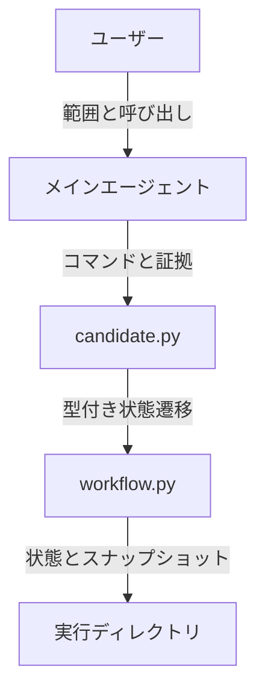
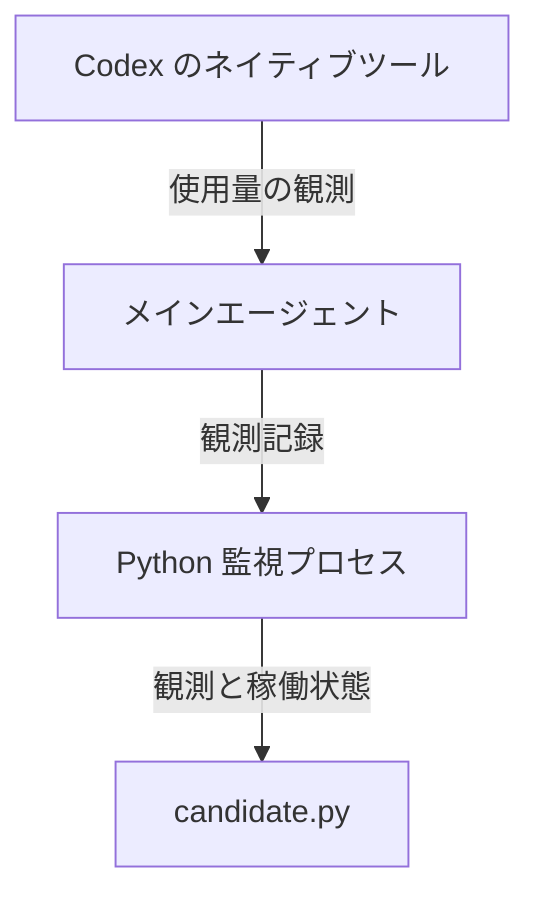
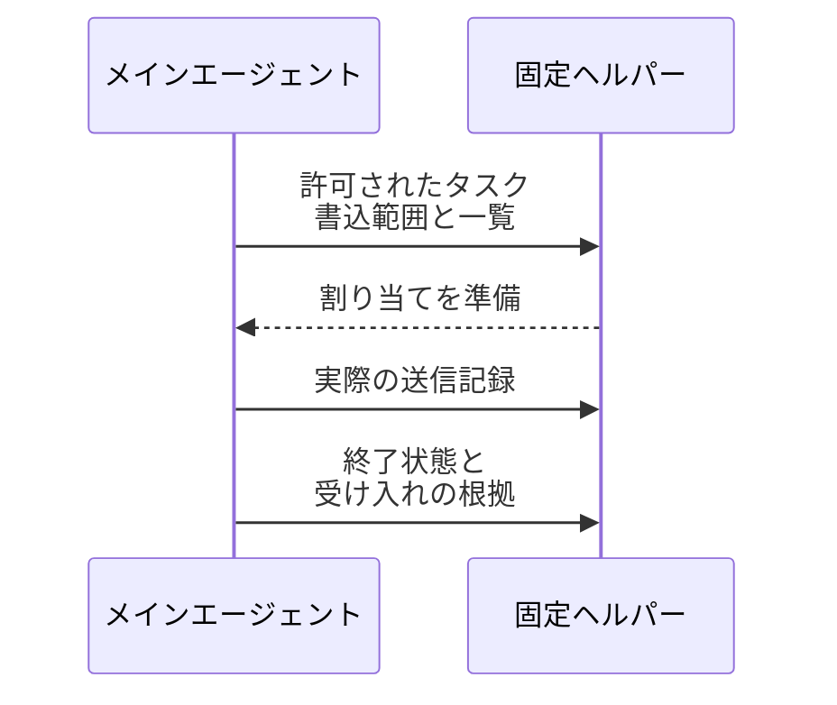
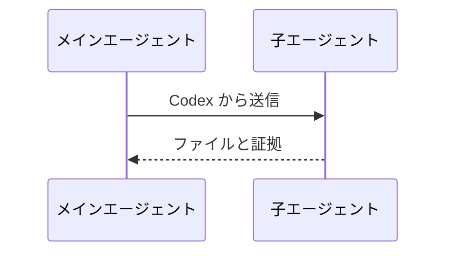
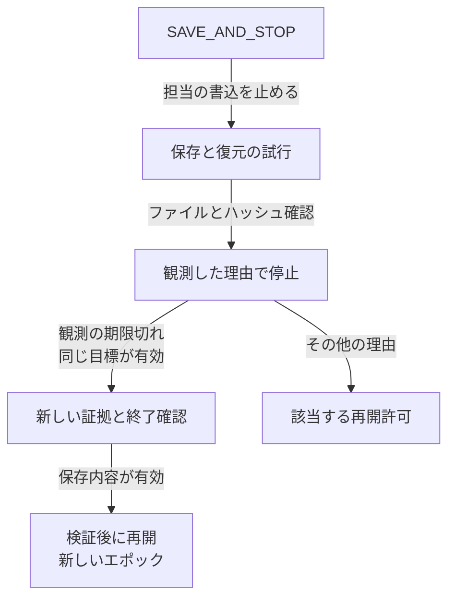

# アーキテクチャとタスクの調整

ユーザーが範囲を許可し、Codex のネイティブツールが目標や実際の出来事を示します。Python の candidate は与えられた証拠を検証し、ローカルの状態遷移を管理します。形式が正しい JSON でも、出所まで確認できたとは限りません。

## コンポーネントと担当範囲

candidate は外部に保管したマニフェストハッシュと入口を検証してから、パッケージをプロジェクトと実行に紐付けます。コアはタスク、ファイル担当、再利用防止、承認の状態、スナップショット情報を保持します。調整ジャーナルには未決の処理や結果不明の操作が残ります。監視には別の証拠経路があります。コマンドと測定の境界でパッケージ全体を、ハートビートでは小さな所有・制御情報を検証します。

candidate が監視プロセスを起動します。メインエージェントは目標と子エージェントの一覧も Codex から取得します。監視は実行とエポックのリースを管理しますが、Codex 使用量を直接は取得できません。

| 境界 | ソースと参照先 |
| --- | --- |
| 外部ハッシュ、依存関係、起動とプロセス終了 | [candidate](../../../../skills/agent-workflow-v1-1/scripts/candidate.py)、[パッケージの紐付け](../skills/agent-workflow-v1-1/references/coexistence.md) |
| 承認、ファイル担当、割り当て準備、成果物とチェックポイント | [ワークフローコア](../../../../skills/agent-workflow-v1-1/scripts/workflow.py)、[コマンド仕様](../skills/agent-workflow-v1-1/references/commands.md) |
| 使用量、再利用、ハートビート、リース、停止判断 | [監視プロセス](../../../../skills/agent-workflow-v1-1/private/limit-watcher/scripts/monitor.py)、[ネイティブ使用量の記録](../skills/agent-workflow-v1-1/references/native-usage.md) |
| セッション準備とライフサイクル観測の確認 | [ライフサイクルツール](../../../../tooling/run-lifecycle-check.py)、[操作ガイド](lifecycle-check.md) |

## 誰が何を受け渡すか

値を準備してから送信記録を残すまでの間に、Codex のツールで実際の割り当てを送ります。成果物と証拠はメインエージェントが受け取ります。

小さな作業はメインエージェントが担当できます。大きな仕事ではコーディネーターが担当範囲を提案します。アーキテクト、実装担当、調査担当は区切られたタスクを受け持ち、検証担当は成果物を独立に確認できます。パッケージには[ロール定義](../../../../skills/agent-workflow-v1-1/roles)と指示ファイルがあります。メインエージェントのモデルと推論レベルはユーザーが選びます。準備した設定と実際にプロバイダー上で観測した設定は別の証拠です。

割り当ての結果が不明なときは、準備した引数と実際のセッションを最新一覧と照合します。終了状態で実行の不確かさが解消しても、成果物の正しさは別に確認します。独立した検証者は対象のリビジョンと出力ハッシュを固定します。後からファイルが編集された場合、以前の審査はその変更後のファイルに適用できません。[受け入れと引き継ぎ](../skills/agent-workflow-v1-1/references/context.md)。

## 停止後に何を復元できるか

スナップショットには指定の変更パス、削除記録、担当ファイルとローカル状態が入ります。新しいディレクトリに試しに復元し、ハッシュを照合します。チェックポイントが不完全または変更されていれば、先に矛盾を解決します。ヘルパーはネイティブ目標の状態を変更しません。許可されているときにメインエージェントが Codex ツールで参照や変更を行います。

図の技術的な復旧は、使用量の観測期限切れを記録した、目標に紐付いたワークフローに適用できます。許可された同じ目標が有効なままで、停止後の実観測が必要です。監視だけの実行には明示の続行許可または検証済みのネイティブ遷移が必要です。判断前に[起動、停止、復旧の手順](../skills/agent-workflow-v1-1/references/operations.md)を確認してください。
