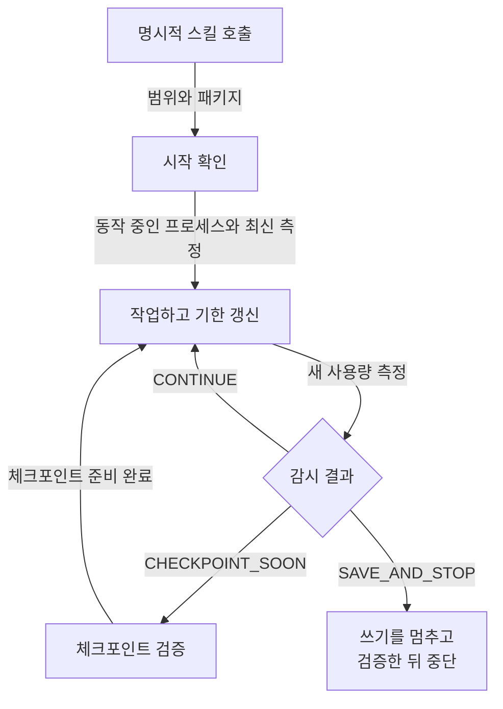

<a name="agwf--agent-workflow-for-codex"></a>

# AGWF · Codex 작업 조율

**Codex에서 오래 걸리는 작업을 조율하고, 실제로 무엇을 검증했는지 확인하고, 다음 세션이 재개 전에 점검할 수 있는 체크포인트를 남기세요.**

[English](../../../README.md) · [Türkçe](../tr/README.md) · [简体中文](../zh-Hans/README.md) · [Español](../es/README.md) · [日本語](../ja/README.md) · [Français](../fr/README.md) · [Deutsch](../de/README.md) · [Italiano](../it/README.md) · [Русский](../ru/README.md) · [한국어](README.md)

[설치 및 검증](docs/installation.md) · [아키텍처와 오케스트레이션](docs/architecture.md) · [수명 주기 명령](docs/lifecycle-check.md) · [변경 이력](CHANGELOG.md)

> **일반적인 실행 예시.** 프로젝트 관리자가 Codex에 변경을 요청하고 결과도 확인해 달라고 합니다. 한 에이전트가 배정된 파일을 책임지고, 검토자는 완성된 파일과 근거를 받습니다. 작업 중 사용량 측정값의 유효 기간이 지나면 AGWF가 중단을 요청합니다. 체크포인트에는 변경된 파일과 해시가 남습니다. 다음 세션은 이 체크포인트를 점검한 뒤 실행을 재개할 수 있는지 판단합니다.

<a name="what-is-it"></a>

## AGWF란 무엇인가요?

AGWF는 명시적으로 호출하는 Codex 스킬과 Python 3.11 이상의 런타임으로 구성됩니다. 누가 실행을 승인했는지, 어느 패키지와 프로젝트에 속하는지, 각 파일에 누가 쓸 수 있는지, Codex가 어떤 작업을 실제로 배정했는지, 결과를 받아들이는 근거가 무엇인지 기록합니다. 호출 이름은 `$agent-workflow-v1-1`, 표시 이름은 **agent-workflow-v1.1**, 패키지 버전은 **1.1**입니다.

주 에이전트가 판단하고 Codex의 기본 도구를 호출합니다. Python 보조 프로그램은 전달된 근거를 검사하고 실행과 작업의 상태 전이를 기록합니다. 백그라운드 감시 프로세스는 모델을 사용하지 않습니다. Codex 사용량 측정값의 유효성, 프로세스 식별자, 상태 신호, 실행 유지 기한을 확인합니다. 감시 프로세스가 체크포인트나 중단을 요청하면 주 에이전트가 그 결정을 실행합니다.

<a name="why-does-it-exist"></a>

## 왜 만들었나요?

오래 진행되는 세션은 에이전트가 파일을 수정한 뒤 다른 사람이 검토하기 전에 끊길 수 있습니다. 에이전트가 작업을 마쳤다는 상태만으로는 산출물이 올바른지 알 수 없습니다. 시간 초과로 결과를 모르는 작업 배정을 그대로 반복하면 두 에이전트가 같은 파일에 쓸 수 있습니다. 사용량 때문에 멈췄다가 돌아오면 마지막 체크포인트 이후에 손댄 파일이 있을 수 있습니다.

AGWF는 이 상황들을 구별하는 데 필요한 정보를 남깁니다. 실행을 승인된 패키지와 프로젝트에 묶고, 배정하기 전에 파일별 쓰기 권한을 확인하며, 실제 도구 호출 기록을 저장합니다. 배정 결과가 불확실하면 Codex의 세션 목록으로 확인할 때까지 미해결 상태로 둡니다. 체크포인트에는 변경 파일, 삭제 기록, 워크플로 상태가 들어갑니다. 별도 디렉터리에서 복원을 시험한 뒤 체크포인트를 승인합니다.

<a name="what-can-i-use-it-for"></a>

## 어디에 쓸 수 있나요?

| 작업 | AGWF가 기록하거나 검사하는 것 | 확인할 수 있는 것 |
| --- | --- | --- |
| 중요한 작업을 주 채팅에서 진행 | 실행 식별자와 명시적으로 승인된 경우 Codex 목표 및 사용량 근거 | 보조 프로그램과 감시 프로세스가 실제로 동작하는지 확인합니다. 작은 작업은 주 에이전트가 맡을 수 있습니다. |
| 개발, 조사, 문서 작업을 나눠 수행 | 의존 관계, 프로젝트 기준의 정확한 쓰기 경로, 입력 해시, 역할, 실행 가능 슬롯, 실제 배정 요청 | 각 산출물의 담당자와 불확실한 배정 결과를 안전하게 확인할 수 있는지 알 수 있습니다. |
| 독립 검토 진행 | 종료 상태가 관측된 에이전트 목록, 산출물 해시, 검토 대상을 지정하는 근거 | 검토한 파일과 실제로 승인할 파일이 같은지 확인합니다. |
| 안전하게 멈췄다가 다시 시작 | 검증된 스냅샷, 감시 프로세스가 기록한 실제 중단 사유, 새로운 관측값 | 이전 체크포인트가 현재 파일과 일치하는지, 해당 사유로 재개할 수 있는지 확인합니다. |
| 전체 오케스트레이션 없이 승인된 작업 감시 | 수동 감시 실행, Codex 사용량 측정 기록, 측정값, 실행 유지 기한 | 감시 프로세스가 정상인지 확인합니다. 이 모드는 Codex 목표를 생성하거나 활성화하지 않습니다. |
| 진행 중인 작업을 인계하거나 실행 후 사용량 분석 | 출처 해시가 지정된 읽기 전용 요약 또는 명시적으로 선택한 대화 기록 범위의 사용량 합계 | 인계 후 남는 장애 요인과 근거, 기록으로 뒷받침되는 토큰 수와 시간을 확인합니다. |

<a name="how-it-works"></a>

## 어떻게 동작하나요?

이 그림은 감시 프로세스가 작업 보존이나 중단을 요청했을 때 주 에이전트가 어떻게 대응하는지 보여 줍니다.



- **패키지와 실행의 식별 정보.** 호출자는 변경 가능한 패키지 밖에 보관한 매니페스트 해시를 제공합니다. 후보 프로그램은 매니페스트와 의존성을 검증한 뒤 프로젝트, 패키지, 실행 ID를 연결합니다. 변경된 매니페스트의 해시를 다시 계산해도 승인이 입증되지는 않습니다.
- **작업 배정과 결과 승인.** 보조 프로그램은 범위가 정해진 작업 요청을 준비합니다. Codex가 실제로 에이전트를 시작하고 식별자와 호출 기록을 반환합니다. 작업이 끝나도 산출물은 따로 확인합니다. 독립 검토가 필요하면 검토자는 기록된 산출물 해시를 기준으로 작업합니다.
- **최신 측정값과 해당 실행의 프로세스.** 정상 상태 신호가 들어와도 사용량 측정값은 갱신되지 않습니다. 주 에이전트가 상황에 따라 정해진 기한 전에 새 사용량을 측정하고 실행 유지 기한을 연장해야 합니다. 기본 규칙은 잔여량 25%에서 체크포인트를, 20% 또는 조기 중단 신호에서 중단을 요청합니다.
- **중단 사유에 따른 재개.** `usage_receipt_expired`가 기록됐다면 같은 승인된 Codex 목표가 계속 활성 상태인 경우 재개할 수 있습니다. 체크포인트가 그대로이고, 해당 실행의 프로세스가 모두 종료됐으며, 필요한 관측값이 최신이어야 합니다. 조기 중단, 한도 소진, 사용자의 명시적 중단에는 각기 다른 재개 조건이 있습니다. 수동 감시만 실행한 경우에는 별도의 명시적 재개 절차를 따릅니다.
- **근거는 따로 살펴볼 수 있습니다.** 컨텍스트 도구는 진행 중인 작업을 요약하면서 근거와 장애 요인의 참조를 보존합니다. 전체 로그를 복사하지 않습니다. 사용량 추출기는 해시로 고정된 입력 범위에서 고유 응답을 세고, 누락 범위를 드러내고, 정해진 범위의 메타데이터 보고서를 만듭니다. 여기서 측정하는 것은 기록에 남은 사용량입니다. 청구액, 캐시 효과, 시간 절약을 확인하려면 각각의 근거가 필요합니다.

[아키텍처 안내서](docs/architecture.md)는 구성 요소, 작업 배정과 검토 사이의 메시지, 재개 판단을 따로 설명합니다. [운영 안내서](skills/agent-workflow-v1-1/references/operations.md)에서 명령마다 어떤 근거가 필요한지 확인할 수 있습니다.

<a name="get-started"></a>

## 시작하기

[설치 안내서](docs/installation.md)에 따라 후보 패키지를 빌드하고 따로 보관한 매니페스트 해시로 확인하세요. 첫 검사는 임시 프로젝트에서 실행할 수 있습니다. 패키지와 실행 연결을 확인하며 워크플로를 활성화하거나 감시 프로세스를 시작하거나 Codex 목표를 만들지 않습니다.

Codex에서 실제 작업을 시작하려면 `$agent-workflow-v1-1`을 명시적으로 선택하고 범위를 설명하세요. 예를 들어 다음과 같이 요청할 수 있습니다.

> $agent-workflow-v1-1 — 이 프로젝트에서 실패하는 회귀 테스트의 원인을 찾아 필요한 부분만 고치고 확인해 줘. 실행을 중단해야 하면 체크포인트를 남겨 줘. 결과에 독립 검토가 필요할 때만 별도 검토자를 써 줘.

이 문장은 호출 예시입니다. 워크플로를 시작하려면 새 Codex 사용량 측정 기록과 해당 작업의 승인 근거가 필요합니다. [Codex 측정 기록 형식](skills/agent-workflow-v1-1/references/native-usage.md).

<a name="technical-guides"></a>

## 기술 안내서

| 안내서 | 찾을 수 있는 내용 |
| --- | --- |
| [설치 및 검증](docs/installation.md) | 빌드, 수동 설치와 에이전트를 통한 설치, 격리 확인, 업데이트, 제거 시 데이터 보존 |
| [아키텍처와 오케스트레이션](docs/architecture.md) | Codex에서 실행하는 기능, Python의 검사 항목, 파일 담당자, 중단 사유에 따른 재개 |
| [수명 주기 검사](docs/lifecycle-check.md) | 실제 호스트 관측값으로 검사 도구를 준비하고 사용하는 법과 시간 측정의 한계 |
| [명령 명세](skills/agent-workflow-v1-1/references/commands.md) | 입력 타입, 지원 명령, JSON과 오류 처리 |
| [운영](skills/agent-workflow-v1-1/references/operations.md) | 활성화, 배정, 불확실한 결과 확인, 검증, 체크포인트, 중단, 재개 |
| [컨텍스트와 승인](skills/agent-workflow-v1-1/references/context.md) | 필요한 컨텍스트만 인계하고 독립 검토를 산출물 해시에 연결하는 법 |
| [사용량 측정](skills/agent-workflow-v1-1/references/measurement.md) | 범위가 정해진 토큰과 시간 지표, 기록의 누락 확인 |
| [패키지 연결](skills/agent-workflow-v1-1/references/coexistence.md) · [마이그레이션](skills/agent-workflow-v1-1/references/migration.md) | 설치 패키지 검사와 변경 불가능한 과거 실행 기록 보존 |

<a name="updates-and-data"></a>

## 업데이트와 데이터

설치 도구가 관리하는 설치본은 `--update`와 승인된 패키지의 외부 보관 해시를 사용해 업데이트합니다. 설치본을 변경하기 전에 해당 프로세스가 종료됐는지 확인하세요. 업데이트가 성공해도 이전 실행을 다시 연결하지 않습니다. 새 패키지는 새 실행 ID로 사용하고 이전 체크포인트, 연결 기록, 도구 호출 기록은 원래 식별자와 함께 보존하세요.

런타임 상태는 보통 `.agent-workflow-v1-1/runs/<run-id>`에 있습니다. 사용량, 목표, 작업 배정, 로컬 보고서 파일은 공개 대상에 포함하지 마세요. 설치 도구는 영구 롤백 아카이브나 제거 명령을 제공하지 않습니다. [설치와 데이터 보존](docs/installation.md).

<a name="verification"></a>

## 검증

저장소 루트에서 Python 테스트를 실행하세요.

```powershell
python -X utf8 -B -m unittest discover -s skills/agent-workflow-v1-1/tests
python -X utf8 -B -m unittest discover -s tooling/tests
```

이 문서를 위한 격리된 Windows 실행에서 워크플로 테스트 303개와 도구 테스트 124개가 통과했습니다. 테스트는 타입이 지정된 승인 정보, 실행 연결, 측정 기록의 유효 기간과 재사용, 산출물 해시, 실제 프로세스 소유권, 체크포인트 무결성, 설치, Windows 파일 공유를 다룹니다. 테스트의 호스트 관측값은 합성 데이터입니다. 수동 CLI 검사는 패키지 검증을 입증합니다. 실제 Codex Continue, Remote, 공급자 식별 정보, 실제 10초 시간 측정은 각각 별도의 관측이 필요합니다. [수명 주기 안내서](docs/lifecycle-check.md)에서 관측 범위를 확인하세요.

<a name="project-files"></a>

## 프로젝트 파일

| 경로 | 역할 |
| --- | --- |
| [`skills/agent-workflow-v1-1/SKILL.md`](skills/agent-workflow-v1-1/skill-guide.md) | 명시적 호출과 주 에이전트 지침 |
| [`skills/agent-workflow-v1-1/scripts/`](../../../skills/agent-workflow-v1-1/scripts) | 매니페스트 해시로 고정된 진입점, 워크플로 상태 머신, 조율 명령 |
| [`skills/agent-workflow-v1-1/private/limit-watcher/`](../../../skills/agent-workflow-v1-1/private/limit-watcher) | 모델을 쓰지 않는 감시 프로세스와 별도의 선택적 자문 역할 |
| [`skills/agent-workflow-v1-1/roles/`](../../../skills/agent-workflow-v1-1/roles) | 역할 정책, 참고용 메모리, 모델 설정 |
| [`tooling/`](../../../tooling) | 결정적 빌드, 환경 검사, 산출물과 수명 주기 검사 도구 |
| [`docs/`](../..) | 설치, 아키텍처, 수명 주기, 과거 유지보수 기록 |

<a name="license-and-contributions"></a>

## 라이선스와 기여

이 체크아웃에는 라이선스 파일이 없습니다. [변경 이력](CHANGELOG.md)에서 기존 버전 기록을 확인할 수 있습니다. 변경을 기록할 때 실제로 시험한 명령, 영향을 받는 패키지 또는 런타임 영역, 아직 확인이 필요한 호스트 동작을 적어 주세요.
