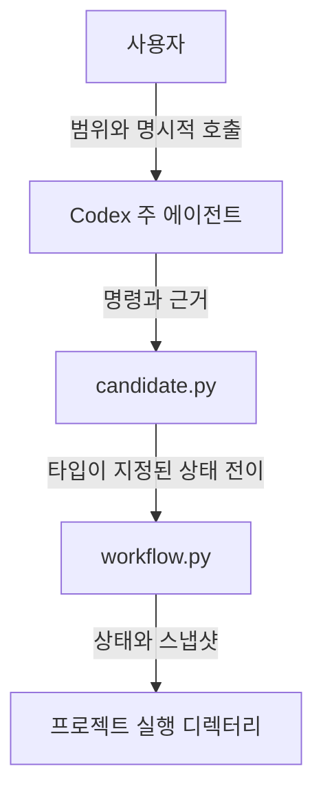
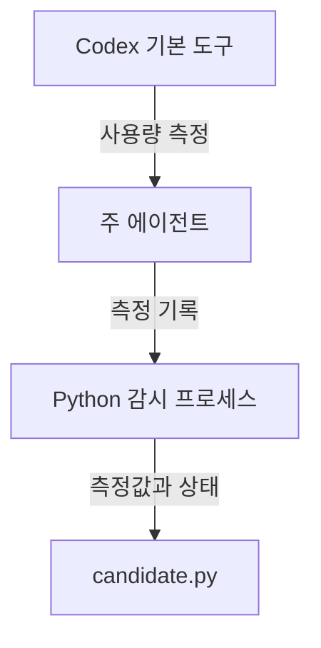
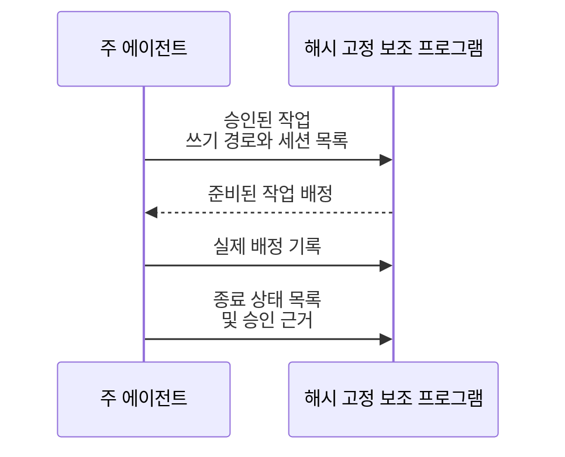
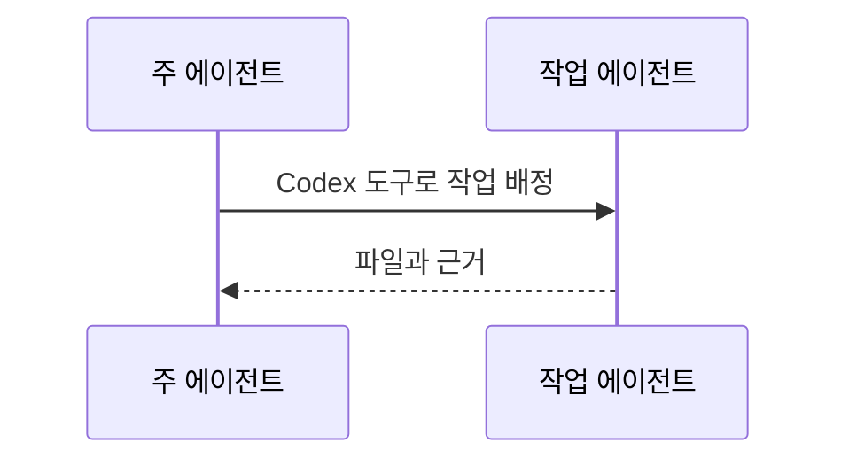
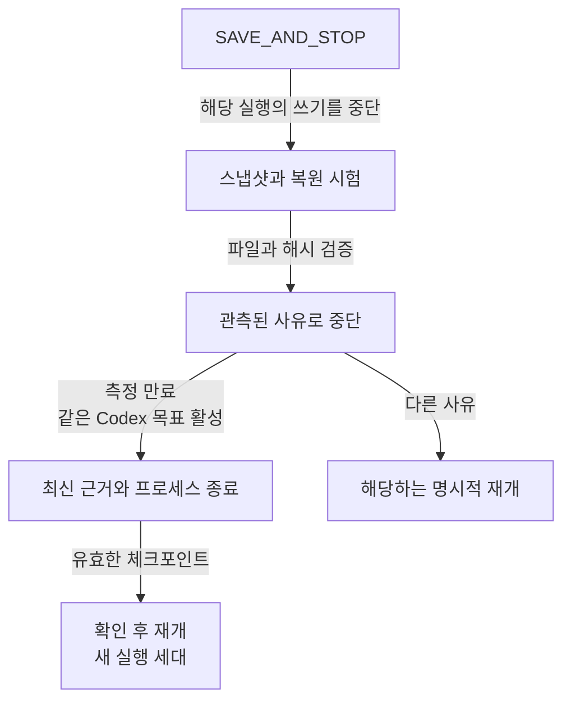

# 아키텍처와 오케스트레이션

AGWF는 누가 어떤 근거를 책임지는지 보여 줍니다. 사용자와 Codex 기본 도구는 승인된 범위, 목표, 실제로 발생한 일을 알려 줍니다. Python 후보 프로그램은 전달받은 근거를 검사하고 로컬 상태를 전이시킵니다. 올바른 JSON 레코드만으로는 그 출처가 독립적으로 인증되지 않습니다.

## 구성 요소와 소유권

후보 프로그램은 외부에 보관한 해시로 매니페스트를 검사하고, 지원되는 진입점을 확인한 뒤 패키지를 프로젝트 및 실행과 연결합니다. 코어에는 작업, 소유권, 재사용 방지, 승인 상태, 스냅샷 메타데이터가 저장됩니다. 조율 저널은 확정되지 않거나 대기 중인 결과를 기록합니다. 감시 프로세스는 별도의 경로로 근거를 받습니다. 명령이나 측정 경계에서 패키지 전체를 점검하고, 상태 신호는 소유권과 제어 기록만 확인합니다.

후보 프로그램이 감시 프로세스의 시작을 맡습니다. 주 에이전트는 호스트에서 목표 관측과 하위 에이전트 목록도 얻습니다. 감시 프로세스는 실행과 실행 세대의 유지 기한을 관리하며, Codex에서 사용량을 직접 읽을 수 없습니다.

| 담당 범위 | 출처 |
| --- | --- |
| 외부 해시, 의존성 검사, 활성화, 프로세스 수명 주기 | [후보 프로그램](../../../../skills/agent-workflow-v1-1/scripts/candidate.py), [패키지 연결](../skills/agent-workflow-v1-1/references/coexistence.md) |
| 승인, 파일 쓰기 권한, 배정 준비, 결과 검사 및 체크포인트 | [워크플로 코어](../../../../skills/agent-workflow-v1-1/scripts/workflow.py), [명령 명세](../skills/agent-workflow-v1-1/references/commands.md) |
| 사용량, 재사용 방지, 상태 신호, 유지 기한, 중단 결정 | [감시 프로세스](../../../../skills/agent-workflow-v1-1/private/limit-watcher/scripts/monitor.py), [Codex 측정 기록](../skills/agent-workflow-v1-1/references/native-usage.md) |
| 세션 준비와 수명 주기 관측 점검 | [검사 도구](../../../../tooling/run-lifecycle-check.py), [수명 주기 안내서](lifecycle-check.md) |

## 누가 누구에게 무엇을 전달하나요?

주 에이전트는 배정 준비와 도구 결과 기록 사이에 Codex로 작업을 보냅니다. 검사를 마친 결과는 주 에이전트에게 돌아옵니다.

작은 작업은 주 에이전트가 직접 맡을 수 있습니다. 큰 작업은 조율 담당자가 범위를 나눌 수 있습니다. 아키텍트, 구현 담당자, 조사 담당자는 범위가 정해진 작업을 맡고 검토자는 산출물을 독립적으로 확인할 수 있습니다. 패키지에 [역할 정의](../../../../skills/agent-workflow-v1-1/roles)와 프롬프트 파일이 들어 있습니다. 주 에이전트는 사용자가 정한 모델과 추론 강도를 사용합니다. 배정에서 요청한 설정과 공급자 측에서 실제로 관측한 설정은 별개입니다.

배정 결과가 불확실하면 주 에이전트는 무작정 재시도하기 전에 준비된 인자 및 실제 세션을 최신 세션 목록과 대조합니다. 작업 에이전트의 종료 상태를 보면 실행 여부가 확정됩니다. 산출물이 올바른지는 따로 확인해야 합니다. 독립 검토자는 산출물의 정확한 리비전과 해시를 참조합니다. 파일이 나중에 바뀌면 이전 검토 대상은 무효가 됩니다. [승인과 인계](../skills/agent-workflow-v1-1/references/context.md).

## 중단 뒤 무엇이 남나요?

스냅샷에는 명시한 변경 경로, 삭제 기록, 작업별 쓰기 경로, 로컬 상태가 들어갑니다. 도구가 새 디렉터리에 복원한 뒤 해시를 비교합니다. 체크포인트가 바뀌거나 불완전하면 실제 상태와 대조해 해결해야 합니다. 보조 프로그램은 Codex 목표 상태를 바꾸지 않습니다. 주 에이전트가 승인된 범위 안에서 Codex 도구로 목표를 조회하거나 갱신합니다.

그림의 기술 복구는 측정 기록 만료가 남아 있는, 재개 요건에 맞는 연결된 워크플로에 적용됩니다. 동일한 목표가 이미 승인됐고 여전히 활성 상태여야 하며, 중단 뒤의 실제 관측값이 필요합니다. 수동 감시만 사용한 실행에는 명시적 재개 또는 검증된 Codex 상태 전이 절차가 적용됩니다. 어떤 경로가 맞는지 [시작, 중단 및 재개 규칙](../skills/agent-workflow-v1-1/references/operations.md)에서 확인하세요.
