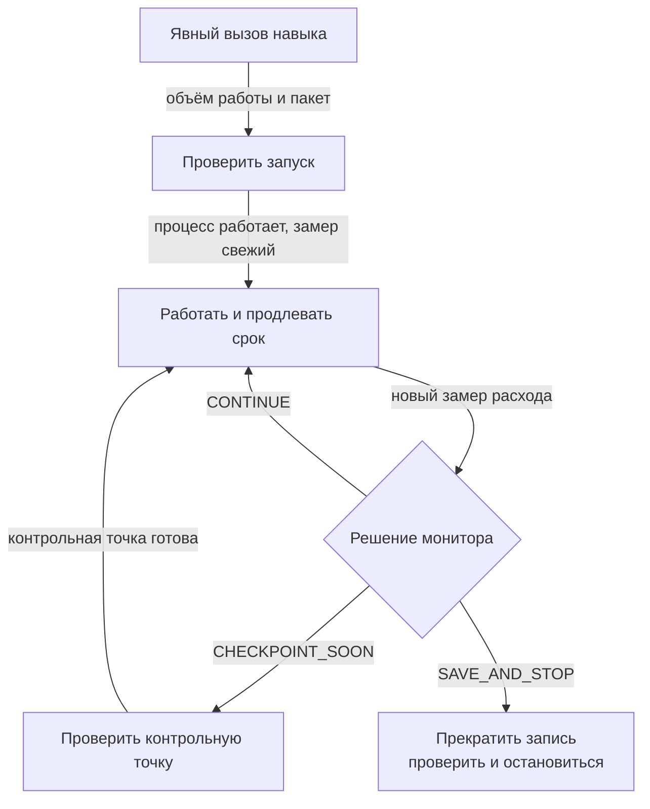

<a name="agwf--agent-workflow-for-codex"></a>

# AGWF · Координация задач в Codex

**Координируйте длительную работу в Codex, смотрите, что действительно проверили, и сохраняйте контрольную точку, которую следующая сессия сможет проверить перед продолжением.**

[English](../../../README.md) · [Türkçe](../tr/README.md) · [简体中文](../zh-Hans/README.md) · [Español](../es/README.md) · [日本語](../ja/README.md) · [Français](../fr/README.md) · [Deutsch](../de/README.md) · [Italiano](../it/README.md) · [Русский](README.md) · [한국어](../ko/README.md)

[Установка и проверка](docs/installation.md) · [Архитектура и оркестрация](docs/architecture.md) · [Команды жизненного цикла](docs/lifecycle-check.md) · [История изменений](CHANGELOG.md)

> **Типичный запуск.** Сопровождающий проекта просит Codex внести изменение и проверить результат. Один агент отвечает за назначенные ему файлы. Проверяющий получает готовые файлы и подтверждающие материалы. Если срок действия замера расхода истекает во время работы, AGWF требует остановиться. Контрольная точка сохраняет изменённые файлы и их хеши. Следующая сессия может проверить её перед тем, как решать, можно ли возобновить запуск.

<a name="what-is-it"></a>

## Что такое AGWF?

AGWF состоит из навыка Codex, который нужно вызвать явно, и среды выполнения на Python 3.11 или новее. Он фиксирует, кто разрешил запуск, к какому пакету и проекту он относится, кто может писать в каждый файл, какие задания Codex действительно передал на выполнение и чем обоснована приёмка результата. Команда вызова — `$agent-workflow-v1-1`, отображаемое имя — **agent-workflow-v1.1**, версия пакета — **1.1**.

Главный агент принимает решения и вызывает штатные инструменты Codex. Вспомогательная программа на Python проверяет полученные подтверждения и записывает изменения состояния запуска и задач. Фоновый монитор работает без модели. Он проверяет актуальность замера расхода, идентификатор процесса, сигнал активности и срок разрешения на работу. Монитор может потребовать сохранить контрольную точку или остановиться. За выполнение этого решения отвечает главный агент.

<a name="why-does-it-exist"></a>

## Зачем нужен проект?

Длительная сессия может прерваться, когда агент уже изменил файлы, а другой участник ещё не проверил их. Статус завершения агента ничего не говорит о правильности результата. Если повторить назначение после истечения времени ожидания, два агента могут начать писать в одни и те же файлы. При продолжении после остановки из-за расхода ресурсов можно столкнуться с файлами, которые изменились после последней контрольной точки.

AGWF фиксирует сведения, по которым можно различить эти ситуации. Он связывает каждый запуск с утверждённым пакетом и проектом, проверяет право записи перед назначением, сохраняет квитанции вызовов и оставляет назначение с неясным исходом открытым, пока перечень сессий Codex не прояснит ситуацию. Контрольная точка сохраняет изменённые файлы, записи об удалениях и состояние рабочего процесса. До приёмки контрольной точки восстановление пробуют в отдельном каталоге.

<a name="what-can-i-use-it-for"></a>

## Для чего его можно использовать?

| Задача | Что фиксирует или проверяет AGWF | Что можно проверить |
| --- | --- | --- |
| Вести значительную задачу в основном чате | Идентификатор запуска и, при явном разрешении, сведения о цели и расходе из штатных инструментов | Действительно ли активны вспомогательная программа и монитор. Небольшая задача может остаться у главного агента. |
| Разделить разработку, исследование или подготовку текста | Зависимости, точные пути записи относительно проекта, хеши входных данных, роли, доступные места и фактически отправленное назначение | Кто отвечает за каждый результат и можно ли безопасно прояснить исход неясного назначения. |
| Потребовать независимую проверку | Перечень агентов в конечных состояниях, хеши выходных файлов и подтверждения того, что именно проверяли | Проверял ли ревьюер именно те файлы, которые принимаются. |
| Безопасно остановиться и продолжить позже | Проверенный снимок, фактическую причину остановки монитора и новые наблюдения | Соответствует ли исходная контрольная точка текущим файлам и позволяет ли причина продолжить работу. |
| Наблюдать за разрешённой задачей без полной оркестрации | Ручной запуск монитора, штатные квитанции расхода, замеры и срок работы процесса | Исправен ли монитор. Этот режим не создаёт и не активирует цель Codex. |
| Передать текущую работу или измерить расход после запуска | Сводку контекста только для чтения с хешами источников либо итоги расхода по явно выбранным диапазонам журнала сессии | Какие препятствия и подтверждения сохранились при передаче и какие значения токенов и времени подтверждаются журналом. |

<a name="how-it-works"></a>

## Как это работает?

Диаграмма показывает решение, которое принимает главный агент по ходу работы. На ней видно, что происходит, когда монитор требует сохранить работу или остановиться.



- **Идентификаторы пакета и запуска.** Вызывающая сторона передаёт хеш манифеста, сохранённый отдельно от изменяемого пакета. Кандидат проверяет манифест и зависимости и связывает проект, пакет и идентификатор запуска. Новый хеш изменённого манифеста сам по себе не подтверждает одобрение.
- **Назначение и приёмка.** Вспомогательная программа готовит задание с ограниченным объёмом. Codex фактически запускает агента и возвращает его идентификатор и квитанцию вызова. После завершения работы агента проверяют его результат. Если требуется независимая проверка, ревьюер использует зарегистрированные хеши выходных файлов.
- **Актуальный замер и процесс запуска.** Сигнал активности не обновляет сведения о расходе. Главный агент должен сделать новый штатный замер до адаптивного срока и продлить разрешение на работу процесса. По умолчанию при 25 % остатка требуется контрольная точка. При 20 % или сигнале раннего резерва требуется остановка.
- **Продолжение зависит от причины остановки.** После остановки с зарегистрированным `usage_receipt_expired` можно возобновить работу в рамках той же разрешённой и всё ещё активной цели Codex. Контрольная точка должна быть неизменной, процессы этого запуска — завершёнными, а требуемые наблюдения — актуальными. Для раннего резерва, исчерпанной квоты и явной остановки пользователем действуют отдельные правила. При одном лишь ручном мониторинге применяется своя процедура явного продолжения.
- **Подтверждения можно изучать отдельно.** Средство подготовки контекста сводит текущие задачи и сохраняет ссылки на подтверждения и препятствия без копирования полных журналов. Анализатор расхода считает уникальные записи об ответах в закреплённых диапазонах, показывает пробелы и публикует ограниченный отчёт о метаданных. Он измеряет зарегистрированный расход. Начисления, преимущества кеша и экономия времени требуют отдельных подтверждений.

[Руководство по архитектуре](docs/architecture.md) отдельно показывает компоненты, обмен при назначении и проверке и принятие решения о продолжении. В [руководстве по эксплуатации](skills/agent-workflow-v1-1/references/operations.md) указано, какие подтверждения нужны каждой команде.

<a name="get-started"></a>

## Начало работы

По [руководству по установке](docs/installation.md) соберите и проверьте пакет-кандидат с сохранённым хешем манифеста. Первую проверку можно выполнить во временном проекте. Она проверяет пакет и привязку запуска, не активируя рабочий процесс, не запуская монитор и не создавая цель Codex.

Когда будете готовы начать работу, явно выберите `$agent-workflow-v1-1` в Codex и обозначьте объём задачи. Например, так.

> $agent-workflow-v1-1 — Разберись, почему в этом проекте не проходит регрессионный тест, внеси точечное исправление и проверь его. Сохрани контрольную точку, если придётся остановиться. Подключи отдельного проверяющего только при необходимости.

Это пример формулировки вызова. Для запуска процесса нужны актуальный штатный замер расхода и подтверждение соответствующего разрешения. [Формат штатных квитанций](skills/agent-workflow-v1-1/references/native-usage.md).

<a name="technical-guides"></a>

## Технические руководства

| Руководство | Что в нём можно узнать |
| --- | --- |
| [Установка и проверка](docs/installation.md) | Как собрать пакет, установить вручную или через агента, проверить изоляцию, обновить или сохранить данные при удалении |
| [Архитектура и оркестрация](docs/architecture.md) | Что выполняет Codex, что проверяет Python, кто отвечает за файлы и как причина остановки влияет на продолжение |
| [Проверка жизненного цикла](docs/lifecycle-check.md) | Как подготовить и использовать средство проверки с фактическими наблюдениями среды и понять ограничения замеров времени |
| [Спецификация команд](skills/agent-workflow-v1-1/references/commands.md) | Какие типы входных данных и команды поддерживаются и как обрабатываются JSON и ошибки |
| [Эксплуатация](skills/agent-workflow-v1-1/references/operations.md) | Как активировать запуск, назначать задачи, разбирать неясный исход, проверять, сохранять, останавливать и продолжать |
| [Контекст и приёмка](skills/agent-workflow-v1-1/references/context.md) | Как передать нужный контекст и связать независимую проверку с хешами результатов |
| [Измерение расхода](skills/agent-workflow-v1-1/references/measurement.md) | Как изучить подтверждённые значения токенов и времени и найти пробелы в данных |
| [Привязка пакета](skills/agent-workflow-v1-1/references/coexistence.md) · [Миграция](skills/agent-workflow-v1-1/references/migration.md) | Как проверить установленный пакет и сохранить неизменяемые записи прежних запусков |

<a name="updates-and-data"></a>

## Обновления и данные

Для обновления управляемой установки используйте установщик с `--update` и сохранённым отдельно хешем одобренного пакета. Перед изменением установки проверьте, что связанный с ней процесс завершился. Успешное обновление не привязывает старый запуск заново. С новым пакетом используйте новый идентификатор запуска. Храните прежние контрольные точки, привязки и квитанции с исходными идентификаторами.

Рабочее состояние обычно хранится в `.agent-workflow-v1-1/runs/<run-id>`. Данные о расходе, целях, назначениях и локальные отчёты не публикуйте. Установщик не предоставляет постоянного архива для отката и команды удаления. [Установка и сохранение данных](docs/installation.md).

<a name="verification"></a>

## Проверка

Запускайте тесты Python из корня репозитория.

```powershell
python -X utf8 -B -m unittest discover -s skills/agent-workflow-v1-1/tests
python -X utf8 -B -m unittest discover -s tooling/tests
```

В изолированной проверке под Windows для этой документации прошли 303 теста рабочего процесса и 124 теста инструментов. Они охватывают типизированные разрешения, привязку, срок действия и повторы квитанций, хеши выходных файлов, принадлежность реальных процессов, целостность контрольных точек, установку и совместный доступ к файлам Windows. Наблюдения среды в этих тестах синтетические. Пассивная проверка из командной строки подтверждает проверку пакета. Фактические Continue в Codex, Remote, сведения о поставщике и десятисекундный опыт на работающей системе требуют отдельных наблюдений. [Руководство по жизненному циклу](docs/lifecycle-check.md) описывает их границы.

<a name="project-files"></a>

## Файлы проекта

| Путь | Назначение |
| --- | --- |
| [`skills/agent-workflow-v1-1/SKILL.md`](skills/agent-workflow-v1-1/skill-guide.md) | Явный вызов и инструкции для главного агента |
| [`skills/agent-workflow-v1-1/scripts/`](../../../skills/agent-workflow-v1-1/scripts) | Точка входа с проверкой хеша манифеста, автомат состояний и команды координации |
| [`skills/agent-workflow-v1-1/private/limit-watcher/`](../../../skills/agent-workflow-v1-1/private/limit-watcher) | Монитор без модели и отдельная необязательная роль консультанта |
| [`skills/agent-workflow-v1-1/roles/`](../../../skills/agent-workflow-v1-1/roles) | Политики ролей, справочные сведения и настройки моделей |
| [`tooling/`](../../../tooling) | Детерминированная сборка, проверки среды, результатов и жизненного цикла |
| [`docs/`](../..) | Установка, архитектура, жизненный цикл и исторические записи о сопровождении |

<a name="license-and-contributions"></a>

## Лицензия и участие

В этой копии репозитория файла лицензии нет. [История изменений](CHANGELOG.md) содержит сведения о существующих версиях. Описывая изменение, укажите, какие команды действительно проверялись, какая часть пакета или среды выполнения затронута и какие взаимодействия со средой ещё предстоит проверить.
