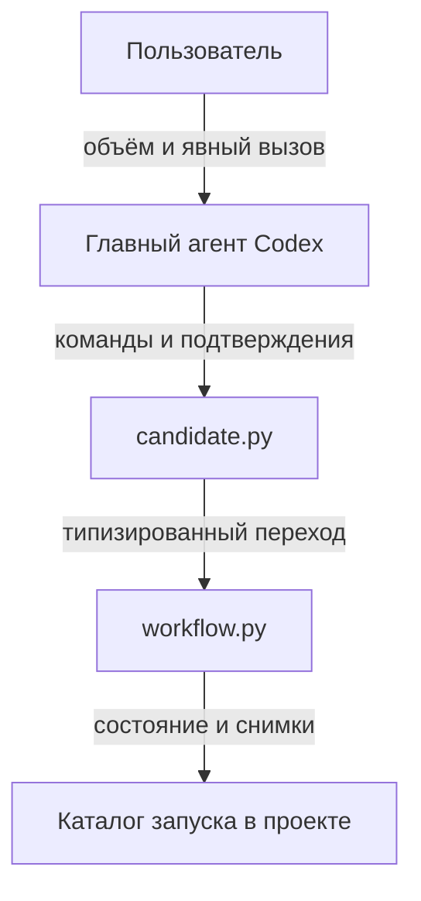
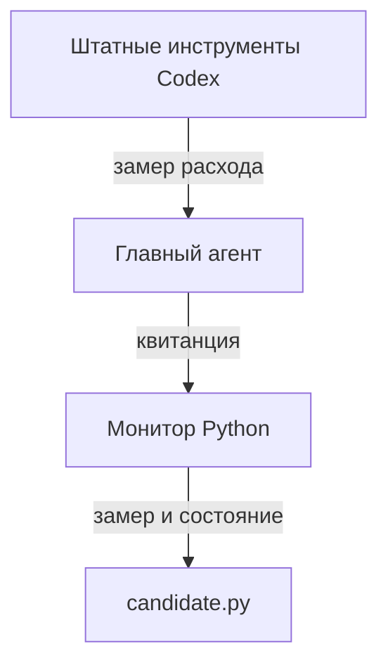
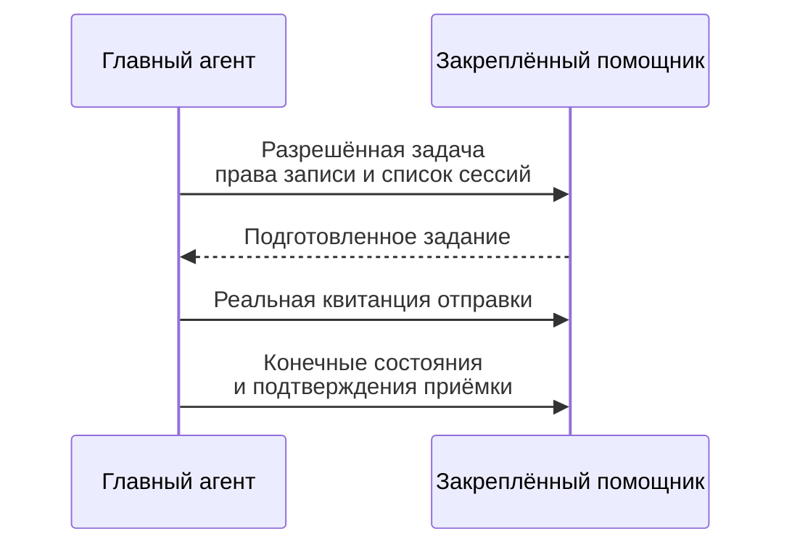
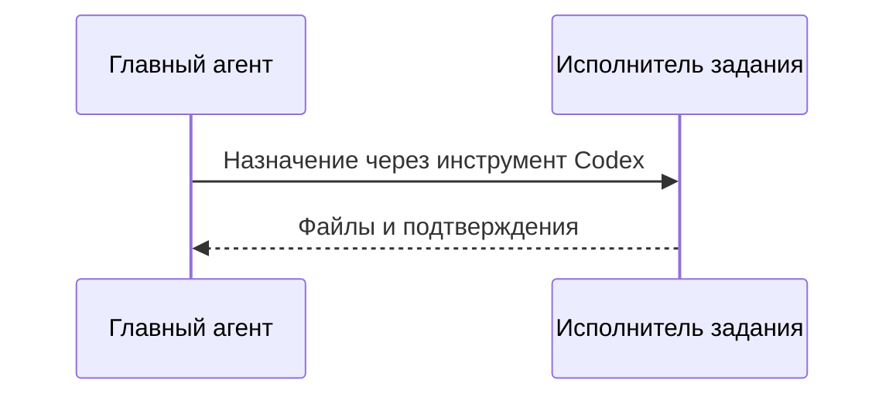
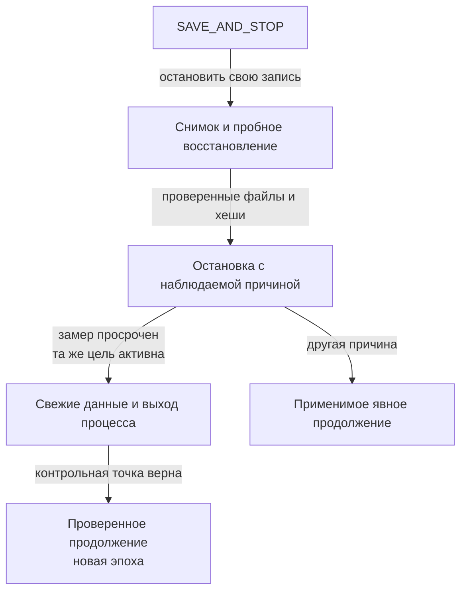

# Архитектура и оркестрация

В AGWF видны две группы полномочий. Пользователь и штатные инструменты Codex определяют разрешённый объём, цель и фактические события. Кандидат на Python проверяет переданные подтверждения и выполняет локальные переходы состояния. Корректный JSON сам по себе не удостоверяет свой источник.

## Компоненты и ответственность

Кандидат проверяет манифест по отдельно сохранённому хешу и поддерживаемую точку входа, прежде чем связать пакет с проектом и запуском. Ядро хранит задачи, ответственность за файлы, защиту от повторов, состояние разрешений и метаданные снимков. Журнал координации отмечает неясные и ожидающие исходы. Монитор работает с отдельным потоком подтверждений. Пакет полностью проверяется на границах команд и замеров. Сигнал активности проверяет только небольшую запись о принадлежности и управлении.

Монитор запускает кандидат. Главный агент также получает от среды наблюдение цели и список дочерних агентов. Монитор поддерживает срок работы запуска и эпохи. Читать расход из Codex напрямую он не может.

| Область ответственности | Источник |
| --- | --- |
| Внешний хеш, проверка зависимостей, активация и жизненный цикл процесса | [Кандидат](../../../../skills/agent-workflow-v1-1/scripts/candidate.py), [привязка пакета](../skills/agent-workflow-v1-1/references/coexistence.md) |
| Разрешение, права записи, подготовка назначения, проверка результатов и контрольные точки | [Ядро](../../../../skills/agent-workflow-v1-1/scripts/workflow.py), [спецификация команд](../skills/agent-workflow-v1-1/references/commands.md) |
| Замер расхода, защита от повторов, сигнал активности, срок работы и решение об остановке | [Монитор](../../../../skills/agent-workflow-v1-1/private/limit-watcher/scripts/monitor.py), [штатные квитанции](../skills/agent-workflow-v1-1/references/native-usage.md) |
| Подготовка сессий и проверка наблюдений жизненного цикла | [Средство проверки](../../../../tooling/run-lifecycle-check.py), [руководство по жизненному циклу](lifecycle-check.md) |

## Кто кому что передаёт?

Между подготовкой и фиксацией квитанции главный агент отправляет задание через Codex. После проверки результат возвращается к главному агенту.

Небольшую задачу главный агент может выполнить сам. Для большой работы координатор может предложить разделение. Архитектор, исполнитель и исследователь получают отдельные задания. Проверяющий может независимо изучить результаты. В пакете есть [определения ролей](../../../../skills/agent-workflow-v1-1/roles) и их инструкции. Модель и уровень рассуждения главного агента выбирает пользователь. Подготовленные настройки и настройки, фактически наблюдавшиеся у поставщика, учитываются раздельно.

Если исход отправки неясен, главный агент сравнивает подготовленные аргументы и фактическую сессию с актуальным перечнем сессий, прежде чем решать вопрос о повторе. Конечное состояние агента снимает неопределённость о выполнении. Правильность результата проверяется отдельно. Независимая проверка относится к конкретной ревизии и хешу результата. Позднее изменение файла делает объект предыдущей проверки недействительным. [Приёмка и передача работы](../skills/agent-workflow-v1-1/references/context.md).

## Что сохраняется после остановки?

Снимки включают указанные изменённые пути, записи об удалениях, права записи задач и локальное состояние. Средство восстанавливает содержимое в новом каталоге и сравнивает хеши. Изменённая или неполная контрольная точка требует сверки. Вспомогательная программа не меняет статус цели Codex. Главный агент читает и меняет его штатными инструментами, если это разрешено задачей.

Техническое возобновление на схеме относится к подходящему привязанному запуску с зарегистрированным истечением срока квитанции. Нужны та же разрешённая и всё ещё активная цель и фактические наблюдения после остановки. Запуск, в котором есть только ручной мониторинг, использует явное продолжение или проверенный штатный переход. Прежде чем выбрать процедуру, прочитайте [правила запуска, остановки и возобновления](../skills/agent-workflow-v1-1/references/operations.md).
