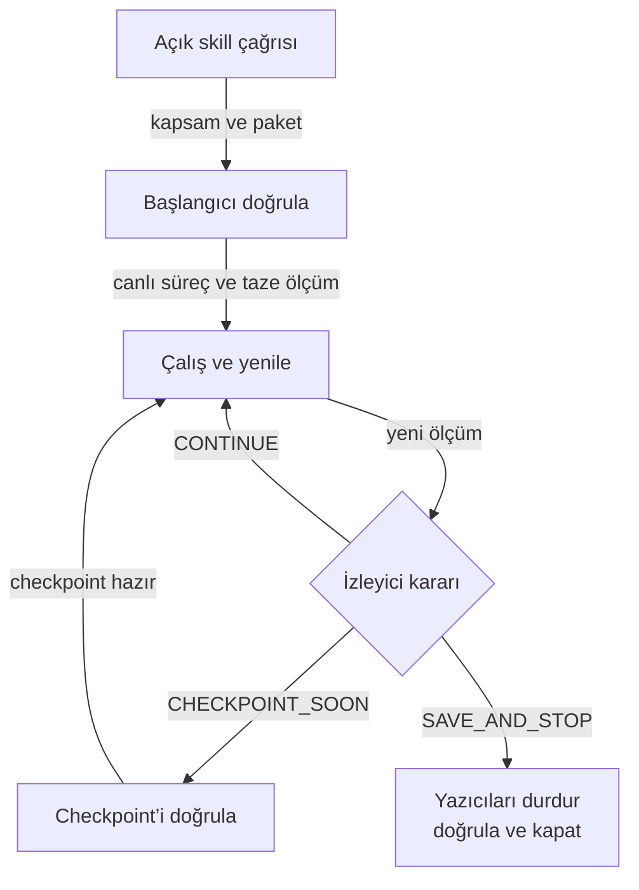

<a name="agwf--agent-workflow-for-codex"></a>

# AGWF · Codex için Ajan İş Akışı

**Uzun bir Codex görevini koordine edin, hangi sonucun gerçekten doğrulandığını görün ve başka bir oturumun kontrol ederek devam edebileceği bir checkpoint bırakın.**

[English](../../../README.md) · [Türkçe](README.md) · [简体中文](../zh-Hans/README.md) · [Español](../es/README.md) · [日本語](../ja/README.md) · [Français](../fr/README.md) · [Deutsch](../de/README.md) · [Italiano](../it/README.md) · [Русский](../ru/README.md) · [한국어](../ko/README.md)

[Kurulum ve doğrulama](docs/installation.md) · [Mimari ve orkestrasyon](docs/architecture.md) · [Yaşam döngüsü komutları](docs/lifecycle-check.md) · [Değişiklik geçmişi](CHANGELOG.md)

> **Örnek çalışma.** Bir proje sahibi Codex’ten değişiklik yapmasını ve sonucu doğrulamasını ister. Atanan dosyaları bir ajan yazar. Doğrulayıcı tamamlanan dosyaları ve çalışma kanıtını inceler. İş sürerken kullanım ölçümü eskirse AGWF duruş ister. Checkpoint değişen dosyaları ve hash’lerini kaydeder. Sonraki oturum, devam koşullarının karşılanıp karşılanmadığına bu kaydı inceleyerek karar verir.

<a name="what-is-it"></a>

## Nedir?

AGWF, açıkça çağrılan bir Codex skill’i ve Python 3.11+ üzerinde çalışan bir yardımcı pakettir. Çalışmayı kimin yetkilendirdiğini, hangi paket ve projeye bağlı olduğunu, hangi ajanın hangi dosyaları yazabileceğini, Codex’in gerçekten hangi görevi gönderdiğini ve sonucun hangi kanıta dayanarak kabul edildiğini kaydeder. Çağrı adı `$agent-workflow-v1-1`, görünen adı **agent-workflow-v1.1**, paket sürümü **1.1**’dir.

Kararlar ve yerleşik araç çağrıları ana Codex ajanına aittir. Python yardımcısı kendisine iletilen kanıtı denetler ve çalışma ile görev geçişlerini kaydeder. Model kullanmayan arka plan izleyicisi kullanım ölçümünün tazeliğini, süreç kimliğini, kalp atışını ve lease’i denetler. Checkpoint veya duruş isteyebilir. Bu kararı uygulama sorumluluğu ana ajandadır.

<a name="why-does-it-exist"></a>

## Neden var?

Uzun bir oturum, bir ajan dosyaları yazdıktan sonra inceleme tamamlanmadan kesilebilir. Bir ajanın görevinin bittiğini görmek, ürettiği dosyaların doğru olduğunu kanıtlamaz. Sonucu bilinmeyen bir atamayı yeniden göndermek iki yazıcı oluşturabilir. Kullanım kesintisinden sonra devam ederken son checkpoint’ten beri dosyalar değişmiş olabilir.

AGWF bu durumları ayırt etmek için gerekli kayıtları tutar. Çalışmayı kabul edilen pakete ve projeye bağlar, görev gönderilmeden dosya sahipliğini kontrol eder ve araç makbuzlarını kaydeder. Sonucu belirsiz bir atama, güncel Codex envanteriyle uzlaştırılıncaya kadar açık kalır. Checkpoint değişen dosyaları, silinen yol kayıtlarını ve iş akışı durumunu saklar. Kabulden önce ayrı bir dizine geri yükleme denenir.

<a name="what-can-i-use-it-for"></a>

## Ne için kullanılır?

| İş | AGWF neyi kaydeder veya denetler? | Neyi doğrulayabilirsiniz? |
| --- | --- | --- |
| Uzun işi ana sohbette yürütmek | Çalışma kimliği, açık yetki varsa yerleşik hedef ve kullanım kanıtı | Yardımcının ve izleyicinin gerçekten etkin olup olmadığı. Küçük işler ana ajanda kalabilir. |
| Kod, araştırma veya yazma görevini bölmek | Bağımlılıklar, proje köküne göre kesin yazma yolları, giriş hash’leri, rol, kapasite ve gönderilen atama | Her çıktının sahibi ve sonucu belirsiz bir atamanın uzlaştırılıp uzlaştırılamayacağı. |
| Ayrı inceleme istemek | Tamamlanan ajanın envanter durumu, üretilen dosyaların hash’leri ve inceleme hedefi | İncelenen dosyaların kabul edilecek dosyalarla eşleşmesi. |
| Güvenli durmak ve daha sonra dönmek | Doğrulanmış snapshot, izleyicinin gerçek duruş nedeni ve yeni gözlemler | Checkpoint’in hâlâ eşleşmesi ve duruş nedenine göre toparlanmanın mümkün olup olmadığı. |
| Tam orkestrasyon olmadan yetkili işi izlemek | Yalnız izleyici çalışması, gerçek kullanım kayıtları, örneklem ve lease | İzleyicinin sağlıklı olup olmadığı. Bu mod yerleşik hedefi oluşturmaz veya etkinleştirmez. |
| Çalışmayı devretmek veya sonradan kullanım ölçmek | Kaynağa bağlı salt okunur bağlam özeti ya da açıkça seçilmiş kayıt aralıklarından kullanım toplamı | Hangi engellerin ve kanıtların devredildiği ve hangi token veya süre ölçümlerinin kayıtlarla desteklendiği. |

<a name="how-it-works"></a>

## Nasıl çalışır?

Şema, izleyicinin çalışma sırasında verdiği kararı ve ana ajanın bu karara göre yapacağı işi gösterir.



- **Manifest bağı ve çalışma kimliği.** Çağıran taraf, değiştirilebilir paketin dışında saklanan manifest hash’ini verir. Candidate manifesti ve bağımlılıkları denetler ve projeyi belirli bir paket ile çalışma kimliğine bağlar. Sonradan değiştirilmiş manifestin hash’ini yeniden hesaplamak onay kanıtı değildir.
- **Görevin gönderilmesi ve kabulü.** Yardımcı kapsamı belirli atamayı hazırlar. Codex görevi gerçekten gönderir. Ana ajan dönen oturum kimliğiyle makbuzu kaydeder. Alt ajanın bitmesi tek başına çıktı kabulü değildir. Bağımsız incelemede aynı çıktı hash’leri kullanılır.
- **Taze ölçüm ve süreç sahipliği.** Kalp atışı ölçümü yenilemez. Ana ajan son tarihten önce gerçek ölçüm almalı ve lease’i yenilemelidir. Varsayılan politika %25 kalınca checkpoint, %20 veya erken rezerv sinyalinde duruş ister.
- **Duruş nedenine göre devam.** Kaydedilmiş `usage_receipt_expired` duruşu, aynı yetkili etkin hedef, değişmemiş checkpoint, durmuş sahipli süreçler ve taze gözlemlerle toparlanabilir. Erken rezerv, biten kota ve açık kullanıcı duruşları kendi devam koşullarına tabidir. Yalnız izleyici modunda açık devam yetkisi veya doğrulanmış geçiş kullanılır.
- **Kanıt ayrı incelenebilir.** Bağlam aracı açık görevleri, kanıt bağlantılarını ve engelleri özetler. Tam logları kopyalamaz. Kullanım aracı sabitlenmiş aralıklardaki benzersiz yanıt kayıtlarını sayar, kapsama eksiklerini gösterir ve yalnız gerekli metadatayı raporlar. Bu ölçüm kayıtlı kullanımı gösterir. Fatura, önbellek veya zaman kazancı ayrı kanıt gerektirir.

[Mimari rehberi](docs/architecture.md) bileşenleri, görev ve inceleme alışverişini ve toparlanma kararını ayrı gösterir. [İşletim sözleşmesi](skills/agent-workflow-v1-1/references/operations.md) her komutun kanıt gereksinimini açıklar.

<a name="get-started"></a>

## İlk kullanım

[Kabul edilen manifest hash’iyle paketi üretip doğrulayın](docs/installation.md). İlk kontrolü geçici bir projede yapabilirsiniz. Bu kontrol iş akışını etkinleştirmeden, izleyici başlatmadan ve yerleşik hedef oluşturmadan paket ile çalışma bağını doğrular.

Codex’te işe başlamak istediğinizde `$agent-workflow-v1-1` skill’ini açıkça çağırıp kapsamı belirtin. Örneğin:

> $agent-workflow-v1-1 — Projedeki başarısız regresyonu incele, düzeltmeyi ilgili kodla sınırla ve sonucu doğrula. Çalışma duracaksa checkpoint bırak. Ayrı incelemeyi sonuç gerektiriyorsa kullan.

Bu metin örnek çağrıdır. Gerçek başlangıç taze kullanım gözlemi ve uygun yetki kanıtı gerektirir. [Yerleşik ölçüm sözleşmesi](skills/agent-workflow-v1-1/references/native-usage.md).

<a name="technical-guides"></a>

## Teknik rehberler

| Rehber | Konu |
| --- | --- |
| [Kurulum ve doğrulama](docs/installation.md) | Paket üretme, manuel veya ajanla kurulum, izole kontrol, güncelleme ve kaldırmada veriyi koruma |
| [Mimari ve orkestrasyon](docs/architecture.md) | Codex ile Python’un sorumlulukları, dosya sahipliği ve duruş nedenine göre toparlanma |
| [Yaşam döngüsü kontrolü](docs/lifecycle-check.md) | Gerçek host gözlemleriyle yardımcı aracı hazırlama, çalıştırma ve zamanlama sınırları |
| [Komut sözleşmesi](skills/agent-workflow-v1-1/references/commands.md) | Tipli girdiler, desteklenen komutlar, JSON ve hata davranışı |
| [İşletim](skills/agent-workflow-v1-1/references/operations.md) | Etkinleştirme, görev atama, uzlaştırma, doğrulama, checkpoint, duruş ve devam |
| [Bağlam ve kabul](skills/agent-workflow-v1-1/references/context.md) | Gereken bağlamı aktarma ve bağımsız incelemeyi çıktı hash’ine bağlama |
| [Paket bağı](skills/agent-workflow-v1-1/references/coexistence.md) · [Geçiş](skills/agent-workflow-v1-1/references/migration.md) | Kurulu paketi doğrulama ve eski değişmez kayıtları koruma |
| [Kullanım ölçümü](skills/agent-workflow-v1-1/references/measurement.md) | Token ve süre ölçümlerinin kapsamını ve eksik kayıtları görün |

<a name="updates-and-data"></a>

## Güncelleme ve veriler

Sahipliği doğrulanan kurulum, kabul edilen paketin harici pin’iyle ve `--update` ile güncellenir. Kurulumu değiştirmeden önce ilgili sahipli izleyicinin durduğunu gözleyin. Güncelleme eski çalışma bağını değiştirmez. Yeni paketle yeni run kimliği kullanın. Eski checkpoint, bağ ve makbuzları özgün kimlikleriyle saklayın.

Çalışma zamanı kayıtları `.agent-workflow-v1-1/runs/<run-id>` altında tutulur. Kullanım, hedef, atama ve yerel rapor dosyalarını yayın dışında tutun. Kurucunun kalıcı geri alma arşivi ve kaldırma komutu yoktur. [Kurulum ve veri koruma](docs/installation.md).

<a name="verification"></a>

## Doğrulama

Python testlerini depo kökünden çalıştırın.

```powershell
python -X utf8 -B -m unittest discover -s skills/agent-workflow-v1-1/tests
python -X utf8 -B -m unittest discover -s tooling/tests
```

Bu belge için yapılan izole Windows çalışmasında 303 iş akışı testi ve 124 araç testi geçti. Testler tipli yetkiyi, paket bağını, ölçüm eskimesini ve replay kontrolünü, çıktı hash’lerini, gerçek süreç sahipliğini, checkpoint bütünlüğünü, kurulumu ve Windows dosya paylaşımını kapsar. Testlerde host gözlemleri sentetiktir. Pasif CLI kontrolü paket doğrulamasını gösterir. Canlı Codex Continue, Remote, sağlayıcı kimliği ve on saniyelik canlı sonuç ayrı kanıt ister. [Yaşam döngüsü sınırları](docs/lifecycle-check.md).

<a name="project-files"></a>

## Depo dosyaları

| Yol | Sorumluluk |
| --- | --- |
| [`skills/agent-workflow-v1-1/SKILL.md`](skills/agent-workflow-v1-1/skill-guide.md) | Açık çağrı ve ana ajan yönergeleri |
| [`skills/agent-workflow-v1-1/scripts/`](../../../skills/agent-workflow-v1-1/scripts) | Manifest pin’iyle çalışan giriş, durum makinesi ve koordinasyon komutları |
| [`skills/agent-workflow-v1-1/private/limit-watcher/`](../../../skills/agent-workflow-v1-1/private/limit-watcher) | Model kullanmayan izleyici ve gerektiğinde danışılabilen ayrı rol |
| [`skills/agent-workflow-v1-1/roles/`](../../../skills/agent-workflow-v1-1/roles) | Rol politikaları, bağlam belgeleri ve model ayarları |
| [`tooling/`](../../../tooling) | Tekrarlanabilir build, ortam kontrolleri, üretici ve yaşam döngüsü araçları |
| [`docs/`](../..) | Kurulum, mimari, yaşam döngüsü ve geçmiş bakım notları |

<a name="license-and-contributions"></a>

## Lisans ve katkı

Bu çalışma kopyasında lisans dosyası yok. [Değişiklik geçmişi](CHANGELOG.md) mevcut sürümleri kaydeder. Değişiklik önerirken gerçekten sınanan komutları, etkilenen paket veya çalışma sınırını ve doğrulanmayı bekleyen host etkileşimlerini belirtin.
