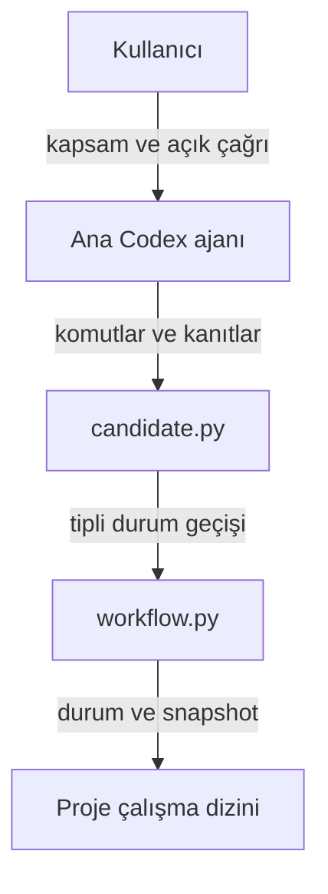
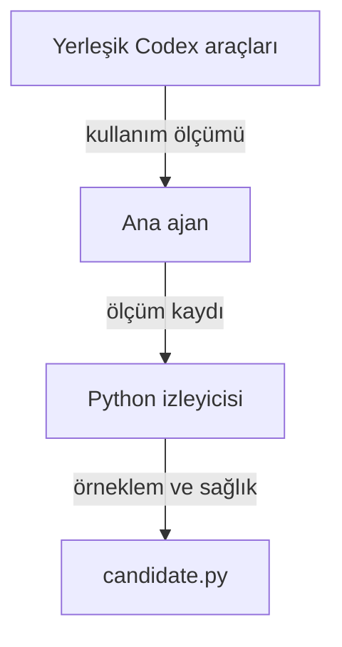
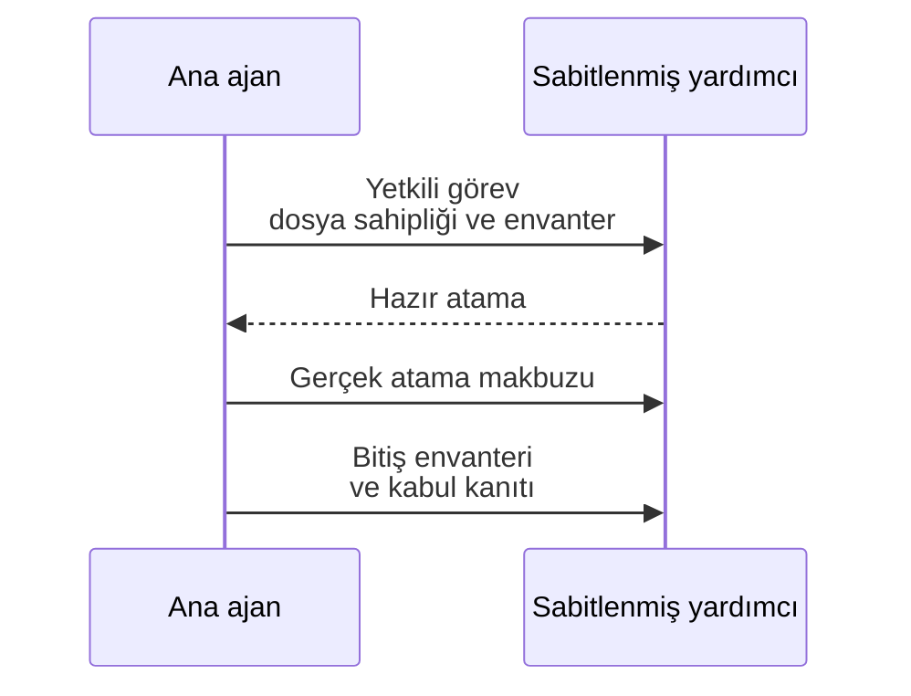
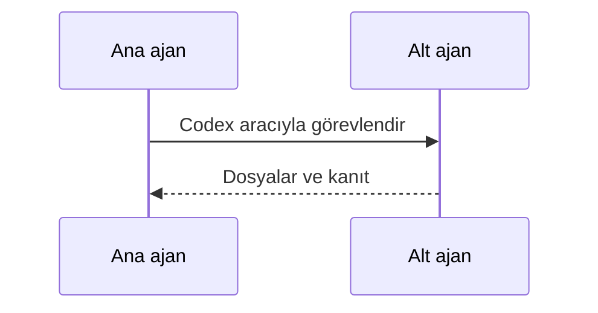
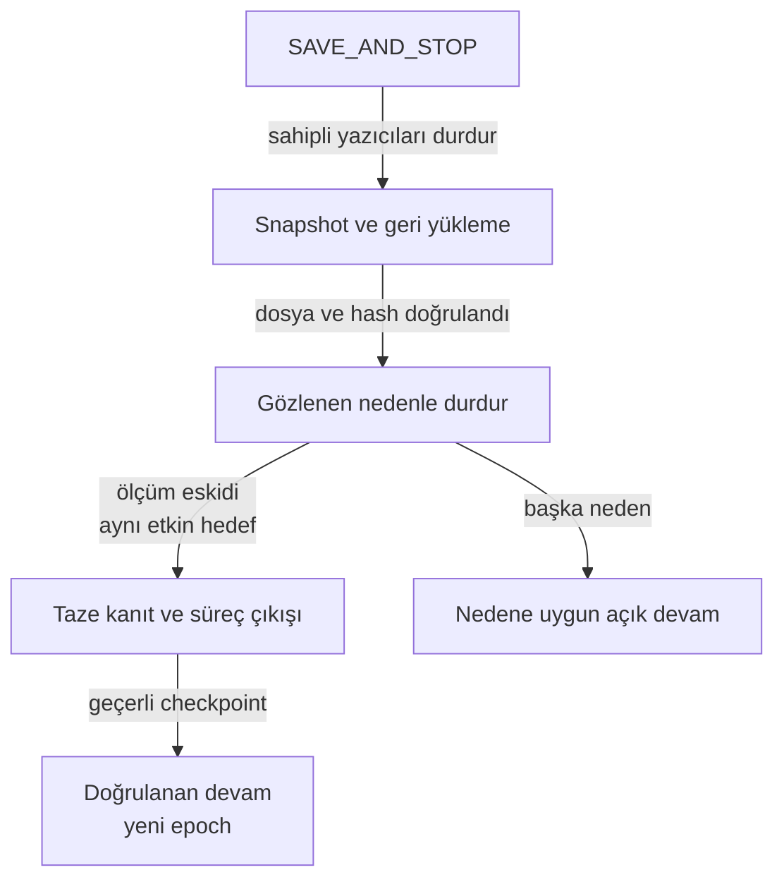

# Mimari ve orkestrasyon

AGWF’de yetkinin kaynağı kullanıcıdır. Yerleşik Codex araçları hedefi ve gerçekleşen işlemleri gösterir. Python candidate, kendisine iletilen kanıtı denetler ve yerel durum geçişlerini yönetir. Bir JSON kaydının geçerli olması, kaynağının bağımsız olarak doğrulandığı anlamına gelmez.

## Bileşenler ve sorumluluklar

Candidate, paketi projeye ve çalışma kimliğine bağlamadan önce harici manifest pin’ini ve desteklenen giriş noktasını denetler. Çekirdek görevleri, sahipliği, tekrar kullanım korumalarını, yetki durumunu ve snapshot bilgilerini saklar. Bir koordinasyon günlüğü, sonucu belirsiz veya bekleyen işlemleri kaydeder. İzleyicinin kanıt akışı ayrıdır. Paket bütünlüğü komut ve ölçüm sınırlarında denetlenir. Kalp atışında daha küçük sahiplik ve kontrol kaydı doğrulanır.

İzleyiciyi candidate başlatır. Ana ajan, hedefi ve alt ajan envanterini de host’tan alır. İzleyici çalışma ve epoch lease’ini denetler. Codex kullanımını doğrudan okuyamaz.

| Sınır | Kaynak |
| --- | --- |
| Harici hash, bağımlılıklar, etkinleştirme ve izleyici yaşam döngüsü | [Candidate](../../../../skills/agent-workflow-v1-1/scripts/candidate.py), [paket bağı](../skills/agent-workflow-v1-1/references/coexistence.md) |
| Yetki, dosya sahipliği, atama hazırlığı, çıktı kontrolü ve checkpoint | [İş akışı çekirdeği](../../../../skills/agent-workflow-v1-1/scripts/workflow.py), [komut sözleşmesi](../skills/agent-workflow-v1-1/references/commands.md) |
| Kullanım ölçümü, replay, kalp atışı, lease ve duruş kararı | [İzleyici](../../../../skills/agent-workflow-v1-1/private/limit-watcher/scripts/monitor.py), [yerleşik kullanım kayıtları](../skills/agent-workflow-v1-1/references/native-usage.md) |
| Oturum hazırlığı ve yaşam döngüsü gözlemlerini işleme | [Yaşam döngüsü aracı](../../../../tooling/run-lifecycle-check.py), [kullanım kılavuzu](lifecycle-check.md) |

## Kim kime ne iletir?

Atama, hazırlık ile atama makbuzunun kaydı arasında Codex üzerinden gönderilir. Çıktı ve kanıt ana ajana döner.

Ana ajan küçük bir görevi kendisi yürütebilir. Koordinatör, kapsamlı işler için sınır önerebilir. Mimar, uygulayıcı ve araştırmacı sınırları belirlenmiş görevlere atanır. Doğrulayıcı, kontrol edilen çıktıyı bağımsız inceleyebilir. Pakette [rol tanımları](../../../../skills/agent-workflow-v1-1/roles) ve yönergeleri bulunur. Ana ajan kullanıcının seçtiği model ve muhakeme düzeyiyle çalışır. Hazırlanan ayar ile sağlayıcıdan gözlenen ayar ayrı kanıtlardır.

Sonucu belirsiz bir atamayı tekrar göndermeden önce ana ajan hazırlanan argümanları ve gerçek oturumu taze envanterle uzlaştırır. Alt ajanın bitiş durumu, yürütme belirsizliğini giderir. Çıktının doğruluğu ayrı denetlenir. Bağımsız doğrulayıcı belirli çıktı sürümünü ve hash’i esas alır. Dosya sonradan düzenlenirse bu inceleme hedefi geçersizleşir. [Kabul ve iş devri](../skills/agent-workflow-v1-1/references/context.md).

## Duruşta hangi kayıtlar korunur?

Snapshot belirtilen değişiklikleri, silinen yol kayıtlarını, görev sahipliği kayıtlarını ve yerel durumu içerir. Araç yeni bir dizine geri yükler ve hash’leri karşılaştırır. Değişmiş veya eksik checkpoint uzlaştırılmadan kullanılamaz. Yardımcı yerleşik hedefin durumunu değiştirmez. Görev buna yetki veriyorsa ana ajan durumu Codex araçlarıyla okur veya günceller.

Bu teknik toparlanma yalnız kayıtlı ölçüm eskimesi olan ve koşulları karşılayan bağlı iş akışına uygulanır. Aynı yetkili hedef hâlâ etkin olmalı ve duruştan sonra gerçek gözlemler toplanmalıdır. Yalnız izleyici modunda açık devam veya doğrulanmış yerleşik geçiş gerekir. Karar vermeden önce [işletim ve toparlanma kurallarını](../skills/agent-workflow-v1-1/references/operations.md) okuyun.
