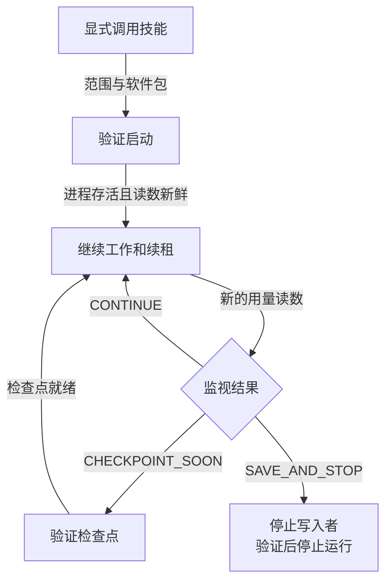

<a name="agwf--agent-workflow-for-codex"></a>

# AGWF · Codex 任务协调工具

**协调长时间运行的 Codex 任务，了解哪些结果已经验证，并留下可供下一次会话核验的检查点。**

[English](../../../README.md) · [Türkçe](../tr/README.md) · [简体中文](README.md) · [Español](../es/README.md) · [日本語](../ja/README.md) · [Français](../fr/README.md) · [Deutsch](../de/README.md) · [Italiano](../it/README.md) · [Русский](../ru/README.md) · [한국어](../ko/README.md)

[安装和验证](docs/installation.md) · [架构与任务编排](docs/architecture.md) · [生命周期命令指南](docs/lifecycle-check.md) · [更新记录](CHANGELOG.md)

> 维护者请 Codex 修改项目并验证结果。一个代理负责写入指定文件，另一位验证者检查交付物与证据。如果用量读数在工作期间过期，AGWF 会请求停止。检查点保存改动和文件哈希。下一次会话先核对检查点，再判断能否继续。

<a name="what-is-it"></a>

## 这是什么？

AGWF 由一个必须显式调用的 Codex 技能和一套 Python 3.11+ 运行工具组成。它记录谁授权了本次运行、运行绑定的项目和软件包、各文件的写入责任人、Codex 实际派发的任务以及验收依据。调用名是 `$agent-workflow-v1-1`，显示名为 **agent-workflow-v1.1**，包版本为 **1.1**。

主代理做决定并调用 Codex 原生工具。Python 辅助程序核验收到的证据，记录运行与任务状态。后台监视器不调用模型，负责检查用量读数是否新鲜、进程身份、心跳和租约。它可以请求保存检查点或停工，由主代理执行。

<a name="why-does-it-exist"></a>

## 为什么需要它？

长会话可能在文件写完、结果还没检查时中断。代理显示已结束，并不代表结果正确。盲目重发超时的派发请求，可能让两个代理写同一文件。用量中断以后继续，也可能碰到在上次检查点之后被修改的文件。

AGWF 为这些情况保留可核对的记录。它把运行绑定到已批准的软件包和项目，派发前核对文件归属，随后记录实际工具回执。派发结果不确定时，要以实际 Codex 会话清单为准。检查点保存变更文件、删除记录和状态，并在单独的目录试恢复后才接受。

<a name="what-can-i-use-it-for"></a>

## 它能用来做什么？

| 工作 | AGWF 记录或检查什么 | 可以确认什么 |
| --- | --- | --- |
| 在主会话内执行规模较大的任务 | 运行标识，获得明确授权时还记录原生目标与用量证据 | 辅助程序和监视器是否在运行。小任务可以由主代理完成。 |
| 拆分代码、研究或写作任务 | 依赖、项目相对写入路径、输入哈希、角色、容量和实际派发数据 | 谁负责写入各项产物，以及如何核对一次结果不明确的派发。 |
| 要求独立审查 | 子代理终止清单、产物哈希和审查目标证据 | 审查的文件与待验收文件是否一致。 |
| 安全停止并在之后继续 | 已验证快照、观测到的停止原因和新观测 | 检查点是否仍一致，当前停止原因是否允许恢复。 |
| 监视已授权任务而不启用完整编排 | 独立监视器、原生用量回执、样本和租约 | 进程是否健康。此模式不会创建或激活原生目标。 |
| 交接当前工作，或在运行结束后分析用量 | 带源文件校验值的只读上下文摘要，或从明确选定的记录范围汇总的用量 | 确认交接保留了哪些阻塞项和证据，以及记录能够支持哪些 token 计数和时间统计。 |

<a name="how-it-works"></a>

## 工作原理

下面的图展示了监视器发出检查点或停止请求时，主代理应当怎么做。



- **软件包和运行身份。** 调用方提供保存在软件包之外的清单哈希。候选程序核验清单及依赖，然后关联项目、软件包和运行 ID。修改过的清单重新算出哈希，并不等同于获得批准。
- **派发与验收。** 辅助程序准备限定范围的分工。Codex 实际派发，主代理记录返回的会话 ID 和回执。子代理完成后仍须检查产物。若要求独立审查，验证者依据记录的输出哈希检查相同的文件。
- **新观测与所属进程。** 心跳正常并不会更新用量读数。主代理应在动态期限之前取得新观测，并续租。按默认规则，剩余 25% 时准备检查点，剩余 20% 或出现提前保留信号时请求停止。
- **按停止原因决定能否恢复。** 如果实际停止原因是 `usage_receipt_expired`，并且原先已获授权的同一原生目标仍活动，可以走技术恢复流程。先确认检查点未变、所属进程已经退出，并取得停止后的新观测。额度耗尽、提前保留额度和用户明确要求停止，各有继续条件。仅启动监视器的运行要走自己的明确继续授权流程。
- **单独查看证据。** 上下文工具汇总当前任务，保留证据引用和阻塞项，无需复制整份日志。用量工具从固定范围内统计唯一响应记录，标明覆盖缺口，并输出范围受限的元数据报告。报告衡量的是已记录的用量。账单、缓存收益和节省时间均需另行举证。

[架构指南](docs/architecture.md)说明各组件、任务派发和审查、以及恢复决策。[运行约定](skills/agent-workflow-v1-1/references/operations.md)列出各命令所需证据。

<a name="get-started"></a>

## 快速入门

根据[安装指南](docs/installation.md)构建软件包，用外部保留的清单哈希验证。可以在一次性项目里做首检。此检查确认软件包和运行绑定，不激活工作流、不启动监视器，也不创建原生目标。

在 Codex 中开始实际工作时，显式调用 `$agent-workflow-v1-1` 并约定范围。例如：

> $agent-workflow-v1-1 — 检查项目中失败的回归测试，做范围明确的修复并验证。若运行必须停止，请保留检查点。需要独立核验时再请另一位验证者。

这段话是一个调用示例。实际启动需要新的原生用量观测和适用的授权证据。[原生用量回执](skills/agent-workflow-v1-1/references/native-usage.md)

<a name="technical-guides"></a>

## 技术指南

| 指南 | 用途 |
| --- | --- |
| [安装与验证](docs/installation.md) | 构建、手动或代理安装、隔离验证、更新与数据保留 |
| [架构与任务编排](docs/architecture.md) | 了解 Codex 和 Python 的职责、文件归属以及停止原因如何影响恢复 |
| [生命周期核验](docs/lifecycle-check.md) | 使用真实宿主观测运行辅助工具，了解计时结果的边界 |
| [命令约定](skills/agent-workflow-v1-1/references/commands.md) | 查询类型化参数、支持的命令、JSON 与错误处理 |
| [运行指南](skills/agent-workflow-v1-1/references/operations.md) | 启用、分工、核对不确定的派发、验证、保存、停止和继续 |
| [上下文与验收](skills/agent-workflow-v1-1/references/context.md) | 传递必要上下文，让独立审查绑定输出哈希 |
| [用量测量](skills/agent-workflow-v1-1/references/measurement.md) | 查明 token 和时间统计的覆盖范围与缺口 |
| [软件包绑定](skills/agent-workflow-v1-1/references/coexistence.md) · [迁移](skills/agent-workflow-v1-1/references/migration.md) | 验证安装的软件包，保留原来的不可变运行记录 |

<a name="updates-and-data"></a>

## 更新和数据

归属明确且未更改的安装可用 `--update` 更新，并传入认可的软件包外部固定值。更改安装前，确认该安装所属监视器已经退出。更新不会重新绑定旧运行。使用新的运行 ID，并保留旧检查点、绑定和回执的原始身份。

运行状态通常在 `.agent-workflow-v1-1/runs/<run-id>`。不要公开用量、目标、派发记录或本地报告。安装程序没有永久回滚归档或卸载命令。[安装与数据保留](docs/installation.md)

<a name="verification"></a>

## 验证

从仓库根目录运行 Python 测试：

```powershell
python -X utf8 -B -m unittest discover -s skills/agent-workflow-v1-1/tests
python -X utf8 -B -m unittest discover -s tooling/tests
```

本文件的隔离 Windows 验证中，303 项工作流测试和 124 项工具测试通过。它们覆盖授权与绑定、回执过期与重放、输出哈希、进程归属、检查点完整性、安装和 Windows 文件共享。测试里的宿主观测是合成的。被动 CLI 只验证软件包，实际 Codex Continue、Remote、提供者身份或实时十秒结果需要各自的证据。[生命周期指南](docs/lifecycle-check.md)

<a name="project-files"></a>

## 项目文件

| 路径 | 职责 |
| --- | --- |
| [`skills/agent-workflow-v1-1/SKILL.md`](skills/agent-workflow-v1-1/skill-guide.md) | 显式调用与主代理指令 |
| [`skills/agent-workflow-v1-1/scripts/`](../../../skills/agent-workflow-v1-1/scripts) | 清单固定入口、状态机与协调命令 |
| [`skills/agent-workflow-v1-1/private/limit-watcher/`](../../../skills/agent-workflow-v1-1/private/limit-watcher) | 无模型监视器与单独的可选顾问 |
| [`skills/agent-workflow-v1-1/roles/`](../../../skills/agent-workflow-v1-1/roles) | 角色策略、上下文记忆与模型设置 |
| [`tooling/`](../../../tooling) | 可复现构建、环境检查、产物检查和生命周期工具 |
| [`docs/`](../..) | 安装、架构、生命周期与历史维护记录 |

<a name="license-and-contributions"></a>

## 许可证与贡献

当前工作副本没有许可证文件。[更新记录](CHANGELOG.md)记录现有版本历史。提出改动时说明实际测试的命令、涉及的包或运行边界，以及尚未验证的宿主交互。
