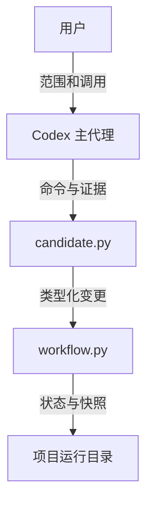
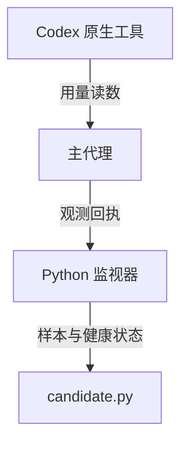
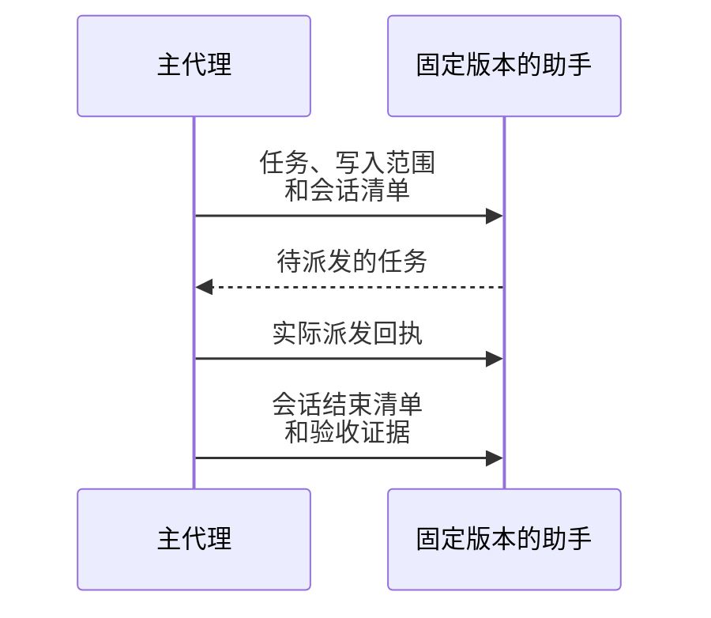
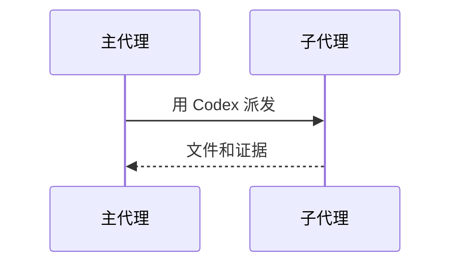
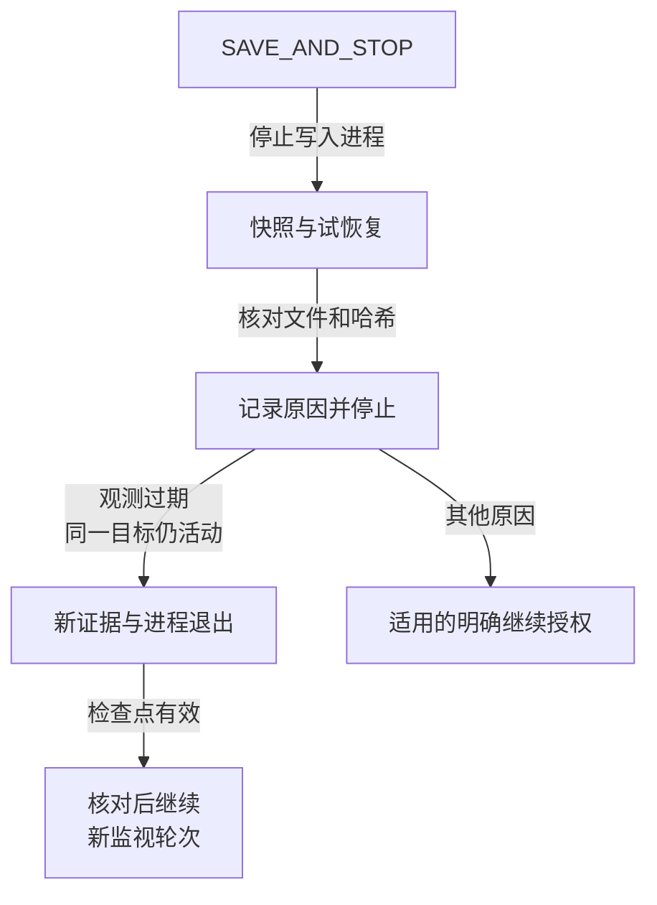

# 架构与任务编排

用户授权范围，Codex 原生工具提供目标和实际工具操作。Python 程序校验收到的证据，并管理本地状态转换。结构合法的 JSON 不能独立证明其来源。

## 组件与职责

candidate 先验证外部固定的清单哈希和受支持的入口，再把软件包关联到项目和运行。核心保存任务、写入归属、重放保护、授权状态和快照信息。协调日志记录未决或结果不明的操作。监视器有独立的证据流。命令和测量边界会校验整个包。心跳只检查较小的运行归属和控制记录。

candidate 启动所属监视器。主代理也从 Codex 获取目标状态和子代理清单。监视器管理运行和监视轮次的租约，无法直接读取 Codex 用量。

| 边界 | 源码与文档 |
| --- | --- |
| 外部哈希、依赖验证、启用和进程生命周期 | [candidate](../../../../skills/agent-workflow-v1-1/scripts/candidate.py)、[软件包绑定](../skills/agent-workflow-v1-1/references/coexistence.md) |
| 授权、文件归属、派发准备、输出检查和检查点 | [工作流核心](../../../../skills/agent-workflow-v1-1/scripts/workflow.py)、[命令约定](../skills/agent-workflow-v1-1/references/commands.md) |
| 用量读数、重放、心跳、租约与停止决策 | [监视器](../../../../skills/agent-workflow-v1-1/private/limit-watcher/scripts/monitor.py)、[原生用量回执](../skills/agent-workflow-v1-1/references/native-usage.md) |
| 准备会话并检查生命周期观测 | [生命周期工具](../../../../tooling/run-lifecycle-check.py)、[使用指南](lifecycle-check.md) |

## 谁负责派发，谁负责验收？

任务准备后，主代理通过 Codex 实际派发，然后记录派发回执。完成的文件和证据交回主代理。

小任务可由主代理自行做完。大型项目可以请协调者建议任务边界。架构、实现和研究角色负责有明确范围的工作，验证者可以独立检查已完成的产物。软件包内有[角色定义](../../../../skills/agent-workflow-v1-1/roles)和各自的提示文件。主代理使用用户选定的模型和推理力度。准备好的配置与提供者实际使用的设置是两类证据。

派发结果不明确时，主代理将预备参数和真实会话与新清单核对，再决定如何处理。进程终止解决的是执行状态的不确定性，产物是否正确仍须验证。独立审查以确切修订和输出文件哈希为准。之后修改文件，先前的审查目标就失效。[验收与交接](../skills/agent-workflow-v1-1/references/context.md)

## 停止后可以恢复什么？

快照包含指定的变更路径、删除记录、任务写入归属和本地状态。工具在新目录试恢复并对照哈希。变化或不完整的检查点需要先核对。辅助程序不会改变原生目标状态。任务明确授权时，主代理才通过 Codex 工具读写该状态。

图中的技术恢复适用于已绑定并且记录了用量回执过期的工作流。同一目标仍须获授权且保持活动，并提供停止后的真实观测。仅启动监视器的运行遵循明确继续授权或已经验证的原生状态转换。决定前查看[运行、停止与恢复规则](../skills/agent-workflow-v1-1/references/operations.md)。
